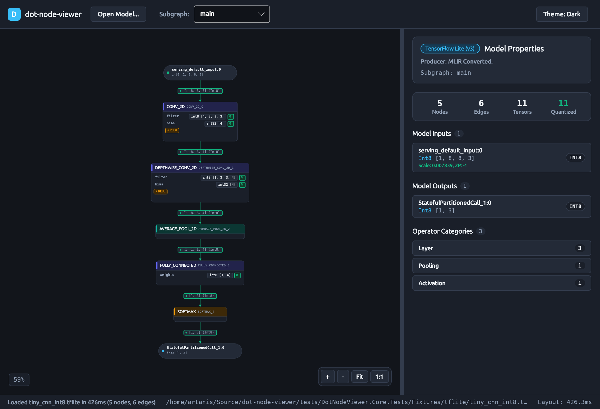
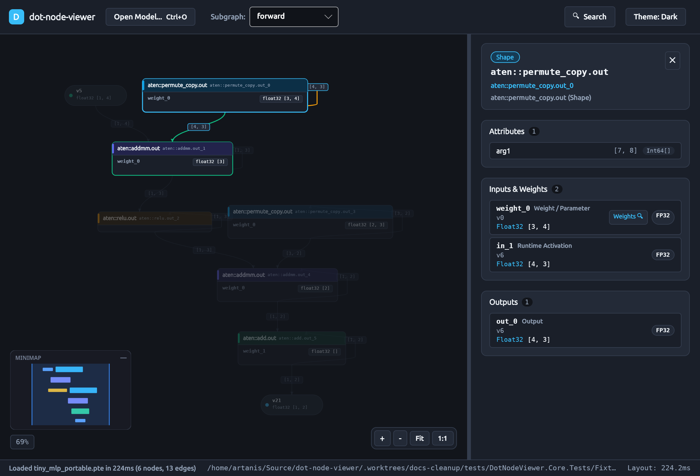

# `dot-node-viewer`

**`dot-node-viewer`** is a high-performance, NativeAOT- and WebAssembly-compatible `.NET 10` rewrite of [Netron](https://github.com/lutzroeder/netron), split into reusable pure-C# libraries for neural network graph extraction (`DotNodeViewer.Core`) and layered graph layout (`DotNodeViewer.Layout`), paired with a cross-platform Avalonia visualizer (`DotNodeViewer.App`, `DotNodeViewer.Desktop`, `DotNodeViewer.Browser`) and CLI tool (`DotNodeViewer.Cli`).

---

## Architectural Highlights

- **Pure Immutable C# Record Unified Graph IR (`DotNodeViewer.Core.Ir`):**
  Every supported model format maps into a strongly typed, immutable record hierarchy (`ModelGraph`, `Subgraph`, `GraphNode`, `NodePort`, `GraphPort`, `TensorEdge`, `TensorDescriptor`, `TensorShape`, `TensorDimension`, `NodeAttribute`, `AttributeValue`, `QuantizationInfo`, `TensorDataSource`). Format-specific binary schemas are strictly `internal`.
- **Zero-Allocation Topology Scanning & Lazy Weight Slices (`DotNodeViewer.Core.Abstractions`):**
  Model parsers never buffer full model files in memory or allocate arrays for tensor weights during graph extraction. Raw weight payloads are recorded as lightweight `TensorDataSlice(StreamOffset, ByteLength, DataType, Encoding)` references and loaded on demand via `TensorDataLoader`.
- **Non-Destructive Probing & Reflection-Free Format Registry:**
  `ModelProbe` peeks the first 64 header bytes and lazily inspects ZIP central-directory entries while restoring `Stream.Position`. `ModelFormatRegistry` wires `IModelFormatDetector` and `IModelFormatReader` implementations without runtime reflection.
- **Zero UI Leakage in Core & Layout:**
  `DotNodeViewer.Core` and `DotNodeViewer.Layout` have zero dependencies on `Avalonia`, `SkiaSharp`, or rendering packages—enforced at build time via MSBuild guardrails in `Directory.Build.props` and at test time via `PublicApiEncapsulationTests`.
- **NativeAOT & WebAssembly Ready:**
  Library projects and `DotNodeViewer.Cli` compile with `IsAotCompatible=true`, `IsTrimmable=true`, `EnableTrimAnalyzer=true`, and `EnableAotAnalyzer=true` with `TreatWarningsAsErrors=true`.

---

## Solution Structure

```text
dot-node-viewer.slnx
├── src/
│   ├── DotNodeViewer.Core/       # Pure C# Unified Graph IR + format detectors & streaming readers
│   ├── DotNodeViewer.Layout/     # Pure C# Sugiyama/dagre layered graph layout (depends ONLY on Core)
│   ├── DotNodeViewer.App/        # Shared Avalonia UI, ViewModels, GraphCanvas, Themes (depends on Core + Layout)
│   ├── DotNodeViewer.Desktop/    # Cross-platform desktop executable (Linux / macOS / Windows)
│   └── DotNodeViewer.Browser/    # WebAssembly (net10.0-browser) head
├── tools/
│   ├── DotNodeViewer.Cli/        # CLI tool: detect, inspect, snapshot
│   └── model-gen/                # Deterministic Python scripts + pinned requirements (onnx/, tf/, torch/)
├── docs/
│   ├── site/                     # DocFX documentation website source (Diátaxis guides + C# API reference)
│   ├── adr/                      # Architecture Decision Records (0001..0006+)
│   └── roadmap/                  # PROGRESS.md and sequential stage briefs (S00..S13)
└── tests/
    ├── DotNodeViewer.Core.Tests/ # TUnit tests: synthetic fixtures + manifest-driven golden snapshots
    ├── DotNodeViewer.Layout.Tests/
    └── DotNodeViewer.App.Tests/  # Headless Avalonia + ViewModel tests
```

---

## Supported Model Formats

| Format | Extensions | Format ID | Capabilities | Status |
|---|---|---|---|---|
| [**ONNX**](docs/site/articles/formats/onnx.md) | `.onnx` | `onnx` | Streaming `ModelProto`/`GraphProto`, IR v3 initializer filtering, symbolic/dynamic shapes, `If`/`Loop`/`Scan` subgraphs, `FunctionProto`, lazy weight slices & `external_data` references | **Supported (S02)** |
| [**TensorFlow Lite**](docs/site/articles/formats/tflite.md) | `.tflite` | `tflite` | Bounds-checked FlatBuffers (`TFL3`), zero-copy `Buffer.data` & external `offset`/`size` weight slices, per-tensor/per-channel `INT8` `AffineQuantization`, fused activations, `IF`/`WHILE`/`CALL_ONCE` subgraphs, and `CUSTOM` NPU delegate slices | **Supported (S03)** |
| [**ExecuTorch**](docs/site/articles/formats/executorch.md) | `.pte` | `executorch` | FlatBuffers (`ET12` / `ET1x`), `eh00` extended header, inline & segmented lazy constant weight slices, dynamic bound shapes, portable ATen operators, and lowered backend delegates (e.g. `XnnpackBackend`, `EthosUBackend`) | **Supported (S07)** |
| [**PyTorch (`state_dict` & TorchScript)**](docs/site/articles/formats/pytorch.md) | `.pt`, `.pth` | `pytorch` | PKZIP container, safe `PickleMachine` VM (protocols 2–5, zero reflection), TorchScript Python AST mini-parser with module inlining, scripted `if` control flow fallback, hierarchical `state_dict` parameter grouping, and lazy weight slicing | **Supported (S08)** |
| [**PyTorch ExportedProgram**](docs/site/articles/formats/pytorch.md#pytorch-2-exportedprogram-pt2) | `.pt2` | `pytorch-pt2` | `torch.export` PKZIP archive, `ExportedProgram` JSON schema, ATen operators, symbolic `SymInt` dimensions & `range_constraints`, parameter/buffer initializer isolation, and zero-allocation lazy stored weight slicing | **Supported (S09)** |
| [**Keras v3 & Legacy HDF5**](docs/site/articles/formats/keras.md) | `.keras`, `.h5` | `keras` | Keras v3 PKZIP archive (`config.json` + `model.weights.h5`), legacy HDF5 `.h5` (`model_config`), pure C# `Hdf5File` reader over `RandomAccessSource`, Sequential and Functional graphs with residual skip connections, weights-only fallback, and contiguous dataset lazy slicing | **Supported (S10)** |

---

## Core Library (`DotNodeViewer.Core`) Overview

`DotNodeViewer.Core` can be embedded directly in any .NET 10 application, CLI tool, or WebAssembly app to inspect neural network topologies:

```csharp
using DotNodeViewer.Core.Abstractions;
using DotNodeViewer.Core.Ir;

await using FileStream stream = File.OpenRead("model.onnx");

// Detect and extract the Unified Graph IR without loading raw weight tensors into memory:
ModelGraph graph = await ModelFormatRegistry.Default.ReadAsync(
    stream,
    new ModelReadOptions { FileName = "model.onnx" });

Subgraph primary = graph.PrimarySubgraph!;
GraphIndex index = new(primary);

foreach (GraphNode node in primary.Nodes)
{
    Console.WriteLine($"{node.Name}: {node.Operator.Name} ({node.Operator.Category})");
}
```

---

## Layout Engine (`DotNodeViewer.Layout`) Overview

`DotNodeViewer.Layout` is a pure C#, zero-UI-dependency Sugiyama/dagre layered graph layout engine paired with `ModelGraphLayoutAdapter`, which collapses static `Initializer`/`Constant` tensors into compact parameter rows inside operator node cards, renders `GraphInput`/`GraphOutput` ports as terminal pills, surfaces fused activation badges, and routes cubic Bézier edges:

```csharp
using DotNodeViewer.Layout;

VisualSubgraphLayout layout = ModelGraphLayoutAdapter.Default.CreateLayout(
    graph,
    new LayoutOptions { Direction = LayoutDirection.TopToBottom });

foreach (VisualNode vNode in layout.Nodes)
{
    Console.WriteLine($"{vNode.Title}: ({vNode.Bounds.X:F1}, {vNode.Bounds.Y:F1}) [{vNode.Bounds.Width:F1}x{vNode.Bounds.Height:F1}]");
}
```

---

## Desktop Visualizer (`DotNodeViewer.Desktop`)

`DotNodeViewer.Desktop` is the cross-platform Avalonia visualizer shell for inspecting neural network architectures, tensor dimensions, and quantization parameters.

```bash
# Launch empty shell (drag-and-drop or file picker)
dotnet run --project src/DotNodeViewer.Desktop -c Release

# Launch directly with a model file
dotnet run --project src/DotNodeViewer.Desktop -c Release -- tests/DotNodeViewer.Core.Tests/Fixtures/tflite/tiny_cnn_int8.tflite
```

### Visualizer Features
- **Interactive GraphCanvas:** High-performance immediate-mode rendering of neural network topologies directly via `DrawingContext` with 60 fps performance even on large models (`mobilenetv2`).
- **Smooth Navigation & Pan/Zoom:** Drag canvas, middle-mouse pan, trackpad scroll, smooth zoom-around-cursor (`Ctrl` + wheel), keyboard shortcuts (`Ctrl+O` / `Cmd+O` open model, `Ctrl+F` search, `Tab`, `Up`/`Down` connected traversal, `F` or `Ctrl+0` zoom-to-fit, `Escape`), and floating HUD controls.
- **On-Demand Weight Inspector:** Inspects raw weights directly from model stream on demand without eager memory allocations. Decodes FP32, FP16, BF16, INT8, UINT8, INT32, INT64, displays min/max/mean/zero statistics, and renders real-time affine dequantized values alongside raw integer bytes.
- **Fast Categorized Search (`Ctrl+F`):** Searches across operator types, instance names, categories, and tensors with keyboard navigation and smooth camera centering on matched nodes.
- **1-Hop Neighborhood Highlighting & Dimming:** Dynamically highlights predecessor (amber) and successor (emerald) connections while dimming unrelated graph branches to 25% opacity.
- **Interactive Minimap:** Collapsible bottom-left silhouette overlay with draggable viewport indicator for effortless spatial orientation in deep networks.
- **Subgraph Breadcrumb Drill-Down:** Inspects nested control-flow branches (`If`, `Loop`, `Scan`) with hierarchic breadcrumb navigation (`Root: main > If_0: then_branch`) and back/escape support.
- **Architecture & Conversion Telemetry:** Real-time metrics bar reporting total parameter count, uncompressed memory volume, precision distribution (`INT8`, `FP32`, `FP16`), hardware delegate blocks (`XNNPACK`), and non-fatal parser diagnostics.
- **Semantic Category Nodes:** Colorblind-checked header bands indicating operator categories (`Layer`, `Activation`, `Normalization`, `Pooling`, `Quantization`, etc.) with clean operator title and node name subtitles.
- **Collapsed Initializer Rows:** Single-consumer parameter weights and biases are collapsed directly inside operator cards with tabular shape and data type callouts.
- **Quantized Edge Indicators:** Smooth cubic Bézier spline routing with directional arrowheads, tensor shape labels, and emerald hardware acceleration indicators for quantized activations.
- **Contextual Properties Sidebar:** Model overview (when no node selected) and deep node inspector with typed attributes, runtime inputs, lazy weights, and quantized output descriptors.
- **Dual Theme Support:** High-contrast dark instrumentation theme (`#12151B`) and slate porcelain light theme (`#F8FAFC`).


*Figure 1: On-demand Tensor Weight Inspector displaying raw INT8 weights and affine-dequantized real values with summary statistics.*


*Figure 2: ExecuTorch model showing XNNPACK delegate badge and 1-hop neighborhood highlighting with unrelated branches dimmed.*


*Figure 3: Instant Categorized Search (`Ctrl+F`) matching operator types and centering the target node.*


*Figure 4: ONNX control-flow model drilled into nested If subgraph with breadcrumb navigation.*


*Figure 5: Keras functional residual model featuring skip connections, architecture telemetry bar, and collapsible minimap.*

---

## WebAssembly Visualizer (`DotNodeViewer.Browser`)

`DotNodeViewer.Browser` is the browser WebAssembly (`net10.0-browser`) head running completely client-side in the browser via Avalonia 11 for WebAssembly. It requires no backend server, preserving complete model privacy by parsing topologies and inspecting tensor slices locally in the browser sandbox.

- **Shared UI & Logic:** Hosts the shared `MainView` with 100% feature parity with the desktop application (pan/zoom canvas, categorized search, weight inspector, subgraph drilldown, and minimap).
- **Safe Browser Streaming (`BrowserStreamAdapter`):** Implements a chunked streaming adapter using `ArrayPool<byte>.Shared` and a configurable 512 MB memory guard to prevent browser tab out-of-memory crashes on oversized models.

```bash
# Run local browser development server
dotnet run --project src/DotNodeViewer.Browser

# Publish standalone static WASM bundle for static web hosting or CDN
dotnet publish src/DotNodeViewer.Browser -c Release -o dist/wasm
```

---

## NativeAOT Compilation

`DotNodeViewer.Cli` and `DotNodeViewer.Desktop` support zero-warning NativeAOT compilation (`PublishAot=true`):

```bash
# Publish self-contained NativeAOT CLI tool (~3.8 MB binary)
dotnet publish tools/DotNodeViewer.Cli -c Release -p:PublishAot=true

# Publish self-contained NativeAOT Desktop visualizer (~19 MB binary)
dotnet publish src/DotNodeViewer.Desktop -c Release -p:PublishAot=true -r linux-x64
```


*Figure 6: NativeAOT compiled DotNodeViewer.Desktop binary verified via automated desktop harness on Linux x64.*

---

## NuGet Packages

The core model parsing and layout engines are published as independent, AOT-compatible NuGet packages:

* **`DotNodeViewer.Core`**: Pure C# Unified Graph IR, streaming readers for ONNX, TFLite, ExecuTorch, PyTorch, and Keras, plus lazy tensor data loaders.
* **`DotNodeViewer.Layout`**: Pure C# Sugiyama-style layered graph layout engine for neural network topologies.

```bash
# Pack NuGet packages
dotnet pack src/DotNodeViewer.Core -c Release
dotnet pack src/DotNodeViewer.Layout -c Release

# Install in your project
dotnet add package DotNodeViewer.Core
dotnet add package DotNodeViewer.Layout
```

---

## CLI Tool (`DotNodeViewer.Cli`)

`DotNodeViewer.Cli` provides three commands for inspecting model files and generating golden regression snapshots:

```bash
# Detect a model file's format ID from its header / container entries
dotnet run --project tools/DotNodeViewer.Cli -c Release -- detect <path-to-model>

# Print a human-readable summary of format, producer, subgraphs, inputs, and outputs
dotnet run --project tools/DotNodeViewer.Cli -c Release -- inspect <path-to-model>

# Emit a deterministic .expected.json topology snapshot to stdout
dotnet run --project tools/DotNodeViewer.Cli -c Release -- snapshot <path-to-model> --id <model-id>
```

---

## Quick Start

See [`PREREQUISITES.md`](PREREQUISITES.md) for full development machine setup instructions.

```bash
# Restore local .NET tools (DocFX)
dotnet tool restore

# Build entire solution in Release mode (zero warnings allowed)
dotnet build dot-node-viewer.slnx -c Release

# Run all TUnit tests on Microsoft.Testing.Platform
dotnet test --solution dot-node-viewer.slnx -c Release

# Publish NativeAOT CLI binary to verify AOT & trimming compliance
dotnet publish tools/DotNodeViewer.Cli -c Release -p:PublishAot=true

# Build the DocFX documentation website and API reference
dotnet tool run docfx build docs/site/docfx.json --warningsAsErrors

# Build (metadata + site) and serve the documentation website locally at http://localhost:8080
dotnet tool run docfx docs/site/docfx.json --serve
```

---

## Documentation & Governance

- [**Documentation Website Source (`docs/site/`)**](docs/site/index.md)
  - [Tutorial: Getting Started](docs/site/articles/getting-started.md)
  - [Explanation: Unified Graph IR & Architecture](docs/site/articles/library/unified-graph-ir.md)
  - [Explanation: Performance Architecture & NativeAOT](docs/site/articles/architecture/performance-and-aot.md)
  - [How-To & Reference: Layered Graph Layout Engine (`DotNodeViewer.Layout`)](docs/site/articles/library/layout-engine.md)
  - [Reference: Supported Model Formats](docs/site/articles/formats/overview.md)
  - [Reference: CLI Tool (`DotNodeViewer.Cli`)](docs/site/articles/cli/reference.md)
  - [Reference: Domain Glossary](docs/site/articles/glossary.md)
  - [How-To: Visualizer User Guide](docs/site/articles/visualizer/user-guide.md)
  - [How-To: Running in the Browser (WebAssembly)](docs/site/articles/visualizer/webassembly.md)
- [**Development Prerequisites (`PREREQUISITES.md`)**](PREREQUISITES.md)
- [**Domain Glossary (`GLOSSARY.md`)**](GLOSSARY.md)
- [**Architecture Decision Records (`docs/adr/`)**](docs/adr/)
- [**Roadmap & Stage Progress (`docs/roadmap/PROGRESS.md`)**](docs/roadmap/PROGRESS.md)
