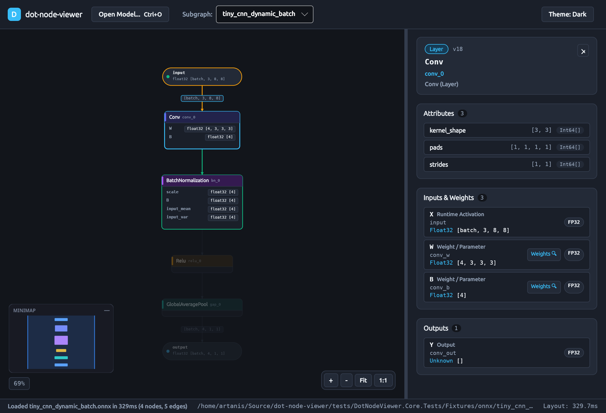
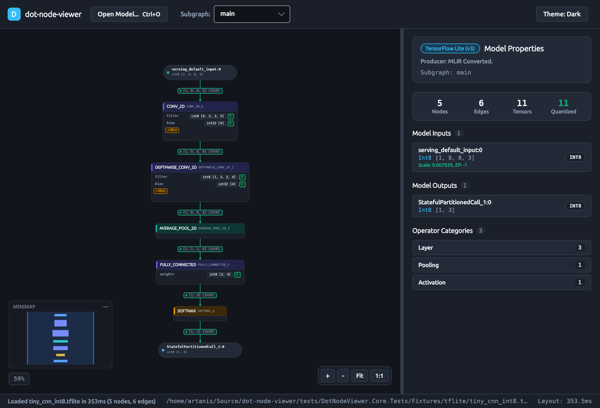

# `dot-node-viewer`

**`dot-node-viewer`** is a high-performance, NativeAOT- and WebAssembly-compatible `.NET 10` rewrite of [Netron](https://github.com/lutzroeder/netron), split into reusable pure-C# libraries for neural network graph extraction (`DotNodeViewer.Core`) and layered graph layout (`DotNodeViewer.Layout`), paired with a cross-platform Avalonia visualizer (`DotNodeViewer.App`, `DotNodeViewer.Desktop`, `DotNodeViewer.Browser`) and CLI tool (`DotNodeViewer.Cli`).

---

## Architectural Highlights

- **Pure Immutable C# Record Unified Graph IR (`DotNodeViewer.Core.Ir`):**
  Every supported model format maps into a strongly typed, immutable record hierarchy (`ModelGraph`, `Subgraph`, `GraphNode`, `NodePort`, `GraphPort`, `TensorEdge`, `TensorDescriptor`, `TensorShape`, `TensorDimension`, `NodeAttribute`, `AttributeValue`, `QuantizationInfo`, `TensorDataSource`). Format-specific binary schemas are strictly `internal`.
- **Zero-Allocation Topology Scanning & Lazy Weight Slices (`DotNodeViewer.Core.Abstractions`):**
  Model parsers never buffer full model files in memory or allocate arrays for tensor weights during graph extraction. Raw weight payloads are recorded as lightweight `TensorDataSlice(StreamOffset, ByteLength, DataType, Encoding)` references and loaded on demand via `TensorDataLoader`.
- **Non-Destructive Probing & Reflection-Free Format Registry:**
  `ModelProbe` peeks the first 64 header bytes and lazily inspects ZIP central-directory entries while restoring `Stream.Position`. `ModelFormatRegistry` wires `IModelFormatDetector` and `IModelFormatReader` implementations without runtime reflection.
- **Zero UI Leakage in Core & Layout:**
  `DotNodeViewer.Core` and `DotNodeViewer.Layout` have zero dependencies on `Avalonia`, `SkiaSharp`, or rendering packages—enforced at build time via MSBuild guardrails in `Directory.Build.props` and at test time via `PublicApiEncapsulationTests`.
- **NativeAOT & WebAssembly Ready:**
  Library projects and `DotNodeViewer.Cli` compile with `IsAotCompatible=true`, `IsTrimmable=true`, `EnableTrimAnalyzer=true`, and `EnableAotAnalyzer=true` with `TreatWarningsAsErrors=true`.

---

## Solution Structure

```text
dot-node-viewer.slnx
├── src/
│   ├── DotNodeViewer.Core/       # Pure C# Unified Graph IR + format detectors & streaming readers
│   ├── DotNodeViewer.Layout/     # Pure C# Sugiyama/dagre layered graph layout (depends ONLY on Core)
│   ├── DotNodeViewer.App/        # Shared Avalonia UI, ViewModels, GraphCanvas, Themes (depends on Core + Layout)
│   ├── DotNodeViewer.Desktop/    # Cross-platform desktop executable (Linux / macOS / Windows)
│   └── DotNodeViewer.Browser/    # WebAssembly (net10.0-browser) head
├── tools/
│   ├── DotNodeViewer.Cli/        # CLI tool: detect, inspect, snapshot
│   └── model-gen/                # Deterministic Python scripts + pinned requirements (onnx/, tf/, torch/)
├── docs/
│   ├── site/                     # DocFX documentation website source (Diátaxis guides + C# API reference)
│   ├── adr/                      # Architecture Decision Records (0001..0006+)
│   └── roadmap/                  # PROGRESS.md and sequential stage briefs (S00..S13)
└── tests/
    ├── DotNodeViewer.Core.Tests/ # TUnit tests: synthetic fixtures + manifest-driven golden snapshots
    ├── DotNodeViewer.Layout.Tests/
    └── DotNodeViewer.App.Tests/  # Headless Avalonia + ViewModel tests
```

---

## Supported Model Formats

| Format | Extensions | Format ID | Capabilities | Status |
|---|---|---|---|---|
| [**ONNX**](docs/site/articles/formats/onnx.md) | `.onnx` | `onnx` | Streaming `ModelProto`/`GraphProto`, IR v3 initializer filtering, symbolic/dynamic shapes, `If`/`Loop`/`Scan` subgraphs, `FunctionProto`, lazy weight slices & `external_data` references | **Supported (S02)** |
| [**TensorFlow Lite**](docs/site/articles/formats/tflite.md) | `.tflite` | `tflite` | Bounds-checked FlatBuffers (`TFL3`), zero-copy `Buffer.data` & external `offset`/`size` weight slices, per-tensor/per-channel `INT8` `AffineQuantization`, fused activations, `IF`/`WHILE`/`CALL_ONCE` subgraphs, and `CUSTOM` NPU delegate slices | **Supported (S03)** |
| [**ExecuTorch**](docs/site/articles/formats/executorch.md) | `.pte` | `executorch` | FlatBuffers (`ET12` / `ET1x`), `eh00` extended header, inline & segmented lazy constant weight slices, dynamic bound shapes, portable ATen operators, and lowered backend delegates (e.g. `XnnpackBackend`, `EthosUBackend`) | **Supported (S07)** |
| [**PyTorch (`state_dict` & TorchScript)**](docs/site/articles/formats/pytorch.md) | `.pt`, `.pth` | `pytorch` | PKZIP container, safe `PickleMachine` VM (protocols 2–5, zero reflection), TorchScript Python AST mini-parser with module inlining, scripted `if` control flow fallback, hierarchical `state_dict` parameter grouping, and lazy weight slicing | **Supported (S08)** |
| [**PyTorch ExportedProgram**](docs/site/articles/formats/pytorch.md#pytorch-2-exportedprogram-pt2) | `.pt2` | `pytorch-pt2` | `torch.export` PKZIP archive, `ExportedProgram` JSON schema, ATen operators, symbolic `SymInt` dimensions & `range_constraints`, parameter/buffer initializer isolation, and zero-allocation lazy stored weight slicing | **Supported (S09)** |
| **Keras v3 & Legacy HDF5** | `.keras`, `.h5` | `keras` | Keras v3 `config.json` + HDF5 weight slices (`PureHDF`) | Planned (S10) |

---

## Core Library (`DotNodeViewer.Core`) Overview

`DotNodeViewer.Core` can be embedded directly in any .NET 10 application, CLI tool, or WebAssembly app to inspect neural network topologies:

```csharp
using DotNodeViewer.Core.Abstractions;
using DotNodeViewer.Core.Ir;

await using FileStream stream = File.OpenRead("model.onnx");

// Detect and extract the Unified Graph IR without loading raw weight tensors into memory:
ModelGraph graph = await ModelFormatRegistry.Default.ReadAsync(
    stream,
    new ModelReadOptions { FileName = "model.onnx" });

Subgraph primary = graph.PrimarySubgraph!;
GraphIndex index = new(primary);

foreach (GraphNode node in primary.Nodes)
{
    Console.WriteLine($"{node.Name}: {node.Operator.Name} ({node.Operator.Category})");
}
```

---

## Layout Engine (`DotNodeViewer.Layout`) Overview

`DotNodeViewer.Layout` is a pure C#, zero-UI-dependency Sugiyama/dagre layered graph layout engine paired with `ModelGraphLayoutAdapter`, which collapses static `Initializer`/`Constant` tensors into compact parameter rows inside operator node cards, renders `GraphInput`/`GraphOutput` ports as terminal pills, surfaces fused activation badges, and routes cubic Bézier edges:

```csharp
using DotNodeViewer.Layout;

VisualSubgraphLayout layout = ModelGraphLayoutAdapter.Default.CreateLayout(
    graph,
    new LayoutOptions { Direction = LayoutDirection.TopToBottom });

foreach (VisualNode vNode in layout.Nodes)
{
    Console.WriteLine($"{vNode.Title}: ({vNode.Bounds.X:F1}, {vNode.Bounds.Y:F1}) [{vNode.Bounds.Width:F1}x{vNode.Bounds.Height:F1}]");
}
```

---

## Desktop Visualizer (`DotNodeViewer.Desktop`)

`DotNodeViewer.Desktop` is the cross-platform Avalonia visualizer shell for inspecting neural network architectures, tensor dimensions, and quantization parameters.

```bash
# Launch empty shell (drag-and-drop or file picker)
dotnet run --project src/DotNodeViewer.Desktop -c Release

# Launch directly with a model file
dotnet run --project src/DotNodeViewer.Desktop -c Release -- tests/DotNodeViewer.Core.Tests/Fixtures/tflite/tiny_cnn_int8.tflite
```

### Visualizer Features
- **Interactive GraphCanvas:** High-performance immediate-mode rendering of neural network topologies directly via `DrawingContext` with 60 fps performance even on large models (`mobilenetv2`).
- **Smooth Navigation & Pan/Zoom:** Drag canvas, middle-mouse pan, trackpad scroll, smooth zoom-around-cursor (`Ctrl` + wheel), and floating HUD controls (`+`, `-`, `Zoom to Fit`, `1:1 Reset`).
- **Semantic Category Nodes:** Colorblind-checked header bands indicating operator categories (`Layer`, `Activation`, `Normalization`, `Pooling`, `Quantization`, etc.) with clean operator title and node name subtitles.
- **Collapsed Initializer Rows:** Single-consumer parameter weights and biases are collapsed directly inside operator cards with tabular shape and data type callouts (e.g. `W · float32 [64, 3, 3, 3]` or `filter · uint8 [32, 3, 3, 3] Q`).
- **Quantized Edge Indicators:** Smooth cubic Bézier spline routing with directional arrowheads, tensor shape labels (`[batch, 64, 112, 112]`), and green hardware acceleration indicators for quantized activations (`INT8` / `UINT8`).
- **Viewport Culling & Level-of-Detail (LOD):** Seamlessly degrades text details at low zoom to sustain high frame rates on expansive graphs.
- **Spatial Grid Hit-Testing ($O(1)$):** Hover highlight and click-to-select for interactive node inspection.
- **Contextual Properties Sidebar (v1):**
  - **Graph Overview (when no node is selected):** Format, producer, opset/version, subgraph selector, inputs/outputs lists, and category distribution.
  - **Node Inspector (when a node is selected):** Operator title, category badge, domain/version, typed attributes list (`Int64`, `Float64`, `String`, `TensorShape`, etc.), runtime activations vs initializer weights, and output tensor descriptors with affine quantization parameters.
- **Dual Theme Support:** High-contrast dark instrumentation theme (`#12151B`) and slate porcelain light theme (`#F8FAFC`).


*Figure 1: Interactive GraphCanvas rendering an ONNX dynamic-batch network with collapsed weights and routed Bézier edges.*


*Figure 2: Contextual Properties Sidebar (v1) inspecting selected node attributes, runtime activations, and weights.*


*Figure 3: Interactive topology of a quantized INT8 TensorFlow Lite model showing quantized weights and parameters.*

---

## CLI Tool (`DotNodeViewer.Cli`)

`DotNodeViewer.Cli` provides three commands for inspecting model files and generating golden regression snapshots:

```bash
# Detect a model file's format ID from its header / container entries
dotnet run --project tools/DotNodeViewer.Cli -c Release -- detect <path-to-model>

# Print a human-readable summary of format, producer, subgraphs, inputs, and outputs
dotnet run --project tools/DotNodeViewer.Cli -c Release -- inspect <path-to-model>

# Emit a deterministic .expected.json topology snapshot to stdout
dotnet run --project tools/DotNodeViewer.Cli -c Release -- snapshot <path-to-model> --id <model-id>
```

---

## Quick Start

See [`PREREQUISITES.md`](PREREQUISITES.md) for full development machine setup instructions.

```bash
# Restore local .NET tools (DocFX)
dotnet tool restore

# Build entire solution in Release mode (zero warnings allowed)
dotnet build dot-node-viewer.slnx -c Release

# Run all TUnit tests on Microsoft.Testing.Platform
dotnet test --solution dot-node-viewer.slnx -c Release

# Publish NativeAOT CLI binary to verify AOT & trimming compliance
dotnet publish tools/DotNodeViewer.Cli -c Release -p:PublishAot=true

# Build the DocFX documentation website and API reference
dotnet tool run docfx build docs/site/docfx.json --warningsAsErrors

# Build (metadata + site) and serve the documentation website locally at http://localhost:8080
dotnet tool run docfx docs/site/docfx.json --serve
```

---

## Documentation & Governance

- [**Documentation Website Source (`docs/site/`)**](docs/site/index.md)
  - [Tutorial: Getting Started](docs/site/articles/getting-started.md)
  - [Explanation: Unified Graph IR & Architecture](docs/site/articles/library/unified-graph-ir.md)
  - [How-To & Reference: Layered Graph Layout Engine (`DotNodeViewer.Layout`)](docs/site/articles/library/layout-engine.md)
  - [Reference: Supported Model Formats](docs/site/articles/formats/overview.md)
  - [Reference: CLI Tool (`DotNodeViewer.Cli`)](docs/site/articles/cli/reference.md)
  - [Reference: Domain Glossary](docs/site/articles/glossary.md)
  - [How-To: Visualizer User Guide](docs/site/articles/visualizer/user-guide.md)
- [**Development Prerequisites (`PREREQUISITES.md`)**](PREREQUISITES.md)
- [**Domain Glossary (`GLOSSARY.md`)**](GLOSSARY.md)
- [**Architecture Decision Records (`docs/adr/`)**](docs/adr/)
- [**Roadmap & Stage Progress (`docs/roadmap/PROGRESS.md`)**](docs/roadmap/PROGRESS.md)
