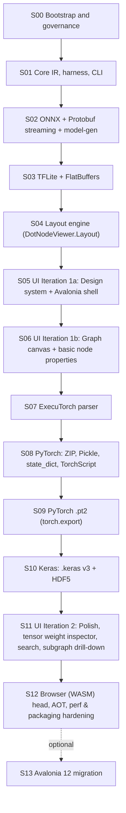

# `dot-node-viewer` Multi-Stage Roadmap

This directory contains the sequential, self-contained stage briefs for building `dot-node-viewer`.

## How to Run a Stage with a New Agent

Each stage is executed on its own dedicated Git branch (`stage/Sxx-<slug>`) and the agent is authorized to make incremental, logical sub-commits (`Sxx: ...`) as it completes each part of the stage.

Give the agent a prompt like:

> Read `AGENTS.md`, `docs/roadmap/PROGRESS.md`, and `docs/roadmap/stages/S00-bootstrap-and-governance.md`, and execute Stage S00 on branch `stage/S00-bootstrap-and-governance`.

## Stage Dependency Order

## Recommended User Checkpoints

- **During S05:** Approve `docs/design/design-system.md` before the agent writes the Avalonia shell XAML.
- **After S06 & After S10:** Optionally invoke `.agents/skills/improve-codebase-architecture/SKILL.md` to review module depth and seams.
