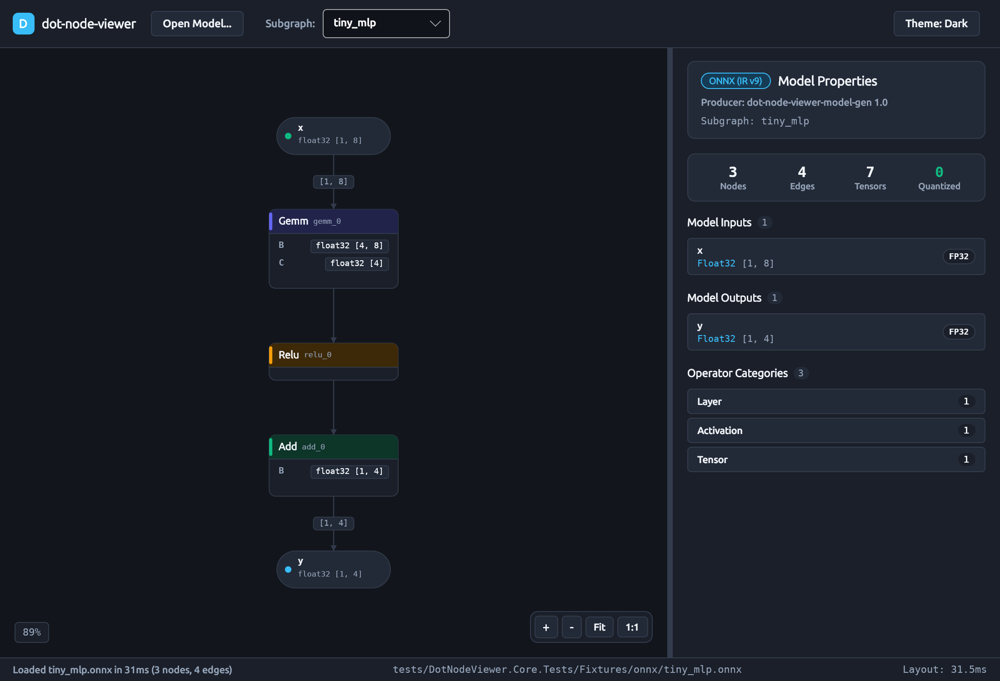

# Performance Architecture & NativeAOT Compilation

DotNodeViewer is built from the ground up for high-throughput model parsing, responsive 60 fps graph rendering, and low-memory footprint on both native desktop targets and WebAssembly.

---

## Architectural Principles

### 1. Zero-Allocation Topology Scanning
Neural network model files often range from tens of megabytes to several gigabytes. Traditional parsers read the entire file into managed byte arrays, causing severe Gen 2 GC pauses and out-of-memory errors.

DotNodeViewer adheres to strict allocation guardrails:
* **Zero Whole-File Buffering:** `IModelFormatReader` implementations stream headers and metadata directly using `ReadOnlySpan<byte>`, `BinaryPrimitives`, and `ArrayPool<byte>.Shared`.
* **Lazy Weight Slicing:** Weights and biases are never loaded during graph parsing. The reader registers a `TensorDataSlice(StreamOffset, ByteLength, DataType, Encoding)`. Raw weight bytes are only read on-demand when a tensor is selected in the UI inspector or evaluated via `TensorDataLoader`.

### 2. Rendering Optimization in `GraphCanvas`
During pan and zoom operations, the graph canvas renders at 60 fps. In Stage S12, a comprehensive performance audit eliminated hot-path allocations:
* **Neighborhood ID Caching:** 1-hop upstream and downstream neighborhood ID sets (`HashSet<string>`) are precomputed and cached on node selection changes rather than re-allocated every animation frame.
* **String Allocation Elimination:** Interpolated strings on the render loop and property formatters were refactored to use `string.Create(CultureInfo.InvariantCulture, ...)` and stack-allocated spans.
* **Ordinal String Comparisons:** Internal format sniffers and keyword matchers use `StringComparison.Ordinal` and `StringComparison.OrdinalIgnoreCase` to bypass culture table lookups.

---

## NativeAOT Compilation

Both `DotNodeViewer.Cli` and `DotNodeViewer.Desktop` support zero-warning NativeAOT compilation (`PublishAot=true`).

### Why NativeAOT?
* **Instant Startup:** Zero JIT warmup delay. CLI commands like `inspect` or `snapshot` execute in milliseconds.
* **Compact Self-Contained Binaries:** No external .NET runtime dependency.
* **Trimmed Attack Surface:** All unused reflection and framework code is stripped at link time.

### Publishing Commands

#### CLI Tool
```bash
dotnet publish tools/DotNodeViewer.Cli -c Release -p:PublishAot=true
```
* **Output Binary:** `tools/DotNodeViewer.Cli/bin/Release/net10.0/linux-x64/publish/DotNodeViewer.Cli`
* **Binary Size:** ~3.8 MB self-contained ELF binary.

#### Desktop Application
```bash
dotnet publish src/DotNodeViewer.Desktop -c Release -p:PublishAot=true
```
* **Output Binary:** `src/DotNodeViewer.Desktop/bin/Release/net10.0/linux-x64/publish/DotNodeViewer.Desktop`
* **Binary Size:** ~19 MB self-contained ELF binary (including Skia rendering engine, HarfBuzz font shaping, and X11 windowing stack).

---

## Verified Desktop Execution

The compiled NativeAOT desktop binary was verified via automated UI harness (`tools/desktop_harness.py`), ensuring flawless startup, font rendering, and interactive graph exploration:



---

## NuGet Library Distribution

The core libraries are packaged as lightweight, AOT-compatible NuGet packages:

* **`DotNodeViewer.Core`**: Pure C# Unified Graph IR, format detectors, streaming readers, and lazy tensor data loader.
* **`DotNodeViewer.Layout`**: High-performance Sugiyama-style layered graph layout engine.

```bash
dotnet pack src/DotNodeViewer.Core -c Release
dotnet pack src/DotNodeViewer.Layout -c Release
```

