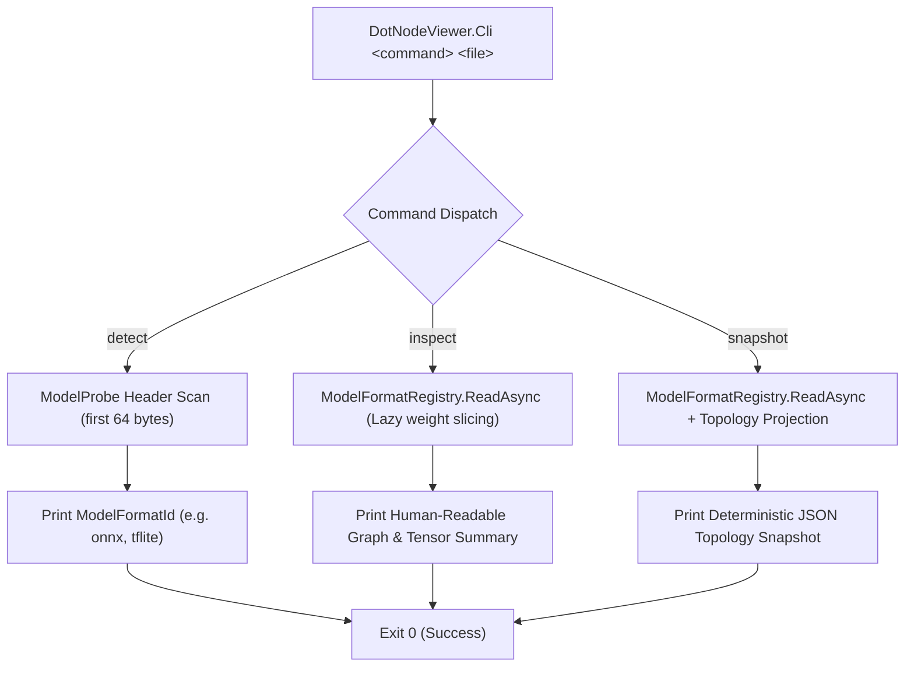

# Reference: `DotNodeViewer.Cli`

`DotNodeViewer.Cli` (`tools/DotNodeViewer.Cli`) is a NativeAOT-compatible command-line tool built on `DotNodeViewer.Core` for detecting neural network formats, inspecting graph summaries, and generating golden topology snapshots (`*.expected.json`).

---

## Command Dispatch Architecture



---

## Synopsis

```text
Usage: DotNodeViewer.Cli <command> <file> [options]

Commands:
  detect <file>                     Print the detected model format ID
  inspect <file>                    Print a human-readable model graph summary
  snapshot <file> --id <model-id>   Print the golden .expected.json topology snapshot
```

---

## Commands & Real-World Output Examples

### 1. `detect` — Detect Model Format ID

Probes the first 64 header bytes (and lazy ZIP central-directory entries when applicable) via `ModelProbe` and `ModelFormatRegistry.Default`, then prints the canonical lowercase `ModelFormatId` (`onnx`, `tflite`, `executorch`, `pytorch`, `pytorch-pt2`, or `keras`) to standard output.

#### ONNX Example:

```bash
dotnet run --project tools/DotNodeViewer.Cli -c Release -- detect tests/DotNodeViewer.Core.Tests/Fixtures/onnx/tiny_mlp.onnx
```

**Output:**
```text
onnx
```

#### TensorFlow Lite Example:

```bash
dotnet run --project tools/DotNodeViewer.Cli -c Release -- detect tests/DotNodeViewer.Core.Tests/Fixtures/tflite/tiny_cnn_int8.tflite
```

**Output:**
```text
tflite
```

---

### 2. `inspect` — Print Human-Readable Graph Summary

Parses the model via `ModelFormatRegistry.Default.ReadAsync` (without loading raw tensor weights into memory) and prints a structured summary of the model's format, producer, subgraphs, node/tensor counts, input/output tensor shapes, and any `ParseDiagnostic` entries.

#### Single-Subgraph ONNX Model:

```bash
dotnet run --project tools/DotNodeViewer.Cli -c Release -- inspect tests/DotNodeViewer.Core.Tests/Fixtures/onnx/tiny_mlp.onnx
```

**Output:**
```text
Format:    ONNX IR v9 (onnx)
Producer:  dot-node-viewer-model-gen 1.0
Subgraphs: 1

Subgraph [0] 'tiny_mlp':
  Nodes:   3
  Tensors: 7
  Inputs:  1
    - x: Float32 [1, 8]
  Outputs: 1
    - y: Float32 [1, 4]
```

#### Quantized CNN TFLite Model:

```bash
dotnet run --project tools/DotNodeViewer.Cli -c Release -- inspect tests/DotNodeViewer.Core.Tests/Fixtures/tflite/tiny_cnn_int8.tflite
```

**Output:**
```text
Format:    TensorFlow Lite v3 (tflite)
Producer:  MLIR Converted.
Subgraphs: 1

Subgraph [0] 'main':
  Nodes:   5
  Tensors: 11
  Inputs:  1
    - serving_default_input:0: Int8 [1, 8, 8, 3]
  Outputs: 1
    - StatefulPartitionedCall_1:0: Int8 [1, 3]
```

#### Multi-Subgraph Control-Flow Model (`tiny_while.tflite`):

```bash
dotnet run --project tools/DotNodeViewer.Cli -c Release -- inspect tests/DotNodeViewer.Core.Tests/Fixtures/tflite/tiny_while.tflite
```

**Output:**
```text
Format:    TensorFlow Lite v3 (tflite)
Producer:  MLIR Converted.
Subgraphs: 3

Subgraph [0] 'main':
  Nodes:   1
  Tensors: 4
  Inputs:  2
    - serving_default_i:0: Int32 []
    - serving_default_x:0: Float32 [1, 4]
  Outputs: 2
    - StatefulPartitionedCall:0: Int32 []
    - StatefulPartitionedCall:1: Float32 [1, 4]

Subgraph [1] 'while_cond':
  Nodes:   1
  Tensors: 4
  Inputs:  2
    - arg: Int32 []
    - arg: Float32 [1, 4]
  Outputs: 1
    - Less:0: Bool []

Subgraph [2] 'while_body':
  Nodes:   2
  Tensors: 6
  Inputs:  2
    - arg: Int32 []
    - arg: Float32 [1, 4]
  Outputs: 2
    - Add:0: Int32 []
    - Mul:0: Float32 [1, 4]
```

---

### 3. `snapshot` — Generate Golden Topology Snapshot (`*.expected.json`)

Parses the model and serializes a deterministic golden topology snapshot JSON document to standard output using source-generated `System.Text.Json` metadata.

#### ONNX Snapshot:

```bash
dotnet run --project tools/DotNodeViewer.Cli -c Release -- snapshot tests/DotNodeViewer.Core.Tests/Fixtures/onnx/tiny_mlp.onnx --id onnx-tiny_mlp
```

**Output:**
```json
{
  "modelId": "onnx-tiny_mlp",
  "format": "onnx",
  "producer": "dot-node-viewer-model-gen 1.0",
  "subgraphCount": 1,
  "nodeCount": 3,
  "tensorCount": 7,
  "inputCount": 1,
  "outputCount": 1,
  "inputs": [
    {
      "name": "x",
      "dataType": "Float32",
      "shape": [
        "1",
        "8"
      ]
    }
  ],
  "outputs": [
    {
      "name": "y",
      "dataType": "Float32",
      "shape": [
        "1",
        "4"
      ]
    }
  ],
  "operatorHistogram": {
    "Gemm": 1,
    "Relu": 1,
    "Add": 1
  },
  "sampleWeightSlice": {
    "tensorName": "fc1_w",
    "streamOffset": 197,
    "byteLength": 128
  }
}
```

#### TFLite Snapshot:

```bash
dotnet run --project tools/DotNodeViewer.Cli -c Release -- snapshot tests/DotNodeViewer.Core.Tests/Fixtures/tflite/tiny_cnn_int8.tflite --id tflite-tiny_cnn_int8
```

**Output:**
```json
{
  "modelId": "tflite-tiny_cnn_int8",
  "format": "tflite",
  "producer": "MLIR Converted.",
  "subgraphCount": 1,
  "nodeCount": 5,
  "tensorCount": 11,
  "inputCount": 1,
  "outputCount": 1,
  "inputs": [
    {
      "name": "serving_default_input:0",
      "dataType": "Int8",
      "shape": [
        "1",
        "8",
        "8",
        "3"
      ]
    }
  ],
  "outputs": [
    {
      "name": "StatefulPartitionedCall_1:0",
      "dataType": "Int8",
      "shape": [
        "1",
        "3"
      ]
    }
  ],
  "operatorHistogram": {
    "CONV_2D": 1,
    "AVERAGE_POOL_2D": 1,
    "RESHAPE": 1,
    "FULLY_CONNECTED": 1,
    "SOFTMAX": 1
  },
  "sampleWeightSlice": {
    "tensorName": "tiny_cnn/conv/bias",
    "streamOffset": 448,
    "byteLength": 16
  }
}
```

- `--id <model-id>`: Sets the `modelId` field in the emitted JSON. If omitted, defaults to the file name without extension.

---

## Exit Codes

| Exit Code | Meaning |
|---|---|
| `0` | Command succeeded (`--help` displayed, format detected, graph inspected, or snapshot emitted). |
| `1` | Invalid command-line arguments or target file does not exist. |
| `2` | Unrecognized model format, corrupted model file (`ModelParseException`), or I/O error. |

---

## Publishing as a NativeAOT Executable

`DotNodeViewer.Cli` is fully compatible with NativeAOT compilation:

```bash
dotnet publish tools/DotNodeViewer.Cli -c Release -p:PublishAot=true
```
