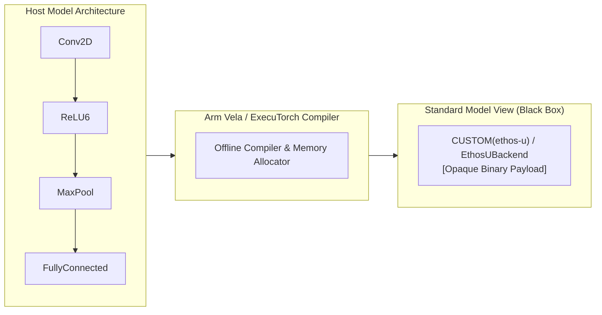
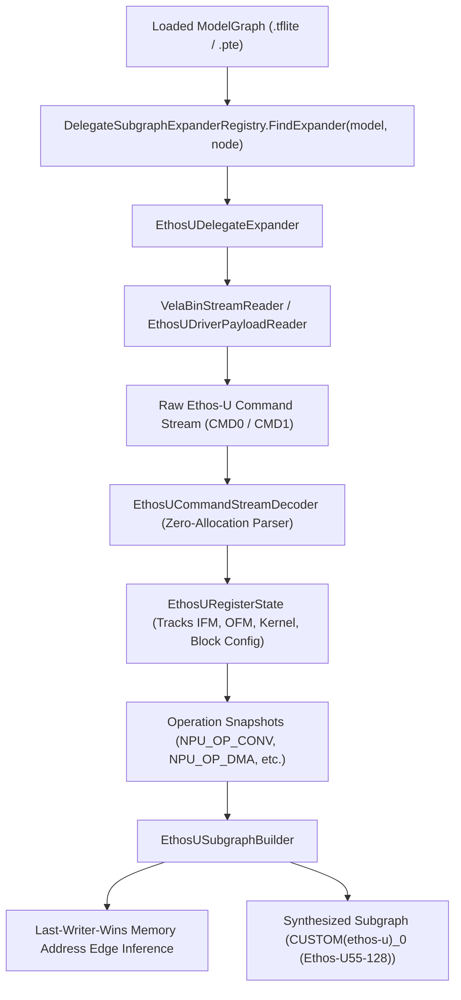
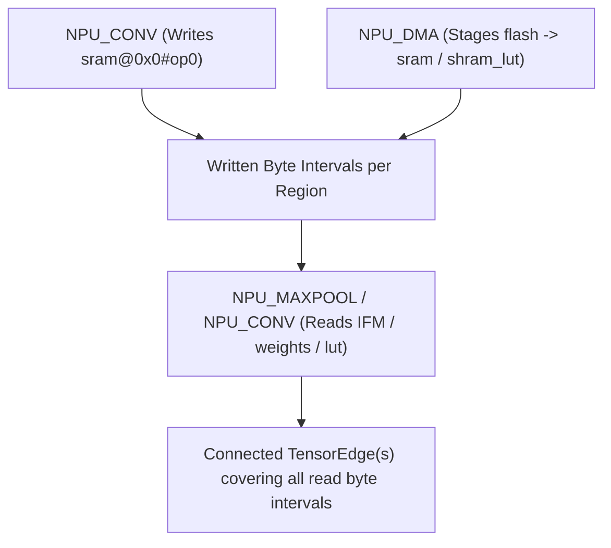

# Reference: Arm Ethos-U NPU Command Stream Unwrapping

`DotNodeViewer.Core` provides on-demand command stream unwrapping for Arm Ethos-U microNPUs (Ethos-U55, Ethos-U65, and Ethos-U85), decompiling compiled delegate payloads embedded inside TensorFlow Lite (`.tflite`) and ExecuTorch (`.pte`) model containers into the Unified Graph IR.

---

## Overview: The Embedded NPU "Black Box" Problem

When edge and microcontroller neural network models are optimized for embedded hardware using compilers like the **Arm Vela compiler** (for TensorFlow Lite) or the **ExecuTorch Arm Ethos-U backend partitioner** (`EthosUBackend`), tens or hundreds of individual layers (convolutions, depthwise convolutions, pooling, activation functions, elementwise adds/multiplications) are converted into hardware-level microcode:



Standard model visualizers display only a single opaque custom node (`CUSTOM(ethos-u)` or `Delegate (EthosUBackend)`), hiding the entire internal execution graph, operator sequence, layer shapes, and register hyperparameters.

`dot-node-viewer` solves this with **on-demand delegate unwrapping** (ADR 0008: *On-Demand Delegate Subgraph Expansion and Ethos-U Decoding*): when inspected or requested via CLI/UI, the engine scans the hardware command stream, tracks register state transitions, reconstructs operator boundaries, and synthesizes a full Unified Graph IR subgraph with inferred dataflow edges and complete microcode disassembly.

---

## On-Demand Delegate Expansion Architecture



### Abstractions (`DotNodeViewer.Core.Abstractions`)

- **`IDelegateSubgraphExpander`:** Public interface for on-demand delegate expanders:
  ```csharp
  public interface IDelegateSubgraphExpander
  {
      string BackendId { get; }
      bool CanExpand(ModelGraph model, GraphNode delegateNode);
      Task<Subgraph?> ExpandAsync(Stream modelStream, ModelGraph model, GraphNode delegateNode, CancellationToken cancellationToken = default);
      Task<IReadOnlyList<string>> DisassembleAsync(Stream modelStream, ModelGraph model, GraphNode delegateNode, CancellationToken cancellationToken = default);
  }
  ```
- **`DelegateSubgraphExpanderRegistry`:** Thread-safe registry providing default expander discovery without coupling core format readers to specific hardware microcode parsers.

---

## Framing & Container Protocols

Ethos-U payloads are encapsulated in two container framing formats, both wrapping a `COP1` driver action payload (`0x31504F43` little-endian):

### 1. TensorFlow Lite `CUSTOM(ethos-u)`
Vela lowers supported subgraphs into a `CUSTOM(ethos-u)` operator whose input tensors supply:
- **`ethos_u_command_stream` (input 0):** `COP1` driver action header (`DACommands.Config`, `DACommands.CmdStream`) followed by raw 32-bit/64-bit NPU command words.
- **`read_only` (input 1):** Flash buffer containing packed compressed weights, bias/scale tables, and read-only constant operands (`region 0`).
- **`scratch` / `scratch_fast` (inputs 2–3):** Runtime SRAM/fast-SRAM arena buffers, paired with `OfflineMemoryAllocation` model metadata mapping runtime input/output tensor arena offsets.

### 2. ExecuTorch `vela_bin_stream` (`Delegate (EthosUBackend)`)
ExecuTorch packages the compiled NPU payload in `BackendDelegate.processed` as a 16-byte-aligned `vela_bin_stream` container of 32-byte block headers:
- **`cmd_data`:** `COP1` driver action payload and NPU command stream.
- **`weight_data`:** Flash buffer (`region 0`) containing packed weights, scales, and constants.
- **`scratch_size`:** Required SRAM scratch arena size in bytes.
- **`inputs` / `outputs`:** 36-byte tensor descriptors carrying 6D shapes, element sizes, arena offsets, and memory region indices.

---

## Hardware Command Stream & Zero-Allocation Decoding

The command stream consists of 32-bit `cmd0` instructions (1 word) and 64-bit `cmd1` instructions (2 words), sharing the lower 10-bit opcode space and disambiguated by the 2-bit mode field (`0xC000`):

| Command Class | Size | Encoding | Purpose |
|---|---|---|---|
| **`cmd0`** | 4 bytes (1 word) | `[31:16] Param (16b) \| [15:14] Mode=0 \| [9:0] Opcode (10b)` | Immediate register configuration and executable NPU operations (`NPU_OP_CONV`, `NPU_OP_POOL`, `NPU_OP_DMA_START`, etc.) |
| **`cmd1`** | 8 bytes (2 words) | `[31:16] Param (16b) \| [15:14] Mode=1 \| [9:0] Opcode (10b)` + `[31:0] Payload (32b)` | 32-bit register payloads (base memory addresses, tensor strides, weight/scale lengths, DMA sizes) |

`EthosUCommandStreamDecoder` parses the payload via `ReadOnlySpan<byte>` without allocating managed objects per command, achieving **0 bytes allocated per command**. Only `cmd0` instructions are evaluated as executable operations so colliding `cmd1` register writes never emit phantom nodes.

---

## Register State Machine & Operator Reconstruction

As commands execute, `EthosURegisterState` models the internal registers of the Ethos-U hardware:

1. **Input Feature Map (`IFM` / `IFM2`):** Base address pointers (`BASE0..BASE3`), region IDs (`0`: flash, `1`: SRAM, `2`: SRAM fast), height, width, channels, memory strides, layout (`NHWC` / `NHCWB16`), data type (`INT8` / `UINT8` / `INT16` / `INT32`), and quantization zero point (plus scalar/broadcast flags for `IFM2`).
2. **Output Feature Map (`OFM`):** Base address pointers, shape, strides, layout, data type, and zero point.
3. **Weight / Scale Feature Maps:** Weight and bias/scale region, base address, and byte length (consumed by `NPU_CONV` / `NPU_DEPTHWISE`, either directly from flash or from `NPU_DMA`-staged SRAM).
4. **Convolution & Kernel Config:** Kernel width, height, strides, dilations, padding, and block configuration (`block_config`).
5. **Operation Trigger:** When a `cmd0` `NPU_OP_*` opcode is encountered (`NPU_OP_CONV`, `NPU_OP_DEPTHWISE`, `NPU_OP_POOL`, `NPU_OP_ELEMENTWISE`, `NPU_OP_DMA_START`), the current register state is snapshotted into an operation node (`op_0`, `op_1`, ...) with preceding commands captured for disassembly.

---

## Stride-Aware Multi-Writer Dataflow Inference

Because Ethos-U microcode operates on physical memory addresses across hardware memory regions rather than named tensor variables, dataflow connections between operators are reconstructed using **stride-aware multi-writer last-writer-wins interval matching**:



- **Exact Strided Intervals:** `NHWC` tensor strides (`IFM_STRIDE_X/Y/C`, `OFM_STRIDE_X/Y/C`) and `NHCWB16` brick layouts are projected into sorted byte intervals so tiled/transposed slices connect cleanly to downstream readers without leaving dead-end slice nodes.
- **Region Isolation & Flash Constants:** Reads from `flash` (`region 0`) resolve to collapsed `TensorKind.Constant` / `TensorKind.Initializer` parameter slots with lazy `TensorDataSlice` ranges rather than fake graph inputs, while `sram` (`r1`), `sram_fast` (`r2`), and `shram_lut` (`0x103`) are tracked independently.
- **DMA & LUT Dependencies:** `NPU_DMA` nodes staging weights/scales into SRAM connect directly to consuming convolutions, and `NPU_DMA` nodes loading Softmax/activation lookup tables into SHRAM (`0x103`) connect to downstream `LUT[n]` operations.
- **Boundary I/O Matching:** Outer delegate runtime inputs and outputs are matched by `(region, offset, byteLength)` against `OfflineMemoryAllocation` (TFLite) or `VelaIoTensor` descriptors (ExecuTorch), excluding Vela scaffolding buffers (`ethos_u_command_stream`, `read_only`, `scratch`, `scratch_fast`).

---

## Decoded Operator Attributes

Unwrapped NPU nodes carry hardware attributes in `NodeAttribute`:

- `ifm_shape`, `ofm_shape`: `[batch, height, width, channels]`.
- `ifm_dtype`, `ofm_dtype`: Decoded `DataType` (`Int8`, `UInt8`, `Int16`, `Int32`, etc.).
- `ifm_layout`, `ofm_layout`: `"NHWC"` or `"NHCWB16"`.
- `ifm_zero_point`, `ofm_zero_point`: Quantization zero points.
- `kernel`, `strides`, `dilations`, `padding`: Convolution/pooling geometry (omitted on elementwise ops).
- `block_config`: `[block_h, block_w, block_c]`.
- `activation`, `clamp_min`, `clamp_max`: Human-readable fused activation (`"TANH"`, `"SIGMOID"`, `"LUT[0]"`, `"CLIP"`) when active.
- `ifm2_broadcast`, `ifm2_scalar`: Broadcast axis flags and scalar operand on elementwise ops.
- `dma_purpose`, `src_region`, `src_addr`, `dst_region`, `dst_addr`, `length`: DMA transfer descriptors.
- `commands`: Monospace disassembly trace with hex offsets and mnemonic descriptions.
