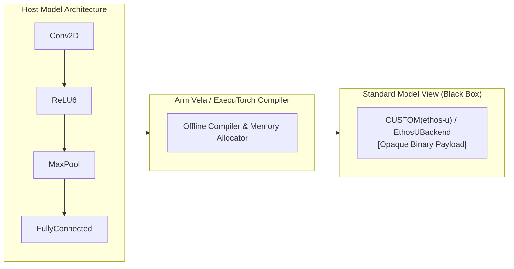
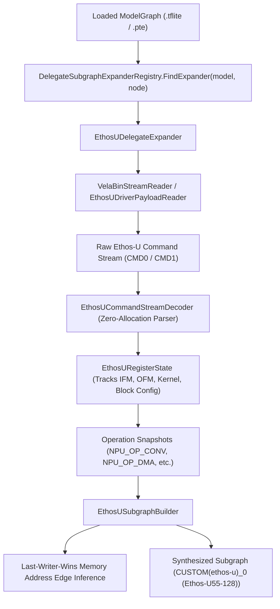
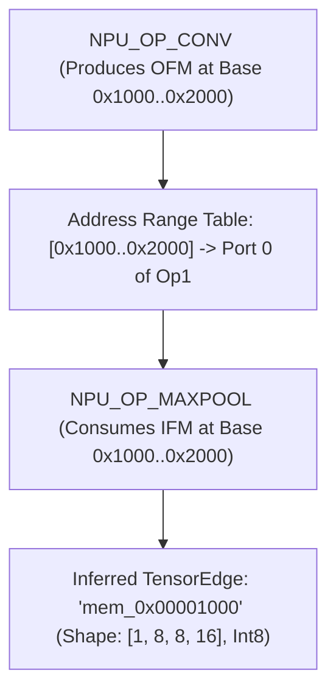

# Reference: Arm Ethos-U NPU Command Stream Unwrapping

`DotNodeViewer.Core` provides on-demand command stream unwrapping for Arm Ethos-U microNPUs (Ethos-U55, Ethos-U65, and Ethos-U85), decompiling compiled delegate payloads embedded inside TensorFlow Lite (`.tflite`) and ExecuTorch (`.pte`) model containers into the Unified Graph IR.

---

## Overview: The Embedded NPU "Black Box" Problem

When edge and microcontroller neural network models are optimized for embedded hardware using compilers like the **Arm Vela compiler** (for TensorFlow Lite) or the **ExecuTorch Arm Ethos-U backend partitioner** (`EthosUBackend`), tens or hundreds of individual layers (convolutions, depthwise convolutions, pooling, activation functions, elementwise adds/multiplications) are converted into hardware-level microcode:



Standard model visualizers display only a single opaque custom node (`CUSTOM(ethos-u)` or `Delegate (EthosUBackend)`), hiding the entire internal execution graph, operator sequence, layer shapes, and register hyperparameters.

`dot-node-viewer` solves this with **on-demand delegate unwrapping** (ADR 0008: *On-Demand Delegate Subgraph Expansion and Ethos-U Decoding*): when inspected or requested via CLI/UI, the engine scans the hardware command stream, tracks register state transitions, reconstructs operator boundaries, and synthesizes a full Unified Graph IR subgraph with inferred dataflow edges and complete microcode disassembly.

---

## On-Demand Delegate Expansion Architecture



### Abstractions (`DotNodeViewer.Core.Abstractions`)

- **`IDelegateSubgraphExpander`:** Public interface for on-demand delegate expanders:
  ```csharp
  public interface IDelegateSubgraphExpander
  {
      string BackendId { get; }
      bool CanExpand(ModelGraph model, GraphNode delegateNode);
      Task<Subgraph?> ExpandAsync(Stream modelStream, ModelGraph model, GraphNode delegateNode, CancellationToken cancellationToken = default);
      Task<IReadOnlyList<string>> DisassembleAsync(Stream modelStream, ModelGraph model, GraphNode delegateNode, CancellationToken cancellationToken = default);
  }
  ```
- **`DelegateSubgraphExpanderRegistry`:** Thread-safe registry providing default expander discovery without coupling core format readers to specific hardware microcode parsers.

---

## Framing & Container Protocols

Ethos-U payloads are encapsulated in two primary container framing formats:

### 1. Vela Binary Stream (`COP1`) in TensorFlow Lite
Vela encapsulates command streams in custom binary options under `CUSTOM(ethos-u)`:
- **Magic:** `COP1` (`0x31504F43` little-endian) at byte `0..4`.
- **Header:** 32-byte header specifying command stream offset and length, weight stream offset and length, and scratch buffer size.
- **Payload:** Raw 16-bit and 48-bit Ethos-U instructions.

### 2. Ethos-U Driver Payload (`ETHU`) in ExecuTorch
ExecuTorch packages the NPU payload in `Delegate (EthosUBackend)`:
- **Magic:** `ETHU` (`0x55485445` little-endian) at byte `0..4`.
- **Header:** Specifies hardware version, MACs per cycle (`macs_per_cc`), command stream length, and weight segment descriptors.

---

## Hardware Command Stream & Zero-Allocation Decoding

The command stream consists of 16-bit register writes (`CMD0`) and 48-bit register writes (`CMD1`):

| Command Class | Size | Encoding | Purpose |
|---|---|---|---|
| **`CMD0`** | 2 bytes | `[15:10] Opcode (6b) \| [9:0] Value (10b)` | Immediate register configuration (e.g. IFM region, rounding mode, activation function) |
| **`CMD1`** | 6 bytes | `[15:10] Opcode (6b) \| [9:0] Offset (10b)` + `[31:0] Payload (32b)` | 32-bit register payloads (base memory addresses, tensor strides, kernel shapes) |

`EthosUCommandStreamDecoder` parses the payload via `ReadOnlySpan<byte>` without allocating managed objects per command, achieving **0 bytes allocated per command**.

---

## Register State Machine & Operator Reconstruction

As commands execute, `EthosURegisterState` models the internal registers of the Ethos-U hardware:

1. **Input Feature Map (`IFM`):** Base address pointers (`BASE0..BASE2`), region IDs (`0..6`), height, width, channels, memory strides, data type (`INT8` / `INT16`), and quantization zero point.
2. **Output Feature Map (`OFM`):** Base address pointers, shape, strides, data type, and zero point.
3. **Weight / Scale Feature Maps:** Weight stream pointers, bias pointers, and scaling tables.
4. **Convolution & Kernel Config:** Kernel width, height, strides, dilation, padding, and block configuration (`block_config`).
5. **Operation Trigger:** When an `NPU_OP_*` opcode is encountered (e.g. `NPU_OP_CONV`, `NPU_OP_DEPTHWISE`, `NPU_OP_POOLING`, `NPU_OP_DMA_START`), the current register state is snapshotted into an operation instance with preceding commands captured for disassembly.

---

## Last-Writer-Wins Address Dataflow Inference

Because Ethos-U microcode operates on physical memory addresses across memory regions (SRAM, Flash, DRAM) rather than named tensor variables, dataflow connections between operators are reconstructed using a **last-writer-wins address interval lookup**:



When an operation reads an `IFM` buffer whose memory address range intersects with an earlier operation's `OFM` buffer, a synthesized `TensorEdge` is established. Operations whose inputs correspond to external input regions become graph inputs, and unconsumed output buffers become graph outputs.

---

## Decoded Operator Attributes

Unwrapped NPU nodes contain complete hardware attributes in `NodeAttribute`:

- `hardware`: Ethos-U architecture (e.g. `"Ethos-U55-128"`, `"Ethos-U65-256"`).
- `ifm_shape`: `[batch, height, width, channels]`.
- `ofm_shape`: `[batch, height, width, channels]`.
- `kernel_size`: `[kernel_h, kernel_w]`.
- `strides`: `[stride_h, stride_w]`.
- `padding`: `[top, left, bottom, right]`.
- `block_config`: `[block_h, block_w, block_c]`.
- `quantization`: Input and output zero points and precisions (`INT8` / `INT16`).
- `commands`: Monospace disassembly trace with hex offsets and mnemonic descriptions.
