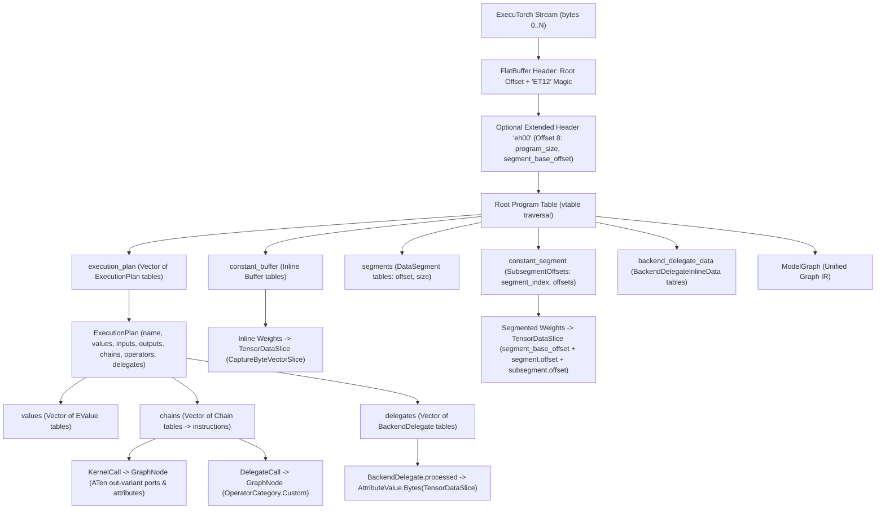

# Reference: ExecuTorch (`.pte` / `ET12`)

`DotNodeViewer.Core` includes a bounds-checked, zero-allocation FlatBuffers reader (`FlatBufferTable`) and ExecuTorch (`.pte`) parser (`ExecuTorchFormatDetector`, `ExecuTorchFormatReader`, and `ExecuTorchOperatorCatalog`).

---

## Format Identification

| Property | Value |
|---|---|
| **Format ID** | `executorch` (`ModelFormatId.ExecuTorch`) |
| **Display Name** | `ExecuTorch` (formatted with schema version as `ExecuTorch v1`) |
| **File Extensions** | `.pte` |
| **Container Framing** | FlatBuffers binary (`ET12` or `ET1x` ASCII identifier at bytes `4..8`) with optional `eh00` extended header at offset `8` |
| **Detection Strategy** | Validates `ET12` or `ET1x` magic identifier at `4..8`, root table `uoffset_t` at `0..4`, optional `eh00` extended header at `8..40`, and root vtable bounds without modifying `Stream.Position` |

---

## FlatBuffers Schema & Parsing Architecture



---

## Unified Graph IR Mapping

### 1. Program Header, Execution Plans & Extended Headers

| ExecuTorch FlatBuffer Field | Unified Graph IR Target | Notes |
|---|---|---|
| `Program.version` | `ModelGraph.Format.Version` | Formatted as `"v{version}"` (for example, `"v1"` -> `"ExecuTorch v1"`) |
| `eh00` extended header | `ModelGraph.Metadata` | Records `executorch.program_size`, `executorch.segment_base_offset`, and `executorch.segment_data_size` |
| `Program.execution_plan[0]` | `ModelGraph.PrimarySubgraph` (`Subgraphs[0]`) | Primary execution plan (defaults to `"forward"`) |
| `Program.execution_plan[1..N]` | `ModelGraph.Subgraphs[1..N]` | Multi-entry execution plans (e.g., prefill, decode, auxiliary methods) |

### 2. Tensors, Dynamic Shapes & Zero-Copy Weight Slicing

ExecuTorch stores static weight buffers either inline in `Program.constant_buffer` or appended as binary data segments referenced by `Program.constant_segment`:

- **Inline Constant Buffers:** Captured in $O(1)$ via `FlatBufferTable.CaptureByteVectorSlice` without loading bytes onto the managed heap.
- **Segmented Weights:** Computed from `segment_base_offset + DataSegment.offset + SubsegmentOffsets.offsets[data_buffer_idx]` as a lazy `TensorDataSlice`.
- **External Weights:** If `ExtraTensorInfo.location == EXTERNAL`, mapped to `ExternalTensorDataReference` pointing to `{fully_qualified_name}.ptd`.
- **Dynamic Shapes:** Static dimensions map to `TensorDimension.Fixed`, while `DYNAMIC_BOUND` with unknown dimensions or `DYNAMIC_UNBOUND` map to `TensorDimension.Dynamic`.

### 3. Kernel Calls, Delegate Calls & Operator Classification

- **Kernel Calls (`KernelCall`):** Named by `plan.operators[op_index]` (e.g., `aten::linear.out`, `aten::conv2d.out`). Scalar arguments (`Int`, `Double`, `Bool`, `String`, `IntList`) map to strongly typed `NodeAttribute` records, and tensor arguments map topologically to input and output `NodePort`s.
- **Backend Delegates (`DelegateCall`):** Represent lowered hardware acceleration blocks (such as `XnnpackBackend`, `CoreMLBackend`, or `EthosUBackend`). Mapped to `OperatorCategory.Custom` with operator name `Delegate (<backend_id>)`. The compiled backend payload is exposed as `AttributeValue.Bytes(TensorDataSlice)` under attribute `"processed"`. When `EthosUBackend` is present, `ExecuTorchFormatReader` tags the node with `delegate.backend = "ethos-u"`, enabling on-demand microcode unwrapping and register disassembly via [Arm Ethos-U NPU Delegate](ethos-u.md).

---

## Programmatic C# Example

```csharp
using DotNodeViewer.Core.Abstractions;
using DotNodeViewer.Core.Ir;

await using FileStream stream = File.OpenRead("model.pte");

// Detect and extract the ExecuTorch model graph
ModelGraph graph = await ModelFormatRegistry.Default.ReadAsync(
    stream,
    new ModelReadOptions { FileName = "model.pte" });

Console.WriteLine($"Format: {graph.Format.ToDisplayString()}");
Console.WriteLine($"Primary Subgraph: {graph.PrimarySubgraph?.Name}");

foreach (GraphNode node in graph.PrimarySubgraph!.Nodes)
{
    Console.WriteLine($"Node '{node.Name}' [{node.Operator.Category}]: {node.Operator.Name}");
}
```

