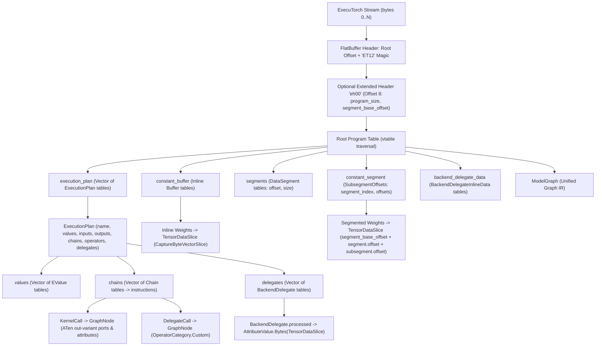
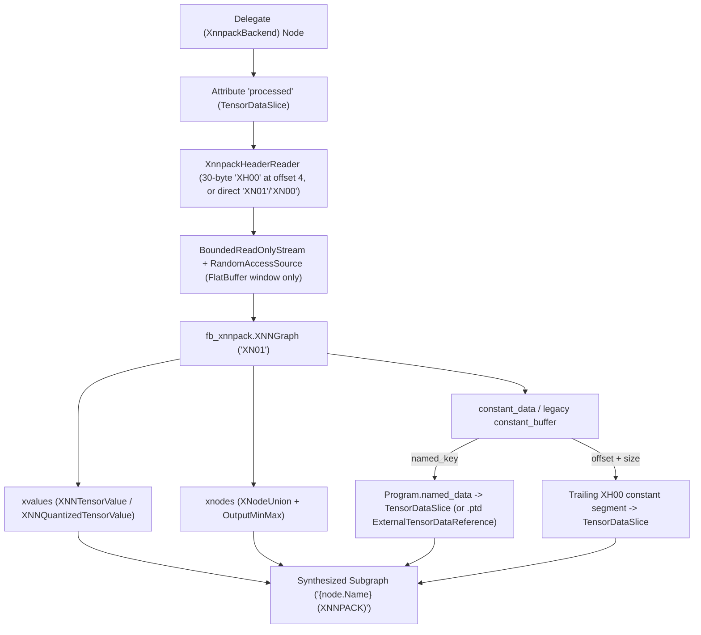

# Reference: ExecuTorch (`.pte` / `ET12`)

`DotNodeViewer.Core` includes a bounds-checked, zero-allocation FlatBuffers reader (`FlatBufferTable`) and ExecuTorch (`.pte`) parser (`ExecuTorchFormatDetector`, `ExecuTorchFormatReader`, and `ExecuTorchOperatorCatalog`).

---

## Format Identification

| Property | Value |
|---|---|
| **Format ID** | `executorch` (`ModelFormatId.ExecuTorch`) |
| **Display Name** | `ExecuTorch` (formatted with schema version as `ExecuTorch v1`) |
| **File Extensions** | `.pte` |
| **Container Framing** | FlatBuffers binary (`ET12` or `ET1x` ASCII identifier at bytes `4..8`) with optional `eh00` extended header at offset `8` |
| **Detection Strategy** | Validates `ET12` or `ET1x` magic identifier at `4..8`, root table `uoffset_t` at `0..4`, optional `eh00` extended header at `8..40`, and root vtable bounds without modifying `Stream.Position` |

---

## FlatBuffers Schema & Parsing Architecture



---

## Unified Graph IR Mapping

### 1. Program Header, Execution Plans & Extended Headers

| ExecuTorch FlatBuffer Field | Unified Graph IR Target | Notes |
|---|---|---|
| `Program.version` | `ModelGraph.Format.Version` | Formatted as `"v{version}"` (for example, `"v1"` -> `"ExecuTorch v1"`) |
| `eh00` extended header | `ModelGraph.Metadata` | Records `executorch.program_size`, `executorch.segment_base_offset`, and `executorch.segment_data_size` |
| `Program.execution_plan[0]` | `ModelGraph.PrimarySubgraph` (`Subgraphs[0]`) | Primary execution plan (defaults to `"forward"`) |
| `Program.execution_plan[1..N]` | `ModelGraph.Subgraphs[1..N]` | Multi-entry execution plans (e.g., prefill, decode, auxiliary methods) |

### 2. Tensors, Dynamic Shapes & Zero-Copy Weight Slicing

ExecuTorch stores static weight buffers either inline in `Program.constant_buffer` or appended as binary data segments referenced by `Program.constant_segment`:

- **Inline Constant Buffers:** Captured in $O(1)$ via `FlatBufferTable.CaptureByteVectorSlice` without loading bytes onto the managed heap.
- **Segmented Weights:** Computed from `segment_base_offset + DataSegment.offset + SubsegmentOffsets.offsets[data_buffer_idx]` as a lazy `TensorDataSlice`.
- **External Weights:** If `ExtraTensorInfo.location == EXTERNAL`, mapped to `ExternalTensorDataReference` pointing to `{fully_qualified_name}.ptd`.
- **Dynamic Shapes:** Static dimensions map to `TensorDimension.Fixed`, while `DYNAMIC_BOUND` with unknown dimensions or `DYNAMIC_UNBOUND` map to `TensorDimension.Dynamic`.

### 3. Kernel Calls, Delegate Calls & Operator Classification

- **Kernel Calls (`KernelCall`):** Named by `plan.operators[op_index]` (e.g., `aten::linear.out`, `aten::conv2d.out`). Scalar arguments (`Int`, `Double`, `Bool`, `String`, `IntList`) map to strongly typed `NodeAttribute` records, and tensor arguments map topologically to input and output `NodePort`s.
- **Backend Delegates (`DelegateCall`):** Represent lowered hardware acceleration blocks (such as `XnnpackBackend`, `CoreMLBackend`, or `EthosUBackend`). Mapped to `OperatorCategory.Custom` with operator name `Delegate (<backend_id>)`. The compiled backend payload is exposed as `AttributeValue.Bytes(TensorDataSlice)` under attribute `"processed"`.
  - When `EthosUBackend` is present, `ExecuTorchFormatReader` tags the node with `delegate.backend = "ethos-u"` and `delegate.expandable = true`, enabling on-demand microcode unwrapping and register disassembly via [Arm Ethos-U NPU Delegate](ethos-u.md).
  - When `XnnpackBackend` is present, `ExecuTorchFormatReader` tags the node with `delegate.backend = "xnnpack"` and `delegate.expandable = true`, enabling on-demand XNNPACK FlatBuffer unwrapping via `XnnpackDelegateSubgraphExpander`.

---

## XNNPACK Delegate Unwrapping (`XnnpackBackend`)

`DotNodeViewer.Core` includes an on-demand XNNPACK delegate decoder (`DotNodeViewer.Core.Delegates.Xnnpack`, all `internal`) registered in `DelegateSubgraphExpanderRegistry.Default` (`BackendId = "xnnpack"`). During `ExecuTorchFormatReader.ReadAsync`, `XnnpackBackend` payloads are **not** decoded eagerly; instead, calling `IDelegateSubgraphExpander.ExpandAsync` (via the CLI `--expand-delegates` flag or double-clicking / clicking **Unwrap Delegate Subgraph** in the visualizer) decodes the payload into a synthesized `Subgraph` named `"{node.Name} (XNNPACK)"`.

> [!NOTE]
> **Pinned Upstream Schema Revision:** Operator discriminants and table field layouts are verified against PyTorch ExecuTorch `executorch==1.5.1+cpu` (`backends/xnnpack/serialization/schema.fbs`, identifier `"XN01"`, and `runtime_schema.fbs`, identifier `"XN00"`), plus forward-compatible Netron-tracked `XNodeUnion` entries `49: XNNDepthToSpace2d` and `50: _XNNStaticReduce`.



### Supported `XNodeUnion` Operator Coverage

| Semantic Category | Supported `fb_xnnpack.XNodeUnion` Operators |
|---|---|
| `Layer` | `XNNConv2d`, `XNNDepthwiseConv2d`, `XNNConvTranspose2d`, `XNNFullyConnected`, `XNNBatchMatrixMultiply`, `XNNScaledDotProductAttention` |
| `Activation` | `XNNSoftmax`, `XNNSigmoid`, `XNNClamp`, `XNNHardswish`, `XNNLeakyReLU`, `XNNELU`, `XNNPReLU`, `XNNGelu`, `XNNTanh` |
| `Pooling` | `XNNAvgPooling2d`, `XNNMaxPooling2d`, `XNNGlobalAvgPooling2d`, `XNNArgMaxPooling2d` |
| `Shape` | `XNNStaticTranspose`, `XNNStaticResizeBilinear2D`, `XNNStaticConstantPad`, `XNNStaticReshape`, `XNNStaticSlice`, `XNNConcatenate2`..`XNNConcatenate5`, `XNNDepthToSpace2d` (`49`) |
| `Tensor` | `XNNAdd`, `XNNSubtract`, `XNNMultiply`, `XNNDiv`, `XNNMinimum`, `XNNMaximum`, `XNNFloor`, `XNNCeiling`, `XNNSquareRoot`, `XNNReciprocalSquareRoot`, `XNNNegate`, `XNNSquare`, `XNNAbs`, `XNNLog`, `XNNExp`, `XNNSin`, `XNNCos`, `_XNNStaticReduce` (`50`) |
| `Quantization` | `XNNConvert` |
| `Data` | `XNNCopy` |
| `Unknown` | Any unrecognized `XNodeUnion` discriminant maps safely to `XNNUnknown_<id>` (`OperatorCategory.Unknown`) with a `DNV_XNNPACK_UNKNOWN_OP` warning diagnostic |

### Constant Weight Slicing & Quantization Mapping

- **ExecuTorch 1.x `Program.named_data`:** When `ConstantDataOffset.named_key` is populated (`offset == UINT64_MAX`), the decoder looks up `key` in the `.pte` file's `Program.named_data` and `Program.segments` (adjusted by `eh00` `segment_base_offset`) to create an exact zero-allocation `TensorDataSlice`. Keys not embedded in `Program.named_data` emit an `ExternalTensorDataReference` (`<named_key>.ptd`) and a `DNV_XNNPACK_EXTERNAL_NAMED_DATA` warning.
- **Trailing & Legacy Buffers:** Inline `XH00` trailing `constant_data` segments and legacy `XNNGraph.constant_buffer` entries are bounds-checked and captured as `TensorDataSlice` without allocating weight arrays.
- **Quantization Parameters:**
  - `PerTensorQuant` → `AffineQuantization([scale], [zeroPoint], QuantizedDimension: null)`
  - `PerChannelQuant` → `AffineQuantization(scales, zeroPoints, QuantizedDimension: channelDim)` (inline or lazily resolved from `scale_buffer_idx`)
  - `PerTokenDynamicQuant` → `BlockQuantization("PerTokenDynamic", numNonbatchDims, 8)`
  - `PerChannelGroupQuant` → `BlockQuantization($"PerChannelGroup(axis={channelDim})", groupSize, 4 or 8)`
- **Fused Activations:** `XNode.output_min_max` maps `[0, +Inf]` to `fused_activation_function = "RELU"`, `[0, 6]` to `"RELU6"`, and other bounded ranges to `"CLAMP"`, surfacing fused activation badges on node cards.

### CLI `--expand-delegates` Example (`tiny_xnnpack_ops.pte`)

```bash
dotnet run --project tools/DotNodeViewer.Cli -c Release -- inspect tests/DotNodeViewer.Core.Tests/Fixtures/executorch/tiny_xnnpack_ops.pte --expand-delegates
```

```text
Format:    ExecuTorch (executorch)
Producer:  executorch
Subgraphs: 1

Subgraph [0] 'forward':
  Nodes:   1
  Tensors: 2
  Inputs:  1
    - v0: Float32 [1, 3, 8, 8]
  Outputs: 1
    - v1: Float32 [1, 4]

  [Delegate Expansion] 'XnnpackBackend_0' (xnnpack) -> XnnpackBackend_0 (XNNPACK):
    Synthesized Nodes:   10
    Synthesized Tensors: 17
    Operator Distribution:
      - XNNStaticTranspose: 2
      - XNNAdd: 1
      - XNNConv2d: 1
      - XNNDepthwiseConv2d: 1
      - XNNFullyConnected: 1
      - XNNGlobalAvgPooling2d: 1
      - XNNHardswish: 1
      - XNNSoftmax: 1
      - XNNStaticReshape: 1
```

---

## Programmatic C# Example

```csharp
using DotNodeViewer.Core.Abstractions;
using DotNodeViewer.Core.Ir;

await using FileStream stream = File.OpenRead("model.pte");

// Detect and extract the ExecuTorch model graph
ModelGraph graph = await ModelFormatRegistry.Default.ReadAsync(
    stream,
    new ModelReadOptions { FileName = "model.pte" });

Console.WriteLine($"Format: {graph.Format.ToDisplayString()}");
Console.WriteLine($"Primary Subgraph: {graph.PrimarySubgraph?.Name}");

foreach (GraphNode node in graph.PrimarySubgraph!.Nodes)
{
    Console.WriteLine($"Node '{node.Name}' [{node.Operator.Category}]: {node.Operator.Name}");
}
```

