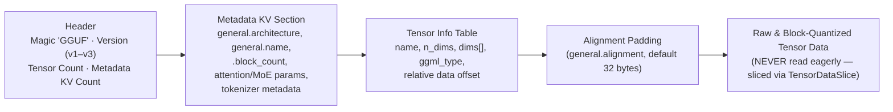

# Reference: GGUF Format Reader (`.gguf`)

This document describes the binary container framing, zero-allocation lazy weight slicing, GGML block-quantized type mapping, and hierarchical block-level graph synthesis for GGUF (`.gguf`) large language, multimodal, and audio models in `DotNodeViewer.Core`.

---

## 1. Container Binary Layout

GGUF (GGML Universal File Format) is a self-contained binary container used by `llama.cpp`, Ollama, LM Studio, and `whisper.cpp`. Unlike ONNX or TFLite, GGUF stores a flat tensor table and architecture metadata rather than an explicit execution graph:

---

## 2. Detection & Streaming Header Guarantees

### Format Detection (`GgufFormatDetector`)
- Peeks the first 24 bytes via `ModelProbe.Header` without allocating or altering `Stream.Position`.
- Validates the 4-byte ASCII magic `'G' 'G' 'U' 'F'`.
- Supports GGUF **v1**, **v2**, and **v3** (including **v3 big-endian** headers) while enforcing bounded `tensor_count` and `metadata_kv_count` sanity limits.

### Zero-Allocation Lazy Weight Slicing
- `GgufBinaryReader` reads metadata KVs and the tensor info table sequentially over `RandomAccessSource` without buffering the file or reading the weight payload section.
- Computes `dataBaseOffset = AlignUp(tensorTableEndOffset, general.alignment ?? 32)` and attaches a `TensorDataSlice(dataBaseOffset + relativeOffset, byteLength, dataType, encoding)` to every tensor, verifying every slice falls within `stream.Length`.
- **Large Tokenizer Array Caps:** Arrays exceeding 64 elements (such as `tokenizer.ggml.tokens`, `tokenizer.ggml.merges`, and `tokenizer.ggml.scores` with 128k–256k entries) are summarized in streaming order. Fixed-width numeric arrays skip in $O(1)$ via checked `UInt128` byte math; string arrays sample only the first 4 entries and advance past remaining length prefixes without UTF-8 decoding.

---

## 3. GGML Type & Block Quantization Mapping

GGML stores tensor dimensions innermost-first (`ne[0], ne[1], ...`). `GgmlTypeCatalog` validates `ne[0]` divisibility by `BlockSize` and computes exact payload byte sizes using checked 128-bit (`UInt128`) arithmetic, while `GgufGraphSynthesizer` normalizes `TensorShape` into row-major order (`[ne[n-1], ..., ne[0]]`).

| GGML Type | Code | Block Size | Bytes / Block | Core IR `DataType` | `Quantization` | `TensorDataEncoding` |
|---|---|---|---|---|---|---|
| `F32` | `0` | `1` | `4` | `Float32` | `null` | `Raw` |
| `F16` | `1` | `1` | `2` | `Float16` | `null` | `Raw` |
| `BF16` | `30` | `1` | `2` | `BFloat16` | `null` | `Raw` |
| `F64` | `28` | `1` | `8` | `Float64` | `null` | `Raw` |
| `I8` / `I16` / `I32` / `I64` | `24..27` | `1` | `1 / 2 / 4 / 8` | `Int8` / `Int16` / `Int32` / `Int64` | `null` | `Raw` |
| `Q4_0` / `Q4_1` | `2` / `3` | `32` | `18` / `20` | `UInt8` | `BlockQuantization("Q4_0" / "Q4_1", 32, 4)` | `GgmlQuantizedBlock` |
| `Q5_0` / `Q5_1` | `6` / `7` | `32` | `22` / `24` | `UInt8` | `BlockQuantization("Q5_0" / "Q5_1", 32, 5)` | `GgmlQuantizedBlock` |
| `Q8_0` / `Q8_1` | `8` / `9` | `32` | `34` / `36` | `UInt8` | `BlockQuantization("Q8_0" / "Q8_1", 32, 8)` | `GgmlQuantizedBlock` |
| `Q2_K`..`Q6_K`, `Q8_K` | `10..15` | `256` | `84..292` | `UInt8` | `BlockQuantization("Q*_K", 256, 2..8)` | `GgmlQuantizedBlock` |
| `IQ1_S`, `IQ1_M`, `IQ2_*`, `IQ3_*`, `IQ4_XS` | `16..19, 21..23, 29` | `256` | `50..136` | `UInt8` | `BlockQuantization("IQ*", 256, 1..4)` | `GgmlQuantizedBlock` |
| `IQ4_NL` | `20` | `32` | `18` | `UInt8` | `BlockQuantization("IQ4_NL", 32, 4)` | `GgmlQuantizedBlock` |
| `TQ1_0` / `TQ2_0` | `34` / `35` | `256` | `54` / `66` | `UInt8` | `BlockQuantization("TQ*_0", 256, 2)` | `GgmlQuantizedBlock` |
| `MXFP4` | `39` | `32` | `17` | `UInt8` | `BlockQuantization("MXFP4", 32, 4)` | `GgmlQuantizedBlock` |

When inspecting a `GgmlQuantizedBlock` tensor in `TensorInspectorViewModel`, raw bytes are rendered safely in hex alongside the block scheme, block size, and effective bit width without misinterpreting super-block scale headers as dense floats.

---

## 4. Block-Level Graph Synthesis & Supported Architectures

`GgufGraphSynthesizer` groups flat tensor entries into a clean hierarchical pipeline so multi-billion-parameter models render legibly:

1. **Pre-Block Embeddings:** `token_embd` (`TokenEmbedding`), `position_embd` (`PositionEmbedding`), `token_types` (`TokenTypeEmbedding`), `text_embd` (`TextEmbedding`), `audio_embd` (`AudioEmbedding`), and `v.*` (`VisionEmbedding`).
2. **Indexed Transformer / MoE / SSM / Engram / Audio Blocks (`blk.{i}.*`, `encoder.blk.{i}.*`, `decoder.blk.{i}.*`, `dep.{i}.*`, `v.blk.{i}.*`):**
   - Data-driven suffix classification distinguishes `TransformerBlock` (`llama`, `qwen*`, `gemma*`, `phi*`, `limite`), `MoETransformerBlock` (`deepseek*`, `mistral-large4`, `kimi-k31`), `EngramTransformerBlock` (`deepseek41` with `engram_*` memory lookup), `SSMBlock` / `HybridSSMBlock` (`mamba*`, `lfm3`), `EncoderBlock` / `DecoderBlock` (`whisper`), `DepthTransformerBlock` (`moshi`), and `VisionTransformerBlock`.
   - Each block node carries a nested `Subgraph` (`NodeAttribute("subgraph", AttributeValue.Graph(...))`) detailing internal submodules (`RMSNorm`, `Attention` / `MultiHeadLatentAttention`, `StateSpace`, `EngramMemory`, `FeedForward` / `MoEFeedForward`) for breadcrumb drill-down.
3. **Named Audio & Multimodal Stages:** Speech/TTS pipelines such as `kokoro` (`bert` → `bert_encoder` → `text_encoder` → `predictor` → `decoder`) and `moshi` (`text_head`, `audio_head`), as well as any unseen future `general.architecture` via longest-prefix grouping.
4. **Output Head:** `output_norm` / `ln_f` (`OutputNorm`) → `output` / `lm_head` (`LMHead`).
