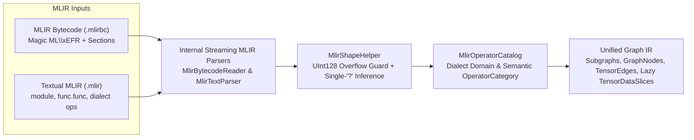

# Reference & Explanation: MLIR Model Format (`DotNodeViewer.Core`)

`DotNodeViewer.Core` includes a built-in, AOT-safe streaming detector and parser for **MLIR (Multi-Level Intermediate Representation)** compiler artifacts (`ModelFormatId.Mlir`, registered in `ModelFormatRegistry.Default`), supporting both **MLIR Bytecode (`.mlirbc`)** and **Textual MLIR (`.mlir`)**.

---

## 1. Format Identification & Probing

| Property | Value |
|---|---|
| **Format ID** | `mlir` (`ModelFormatId.Mlir`) |
| **Display Name** | `MLIR Textual` (`.mlir`) / `MLIR Bytecode v<N>` (`.mlirbc`) |
| **File Extensions** | `.mlir`, `.mlirbc` |
| **Wire Framing** | LLVM MLIR Bytecode (`ML\xEFR` magic + `PrefixVarInt` sections) or UTF-8 MLIR assembly |
| **Supported Bytecode Versions** | MLIR Bytecode `v0`–`v16` |

`MlirFormatDetector` identifies MLIR streams non-destructively via `ModelProbe` while restoring `Stream.Position`:

1. **Binary Bytecode Detection:** Verifies the exact 4-byte magic `ML\xEFR` (`0x4D 0x4C 0xEF 0x52`) followed by a valid `PrefixVarInt` bytecode version (`<= 16`).
2. **Textual Detection:** Scans up to the first 4 KB of the stream (after skipping UTF-8 BOM, `//` comments, and `#`/`!` alias definitions), rejects binary control bytes, JSON (`{`, `[`), XML (`<`), and Python source (`import `, `from `, `def `, `class `), and matches MLIR module/function headers (`module`, `"builtin.module"`, `func.func`, `tt.func`) or MLIR dialect operations paired with MLIR type syntax (`->`, `tensor<`, `memref<`, `!torch.`, `!tt.`, `#loc`).

---

## 2. Streaming Parser Architecture

---

## 3. Dialect Coverage

`MlirOperatorCatalog` extracts the dialect prefix into `OperatorInfo.Domain` (preserving compound namespaces such as `torch.quantized_decomposed` and `torch.torchao`) and classifies operations into semantic `OperatorCategory` values:

| Dialect Family | `OperatorInfo.Domain` | Typical Operators & Semantic Mapping |
|---|---|---|
| **PyTorch & Quantization** | `torch`, `torch.quantized_decomposed`, `torch.torchao` | `torch.aten.mm` (`Layer`), `torch.aten.relu` (`Activation`), `torch.quantized_decomposed.*` (`Quantization`), `torch.torchao.*` (`Quantization`), `torch.vtensor.literal` (`Constant`) |
| **JAX / XLA / OpenXLA** | `stablehlo`, `vhlo`, `mhlo`, `chlo`, `xla` | `stablehlo.convolution` / `dot_general` (`Layer`), `stablehlo.constant` (`Constant`), `stablehlo.reshape` (`Shape`), `stablehlo.add` (`Tensor`) |
| **TOSA & Linalg** | `tosa`, `linalg` | `tosa.conv2d` / `linalg.generic` (`Layer`), `tosa.avg_pool2d` (`Pooling`), `tosa.clamp` (`Activation`), `tosa.rescale` (`Quantization`), `tosa.const` (`Constant`) |
| **IREE & Edge Runtimes** | `iree_input`, `flow`, `hal` | `flow.dispatch` / `hal.command_buffer.dispatch` (`Custom`), buffer/transfer ops (`Data`) |
| **OpenAI Triton GPU** | `tt`, `ttg`, `ttng` | `tt.dot` / `ttng.warp_specialize` (`Layer`), `tt.load` / `tt.store` (`Data`), `ttg.convert_layout` (`Shape`), `tt.make_range` / `tt.get_program_id` (`Constant`) |
| **Core & Control Flow** | `arith`, `math`, `tensor`, `memref`, `scf`, `cf`, `func`, `builtin` | `arith.*` / `math.*` (`Tensor`), `tensor.*` (`Shape`), `scf.if` / `scf.for` / `cf.cond_br` (`ControlFlow`), `arith.constant` (`Constant`) |

---

## 4. Unified Graph IR Mapping & Defensive Guardrails

### 4.1 Functions, Nested Regions & Multi-Block CFG
- **Module Functions:** Top-level functions (`func.func`, `tt.func`, `llvm.func`, `util.func`) map to `Subgraph` entries. When multiple functions exist, `@main` or `@forward` is placed at `Subgraphs[0]` (`PrimarySubgraph`).
- **Nested Regions:** Operations carrying nested regions (`scf.if`, `scf.for`, `stablehlo.while`, `linalg.generic`, `tt.reduce`) attach each child region as a nested `Subgraph` via `AttributeValue.Graph` (for example `then_branch` / `else_branch` on `scf.if`, `body` on single-region ops, or `regions` via `AttributeValue.GraphList`). Nesting depth is bounded by `ModelReadOptions.MaxSubgraphDepth`.
- **Multi-Block Control Flow:** `cf.br` and `cf.cond_br` operations map to `OperatorCategory.ControlFlow` nodes with a `successors` (`AttributeValue.StringList`) attribute recording target block labels (`^bbN`), while block arguments are wired into SSA `TensorEdge`s.

### 4.2 Lazy Bytecode Weight & Resource Slicing
In `.mlirbc` bytecode streams, `MlirBytecodeReader` indexes `kResourceOffset` / `kResource` and skips `kResource` blob payloads and `DenseIntOrFPElementsAttr` raw byte arrays without copying weights onto the managed heap. Each payload is recorded as a lightweight `TensorDataSlice(StreamOffset, ByteLength, DataType)` readable on demand via `TensorDataLoader`.

### 4.3 128-Bit Element-Count Overflow Protection
`MlirShapeHelper` computes element counts and expected byte sizes using checked `UInt128` multiplication. Extreme compiler shapes whose element product exceeds `long.MaxValue` or `UInt128.MaxValue` never wrap around to negative sizes; instead, the parser records a non-fatal warning diagnostic (`DNV_MLIR_SHAPE_OVERFLOW`).

### 4.4 Single-`?` Dynamic Dimension Inference
When a `dense_resource<key>` or `DenseIntOrFPElementsAttr` tensor declares a `TensorShape` containing **exactly one** unnamed dynamic dimension (`?`), zero symbolic dimensions, and positive static dimensions alongside a concrete buffer of known `byteLength` and element bit width, `MlirShapeHelper` infers the missing dimension if `totalElements` is an exact multiple of the static dimensions' product (for example, `tensor<?x4xf32>` with a 48-byte buffer resolves to `[3, 4]`). Multiple `?` dimensions or non-divisible buffer lengths remain `TensorDimension.Dynamic`.

### 4.5 Emerging Compiler Element Types
Emerging compiler element types not yet included in the frozen v1 `DataType` enum—such as `float8e5m3fnu` (`f8E5M3FNU`), `mxi8`, and `complex<float16>`—map gracefully to `DataType.Unknown` and emit a non-fatal `ParseDiagnostic` (`DNV_MLIR_UNSUPPORTED_DTYPE`) preserving the exact MLIR type string (recorded in **ADR 0009**).
