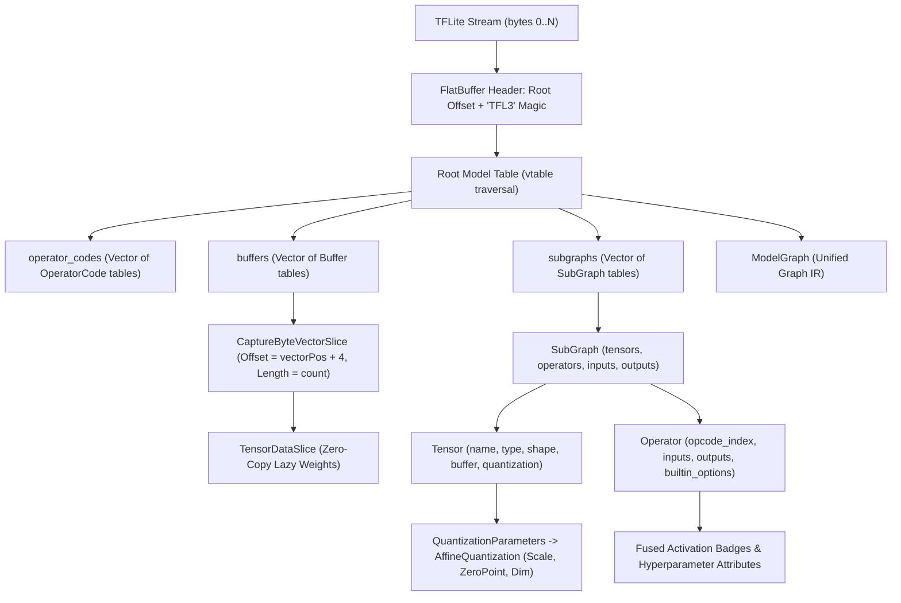

# Reference: TensorFlow Lite (`.tflite` / `TFL3`)

`DotNodeViewer.Core` includes a bounds-checked, zero-allocation FlatBuffers reader (`FlatBufferTable`) and TensorFlow Lite (`TFL3`) parser (`TfliteFormatDetector`, `TfliteFormatReader`, and `TfliteOperatorCatalog`).

---

## Format Identification

| Property | Value |
|---|---|
| **Format ID** | `tflite` (`ModelFormatId.Tflite`) |
| **Display Name** | `TensorFlow Lite` (formatted with schema version as `TensorFlow Lite v3`) |
| **File Extensions** | `.tflite` |
| **Container Framing** | FlatBuffers binary (`TFL3` ASCII identifier at bytes `4..8`) |
| **Detection Strategy** | Validates `TFL3` magic bytes at `4..8`, root table `uoffset_t` at `0..4`, and root vtable bounds without modifying `Stream.Position` |

---

## FlatBuffers Schema & Parsing Architecture

---

## Unified Graph IR Mapping

### 1. Model Header, Operator Codes & Subgraphs

| TFLite FlatBuffer Field | Unified Graph IR Target | Notes |
|---|---|---|
| `Model.version` | `ModelGraph.Format.Version` | Formatted as `"v{version}"` (for example, `"v3"` -> `"TensorFlow Lite v3"`) |
| `Model.description` | `ModelGraph.Producer` & `Metadata["description"]` | Captures converter provenance (such as `"MLIR Converted."`) |
| `Model.operator_codes[i]` | `GraphNode.Operator` (`OperatorInfo`) | Resolves `builtin_code` (falling back to `deprecated_builtin_code` for codes `< 127`), `version`, and `custom_code` |
| `Model.subgraphs[0]` | `ModelGraph.PrimarySubgraph` (`Subgraphs[0]`) | Defaults to `"main"` when `SubGraph.name` is empty |
| `Model.subgraphs[1..N]` | `ModelGraph.Subgraphs[1..N]` | Secondary and control-flow subgraphs (`WHILE`, `IF`, `CALL_ONCE`) |

### 2. Tensors, Shapes & Zero-Copy Weight Buffers

TFLite stores static weights in a top-level `Model.buffers` table vector (`Buffer[0]` is an empty sentinel buffer). When `Tensor.buffer` references a non-empty buffer:

- **Inline `Buffer.data` byte vectors:** `FlatBufferTable.CaptureByteVectorSlice` computes the exact file offset (`vectorPos + 4`) and byte length of the `[ubyte]` vector without reading or allocating the weight bytes on the managed heap, recording a `TensorDataSlice(StreamOffset, ByteLength, DataType, TensorDataEncoding.Raw)` and classifying the tensor as `TensorKind.Initializer`.
- **External-in-file `Buffer.offset` / `Buffer.size` (TFLite v3c):** Validates that `offset + size <= stream.Length` and records a `TensorDataSlice` pointing to the appended buffer region.
- **Dynamic dimensions (`shape_signature`):** Negative dimensions (`-1`) in `Tensor.shape_signature` or `Tensor.shape` map to `TensorDimension.Dynamic.Instance` (`"?"`).

### 3. Per-Tensor & Per-Channel `INT8` Quantization (`AffineQuantization`)

`Tensor.quantization` (`QuantizationParameters`) maps directly to `AffineQuantization`:

- **`Scale`:** `float[]` from `QuantizationParameters.scale` (1 element for per-tensor quantization; $C$ elements for per-channel quantization).
- **`ZeroPoint`:** `long[]` from `QuantizationParameters.zero_point`.
- **`QuantizedDimension`:** `int?` from `QuantizationParameters.quantized_dimension` (for example, `0` for `CONV_2D` output channels or `3` for `DEPTHWISE_CONV_2D` channel multipliers).

### 4. Builtin Options, Fused Activations & Control Flow

`TfliteFormatReader` extracts `Operator.builtin_options` into typed `NodeAttribute` entries:

- **Spatial & Pooling Layers (`CONV_2D`, `DEPTHWISE_CONV_2D`, `AVERAGE_POOL_2D`, `MAX_POOL_2D`, `TRANSPOSE_CONV`):** Extracts `padding` (`"SAME"` or `"VALID"`), `strides` (`[stride_h, stride_w]`), `dilations` (`[dilation_h, dilation_w]`), `depth_multiplier`, `filter_size` (`[filter_h, filter_w]`), and `fused_activation_function`.
- **Fused Activations:** Non-zero `ActivationFunctionType` values (`RELU`, `RELU6`, `RELU_N1_TO_1`, `TANH`, `SIGN_BIT`) are recorded as `fused_activation_function` (`AttributeValue.String`), which `ModelGraphLayoutAdapter` surfaces as inline badge rows in the graph layout.
- **Control-Flow Subgraphs (`IF`, `WHILE`, `CALL_ONCE`, `CALL`):** Resolves `then_subgraph_index` / `else_subgraph_index` (`IF`), `cond_subgraph_index` / `body_subgraph_index` (`WHILE`), and `init_subgraph_index` (`CALL_ONCE`) into nested `AttributeValue.Graph(Subgraph)` attributes while guarding against cyclic subgraph references up to `ModelReadOptions.MaxSubgraphDepth`.
- **Custom & NPU Delegate Operators (`CUSTOM`):** Operators with `BuiltinOperator.CUSTOM` (such as `CUSTOM(ethos-u)` or `CUSTOM(TfLiteGpuDelegateV2)`) are categorized as `OperatorCategory.Custom` in domain `"tflite.custom"`, with `custom_code` recorded as `AttributeValue.String` and `Operator.custom_options` recorded as a lazy `AttributeValue.Bytes(TensorDataSlice)`.

