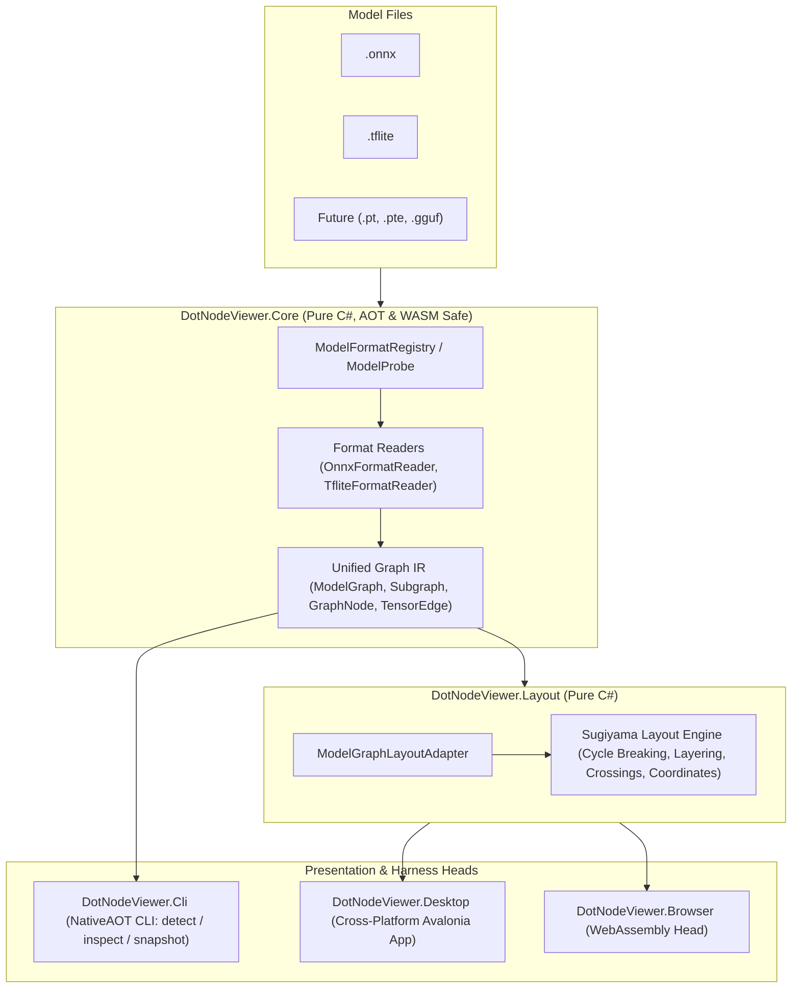

# Tutorial: Getting Started with `dot-node-viewer`

This tutorial walks you through setting up your development environment, building the `.NET 10` solution, running the `TUnit` test suite, and building the documentation site locally.

---

## What You Will Learn

By completing this tutorial, you will:
1. Understand the high-level architecture of `dot-node-viewer`.
2. Verify your `.NET 10` SDK and local tool manifest (`docfx`).
3. Build `dot-node-viewer.slnx` in `Release` configuration with zero warnings.
4. Run the automated `TUnit` tests across `DotNodeViewer.Core.Tests`, `DotNodeViewer.Layout.Tests`, and `DotNodeViewer.App.Tests`.
5. Generate the static documentation website and C# API reference using DocFX.

---

## High-Level Architecture

`dot-node-viewer` follows a strict unidirected layered architecture:



---

## Step 1: Verify the .NET 10 SDK

Ensure the `.NET 10.0` SDK (`10.0.100` or newer feature band) is installed and available on your `PATH`:

```bash
dotnet --list-sdks
```

You should see at least one `10.0.x` SDK listed. The repository's `global.json` pins `10.0.100` with `rollForward: latestFeature` and configures `Microsoft.Testing.Platform` as the test runner.

---

## Step 2: Restore Local .NET Tools

Restore the local tool manifest (`.config/dotnet-tools.json`), which installs `docfx` for building documentation:

```bash
dotnet tool restore
```

---

## Step 3: Build the Solution

Build the entire solution in `Release` mode. All projects enforce `TreatWarningsAsErrors=true`, and `DotNodeViewer.Core` / `DotNodeViewer.Layout` enforce NativeAOT and trimming analyzers (`IsAotCompatible=true`, `IsTrimmable=true`):

```bash
dotnet build dot-node-viewer.slnx -c Release
```

---

## Step 4: Run the Test Suite

Execute all `TUnit` tests across the solution:

```bash
dotnet test dot-node-viewer.slnx -c Release
```

---

## Step 5: Build & Host the Documentation Website Locally

Generate C# API metadata from `DotNodeViewer.Core` and `DotNodeViewer.Layout` and build the static documentation site into `docs/site/_site/`:

```bash
dotnet tool run docfx metadata docs/site/docfx.json --warningsAsErrors
dotnet tool run docfx build docs/site/docfx.json --warningsAsErrors
```

To build (both API metadata and Markdown articles) and host the documentation website locally with live preview at `http://localhost:8080`:

```bash
dotnet tool run docfx docs/site/docfx.json --serve
```

If you have already built `docs/site/_site/` and only want to start the static HTTP server (optionally specifying a custom port with `-p`):

```bash
dotnet tool run docfx serve docs/site/_site -p 8080
```

---

## Next Steps

- Read [**Unified Graph IR & Architecture**](library/unified-graph-ir.md) to understand how neural network models are represented in memory.
- Browse the [**Supported Model Formats Overview**](formats/overview.md) and [**CLI Reference**](cli/reference.md).

