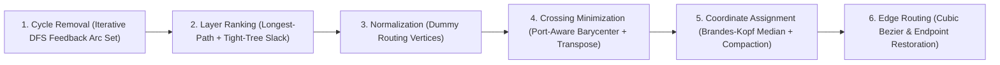

# How-To & Reference: Layered Graph Layout Engine (`DotNodeViewer.Layout`)

`DotNodeViewer.Layout` is a pure C#, zero-UI-dependency layered directed-graph layout library implementing the Sugiyama/dagre pipeline alongside `ModelGraphLayoutAdapter` for converting `DotNodeViewer.Core` subgraphs into positioned visual node cards and routed cubic Bézier edges.

---

## Sugiyama Layout Pipeline Overview

`SugiyamaLayoutEngine` executes a six-stage deterministic pipeline:



1. **Aciclicity (Cycle Removal):** Performs an iterative (stack-safe) depth-first search to identify back-edges in cyclic graphs and temporarily reverses their direction during ranking and ordering, restoring their original `Source -> Target` orientation after coordinate assignment (`PositionedEdge.IsReversed = true`).
2. **Layer Assignment (Ranking):** Computes an initial topological longest-path ranking followed by an iteration-capped tight-tree slack-minimization pass that pulls source and intermediate nodes closer to their consumers.
3. **Normalization:** Splits long edges spanning multiple layers (`rankDelta > 1`) into unit-length segments connected through lightweight dummy routing vertices so long edges reserve horizontal channels across intermediate layers.
4. **Crossing Minimization:** Sweeps alternating top-down and bottom-up passes using port-aware barycenter weights combined with adjacent-exchange transposition to reduce edge crossings.
5. **Coordinate Assignment:** Runs directional Brandes–Köpf median alignment passes paired with 1D non-overlapping block compaction (`NodeSeparation` and `LayerSeparation`), straightening long dummy-vertex runs and balancing node positions across layers.
6. **Edge Routing:** Computes exact `PositionedPort` anchors, traces dummy-vertex chains into polyline `Points` and smooth `CubicBezierSegment` curves, and calculates midpoint `LabelAnchor` coordinates for tensor shape pills.

---

## Programmatic Usage: `ModelGraphLayoutAdapter`

Use `ModelGraphLayoutAdapter` to convert a `ModelGraph` or `Subgraph` from `DotNodeViewer.Core` into a `VisualSubgraphLayout`:

```csharp
using DotNodeViewer.Core.Abstractions;
using DotNodeViewer.Core.Ir;
using DotNodeViewer.Layout;

await using FileStream stream = File.OpenRead("model.onnx");
ModelGraph model = await ModelFormatRegistry.Default.ReadAsync(stream);

// Convert the primary Subgraph into a positioned VisualSubgraphLayout:
VisualSubgraphLayout visualLayout = ModelGraphLayoutAdapter.Default.CreateLayout(
    model,
    new LayoutOptions
    {
        Direction = LayoutDirection.TopToBottom,
        LayerSeparation = 48.0,
        NodeSeparation = 28.0,
    });

foreach (VisualNode node in visualLayout.Nodes)
{
    Console.WriteLine($"{node.Kind} '{node.Title}' at ({node.Bounds.X:F1}, {node.Bounds.Y:F1}) [{node.Bounds.Width:F1}x{node.Bounds.Height:F1}]");
    foreach (CollapsedParameterSlot param in node.CollapsedParameters)
    {
        Console.WriteLine($"  param {param.PortName}: {param.DisplaySummary}");
    }
}
```

### Netron-Style Graph Adaptation Rules

`ModelGraphLayoutAdapter` applies three domain-specific visual transformations before invoking `SugiyamaLayoutEngine`:

- **Initializer & Constant Collapsing:** Static weight tensors (`TensorKind.Initializer` and `TensorKind.Constant`) that are not produced by an operator node are collapsed into `CollapsedParameterSlot` rows inside each consumer node's visual card (`VisualNode.CollapsedParameters`) rather than cluttering the graph with standalone weight nodes.
- **Boundary Terminal Pills:** `Subgraph.Inputs` and `Subgraph.Outputs` are represented as compact `VisualNodeKind.GraphInput` and `VisualNodeKind.GraphOutput` terminal pills.
- **Fused Activation Badges:** Operator attributes such as TFLite's `fused_activation_function` (`RELU`, `RELU6`, `TANH`) are surfaced via `VisualNode.FusedActivationBadge` and factored into the node card's measured height.
- **Custom Text Measurement (`ITextMeasurer`):** Headless callers use `MonospaceTextMeasurer.Default`, while UI renderers (such as `DotNodeViewer.App`) supply a font-aware `ITextMeasurer` implementation so node box widths match rendered glyph metrics.

---

## Direct Usage: `SugiyamaLayoutEngine`

You can also use `SugiyamaLayoutEngine` directly on any custom `LayoutGraph` without `DotNodeViewer.Core`:

```csharp
using DotNodeViewer.Layout;

LayoutNode[] nodes =
[
    new LayoutNode("input", Width: 120, Height: 36, OutputPorts: [new LayoutPort("out")]),
    new LayoutNode("conv", Width: 180, Height: 64, InputPorts: [new LayoutPort("in")], OutputPorts: [new LayoutPort("out")]),
    new LayoutNode("output", Width: 120, Height: 36, InputPorts: [new LayoutPort("in")]),
];

LayoutEdge[] edges =
[
    new LayoutEdge("e0", "input", "conv", "out", "in", Label: "[1, 3, 224, 224]"),
    new LayoutEdge("e1", "conv", "output", "out", "in", Label: "[1, 64, 112, 112]"),
];

PositionedGraph positioned = SugiyamaLayoutEngine.Layout(new LayoutGraph(nodes, edges));
```
