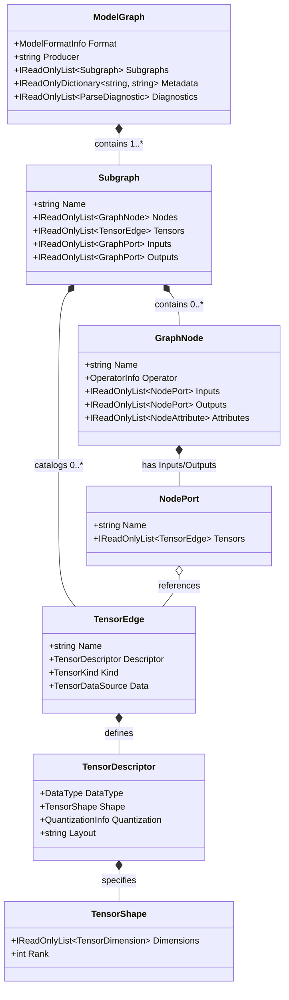

# Explanation & Reference: Unified Graph IR (`DotNodeViewer.Core`)

This article explains the design of `DotNodeViewer.Core`, the immutable **Unified Graph Intermediate Representation (IR)** in `DotNodeViewer.Core.Ir`, and how format detection, lazy weight slicing, and graph indexing work in `DotNodeViewer.Core.Abstractions`.

---

## Architectural Guardrails

`DotNodeViewer.Core` separates **format-specific binary framing** from **graph topology and semantics**:

1. **Zero UI or Layout Coupling:** `DotNodeViewer.Core` and `DotNodeViewer.Layout` never reference `Avalonia` or `SkiaSharp`. An MSBuild guardrail target (`ValidateNoUiDependenciesInCoreAndLayout`) enforces this boundary at compile time, and `PublicApiEncapsulationTests` verifies it at test time.
2. **Pure Immutable C# Record IR:** Every format reader projects its internal container structures into the immutable record hierarchy under `DotNodeViewer.Core.Ir`. Format-specific schemas (Protobuf wire readers, FlatBuffers tables, Pickle VMs, HDF5 headers, JSON DTOs) are strictly `internal`.
3. **Zero-Allocation Lazy Weight Slicing:** Rather than allocating `byte[]` or `float[]` arrays for raw tensor weights during graph extraction, format readers record a lightweight `TensorDataSlice(StreamOffset, ByteLength, DataType, Encoding)` and seek past the payload. Weights are loaded on demand via `TensorDataLoader` only when inspected.
4. **NativeAOT & WebAssembly Compatibility:** All public and internal code in `DotNodeViewer.Core` compiles with `IsAotCompatible=true` and `IsTrimmable=true` with zero warnings.

---

## The Unified Graph IR (`DotNodeViewer.Core.Ir`)



### 1. `ModelGraph` and `Subgraph`

- **`ModelGraph`** is the root record returned by `IModelFormatReader.ReadAsync`:
  - `Format` (`ModelFormatInfo`): Holds the canonical `ModelFormatId` (`onnx`, `tflite`, `executorch`, `pytorch`, `pytorch-pt2`, `keras`), human-readable `DisplayName`, and optional schema `Version`.
  - `Producer` (`string?`): Producer framework and version (for example, `"pytorch 2.6.0"`).
  - `Subgraphs` (`IReadOnlyList<Subgraph>`): All subgraphs in the model. `Subgraphs[0]` (also accessible via `graph.PrimarySubgraph`) is always the primary entry graph.
  - `Metadata` (`IReadOnlyDictionary<string, string>`): Key-value metadata properties extracted from the model header.
  - `Diagnostics` (`IReadOnlyList<ParseDiagnostic>`): Non-fatal informational notes or warnings (`DiagnosticSeverity.Info`, `Warning`, `Error`) emitted during parsing.
- **`Subgraph`** represents a directed computational graph:
  - `Name`: Subgraph identifier (e.g., `"main"` or `"forward"`).
  - `Nodes` (`IReadOnlyList<GraphNode>`): Ordered operator nodes.
  - `Tensors` (`IReadOnlyList<TensorEdge>`): Catalog of tensors in the subgraph.
  - `Inputs` and `Outputs` (`IReadOnlyList<GraphPort>`): External boundary ports of the subgraph.

### 2. `GraphNode`, `OperatorInfo`, and `NodeAttribute`

- **`GraphNode`** represents a single operator, layer, or lowered hardware delegate invocation:
  - `Name`: Node name within the subgraph.
  - `Operator` (`OperatorInfo`): Contains the format-specific operator `Name` (e.g., `"Conv"`, `"CONV_2D"`, `"aten::conv2d.out"`), semantic `OperatorCategory` (`Layer`, `Activation`, `Normalization`, `Pooling`, `Quantization`, `Shape`, `Tensor`, `Constant`, `ControlFlow`, `Data`, `Custom`, `Unknown`), optional `Domain`, and optional opset `Version`.
  - `Inputs` and `Outputs` (`IReadOnlyList<NodePort>`): Named input/output slots (`NodePort(string Name, IReadOnlyList<TensorEdge> Tensors)`), supporting both single-tensor and variadic ports.
  - `Attributes` (`IReadOnlyList<NodeAttribute>`): Strongly typed hyperparameter attributes.
- **`AttributeValue`** is a closed 13-case discriminated union avoiding `object` boxing:
  - Scalars: `AttributeValue.Int64`, `AttributeValue.Float64`, `AttributeValue.Bool`, `AttributeValue.String`
  - Homogeneous lists: `AttributeValue.Int64List`, `AttributeValue.Float64List`, `AttributeValue.StringList`
  - IR metadata values: `AttributeValue.DataTypeValue`, `AttributeValue.ShapeValue`, `AttributeValue.Tensor`
  - Nested control-flow subgraphs: `AttributeValue.Graph`, `AttributeValue.GraphList`
  - Lazy binary payloads (e.g., custom NPU delegate command streams): `AttributeValue.Bytes(TensorDataSlice Slice)`

### 3. `TensorEdge`, `TensorDescriptor`, and `TensorShape`

- **`TensorEdge`** represents a named tensor connection or weight buffer:
  - `Name`: Tensor identifier.
  - `Descriptor` (`TensorDescriptor`): Element `DataType`, `TensorShape?`, optional `QuantizationInfo`, and optional `Layout`.
  - `Kind` (`TensorKind`): Distinguishes runtime activations (`Activation`, `GraphInput`, `GraphOutput`) from static weights (`Initializer`, `Constant`) so downstream visualizers can collapse initializers into compact node parameter rows.
  - `Data` (`TensorDataSource?`): Optional lazy weight reference.
- **`TensorShape` and `TensorDimension`**:
  - `TensorDescriptor.Shape == null` indicates an **unranked** tensor.
  - `TensorDescriptor.Shape` with `Dimensions.Count == 0` (`TensorShape.Scalar`) indicates a **rank-0 scalar** tensor.
  - Each axis is a closed `TensorDimension` union case:
    - `TensorDimension.Fixed(long Value)` — static dimension (e.g., `224`).
    - `TensorDimension.Symbolic(string Name)` — named dynamic symbol (e.g., `"batch"` or `"s0"`).
    - `TensorDimension.Dynamic` — unnamed wildcard dimension (`?` / `-1`).

### 4. `QuantizationInfo` and `TensorDataSource`

- **`QuantizationInfo`** is a closed hierarchy attached to `TensorDescriptor.Quantization`:
  - `AffineQuantization(IReadOnlyList<float> Scale, IReadOnlyList<long> ZeroPoint, int? QuantizedDimension = null)` for per-tensor and per-channel linear quantization.
  - `BlockQuantization(string Scheme, int BlockSize, int Bits)` for block-wise quantized weights.
- **`TensorDataSource`** is a closed hierarchy attached to `TensorEdge.Data`:
  - `TensorDataSlice(long StreamOffset, long ByteLength, DataType DataType, TensorDataEncoding Encoding = TensorDataEncoding.Raw)` records the exact byte range in the model `Stream`.
  - `ExternalTensorDataReference(string RelativePath, long Offset, long? Length, DataType DataType)` records external shard location metadata without opening external files during stream parsing.

---

## Programmatic Usage Examples

### Parsing a Model Stream and Inspecting Topology (`ModelFormatRegistry` & `GraphIndex`)

```csharp
using DotNodeViewer.Core.Abstractions;
using DotNodeViewer.Core.Ir;

await using FileStream stream = new("model.onnx", FileMode.Open, FileAccess.Read, FileShare.Read);

// 1. Non-destructively probe format (stream.Position is automatically restored):
ModelFormatInfo? format = ModelFormatRegistry.Default.TryDetect(stream, "model.onnx");
Console.WriteLine($"Detected: {format?.ToDisplayString()}");

// 2. Parse graph topology (skipping raw weight payloads):
ModelGraph graph = await ModelFormatRegistry.Default.ReadAsync(
    stream,
    new ModelReadOptions { FileName = "model.onnx" });

Subgraph main = graph.PrimarySubgraph!;
GraphIndex index = new(main);

// 3. Query 1-hop upstream producers and downstream consumers for any node:
foreach (GraphNode node in main.Nodes)
{
    IReadOnlyList<GraphNode> upstream = index.GetUpstreamNodes(node);
    IReadOnlyList<GraphNode> downstream = index.GetDownstreamNodes(node);
    Console.WriteLine($"{node.Name} ({node.Operator.Name}): {upstream.Count} in -> {downstream.Count} out");
}
```

### Reading Lazy Tensor Weights On Demand (`TensorDataLoader`)

```csharp
using System.Buffers;
using DotNodeViewer.Core.Abstractions;
using DotNodeViewer.Core.Ir;

// Find an initializer tensor with an inline stream slice:
foreach (TensorEdge tensor in main.Tensors)
{
    if (tensor.Kind == TensorKind.Initializer && tensor.Data is TensorDataSlice slice)
    {
        // Read at most the first 256 bytes into a caller-supplied buffer with zero heap allocation:
        Span<byte> previewBuffer = stackalloc byte[(int)Math.Min(256, slice.ByteLength)];
        int bytesRead = TensorDataLoader.ReadSlice(stream, slice, previewBuffer);
        Console.WriteLine($"Read {bytesRead} bytes of '{tensor.Name}' from offset 0x{slice.StreamOffset:X}");
    }
}
```
