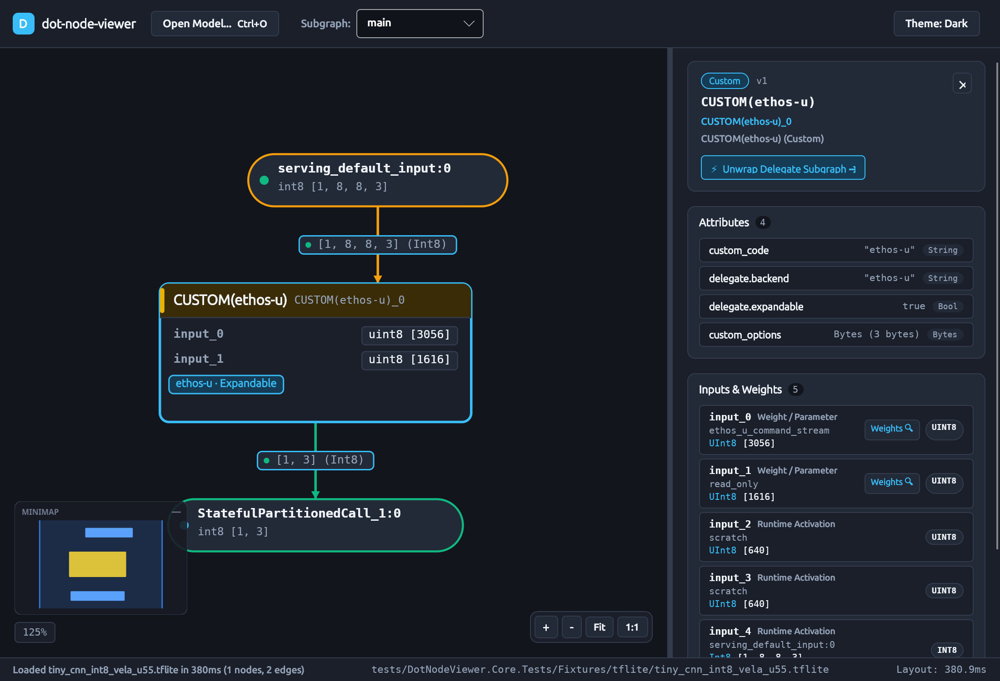
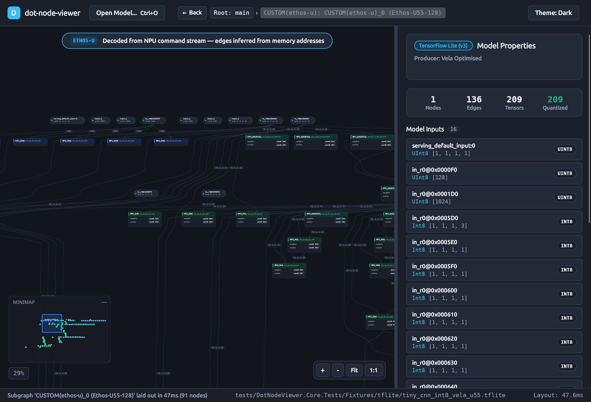
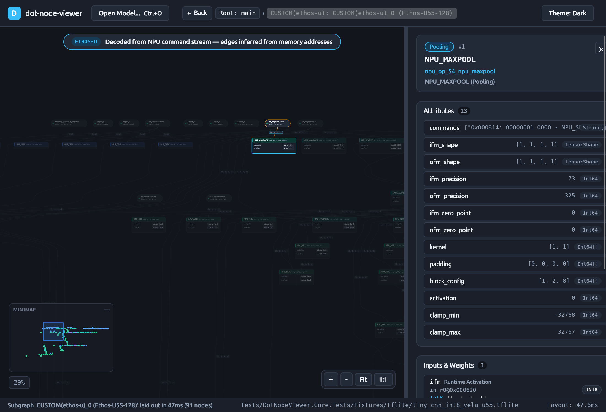

# How-To: Inspecting Arm Ethos-U Delegate Models

This guide shows you how to inspect, unwrap, and debug Arm Ethos-U compiled neural network models (`.tflite` compiled with Arm Vela, or `.pte` compiled with ExecuTorch `EthosUBackend`) using both the graphical visualizer (`DotNodeViewer.Desktop` / `DotNodeViewer.Browser`) and the CLI harness (`DotNodeViewer.Cli`).

---

## Prerequisites

- An Arm Ethos-U compiled model file (for example, `tiny_cnn_int8_vela_u55.tflite` or `tiny_cnn_ethosu55.pte`).
- `dot-node-viewer` visualizer or CLI installed.

---

## Inspecting in the Graphical Visualizer

### Step 1: Open the Model

Launch the desktop visualizer with the model path or open it from the UI:

```bash
dotnet run --project src/DotNodeViewer.Desktop -c Release -- path/to/model_vela_u55.tflite
```

### Step 2: Identify the Expandable Delegate Node

In the root graph, the collapsed delegate node displays an **`Ethos-U · Expandable`** badge pill. Selecting the node displays the model header card with the **`⚡ Unwrap Delegate Subgraph ➔`** action button:



### Step 3: Unwrap the Subgraph

You can unwrap the internal NPU execution graph in either of two ways:
1. Click **`⚡ Unwrap Delegate Subgraph ➔`** in the Properties Panel.
2. **Double-click** the delegate node directly on the Graph Canvas.

The visualizer decompiles the microcode stream, reconstructs operator boundaries and memory dataflow, and transitions into the synthesized NPU subgraph:



### Step 4: Review the Inferred Dataflow Banner

At the top of the canvas, the visualizer displays the notice banner:

> **ETHOS-U** — *Decoded from NPU command stream — edges inferred from memory addresses*

This indicates that connections between layers were synthesized by matching output feature map (`OFM`) memory addresses to subsequent input feature map (`IFM`) reads.

### Step 5: Inspect Hardware Registers & Microcode Disassembly

Click any synthesized NPU operation node (such as `npu_op_0_npu_conv` or `npu_op_1_npu_dma`) to view its hardware execution parameters in the Properties Panel:

- **Shape & Dimensions:** Input and output shapes, channel counts, and tensor sizes.
- **Hardware Config:** Kernel size, strides, dilations, padding, and NPU block configuration (`block_config`).
- **Quantization:** Zero points and datatype precision (`INT8` / `INT16`).
- **NPU Command Disassembly:** A dedicated monospace listing displaying byte offsets, hex opcodes, and mnemonic descriptions for all commands that configured and triggered this operation:



### Step 6: Navigate Back to the Parent Graph

To return to the parent model graph:
- Click the **`← Back`** button in the top navigation toolbar.
- Click any ancestor segment in the breadcrumb trail (`Root: main`).
- Press the **`Escape`** key on the keyboard.

---

## Inspecting via the Command-Line Interface (CLI)

The CLI provides fast inspection and full command disassembly without launching the graphical desktop.

### 1. Model Inspection with Delegate Summary

To inspect high-level model architecture and include expanded delegate metrics:

```bash
dotnet run --project tools/DotNodeViewer.Cli -c Release -- inspect model_vela_u55.tflite --expand-delegates
```

**Output:**
```text
Format:    TensorFlow Lite v3 (tflite)
Producer:  Vela Optimised
Subgraphs: 1

Subgraph [0] 'main':
  Nodes:   1
  Tensors: 5
  Inputs:  1
    - serving_default_input:0: Int8 [1, 8, 8, 3]
  Outputs: 1
    - StatefulPartitionedCall_1:0: Int8 [1, 3]

  [Delegate Expansion] 'CUSTOM(ethos-u)_0' (ethos-u) -> CUSTOM(ethos-u)_0 (Ethos-U55-128):
    Synthesized Nodes:   91
    Synthesized Tensors: 209
    DMA Operations:      19
    Operator Distribution:
      - NPU_MUL: 27
      - NPU_MAXPOOL: 21
      - NPU_DMA: 19
      - NPU_SUB: 6
      - NPU_ADD: 5
      ...
```

### 2. Microcode Disassembly (`cmdstream`)

To dump the full linear disassembly trace of the NPU hardware command stream:

```bash
dotnet run --project tools/DotNodeViewer.Cli -c Release -- cmdstream model_vela_u55.tflite
```

**Sample Disassembly Trace:**
```text
0x000000:          0001 - NPU_SET_IFM_REGION
0x000004: 00000100 0000 - NPU_SET_IFM_BASE0
0x00000C: 00000000 0000 - NPU_SET_IFM_BASE1
0x000014: 00000000 0000 - NPU_SET_IFM_BASE2
0x00001C:          0001 - NPU_SET_OFM_REGION
0x000020: 00000400 0000 - NPU_SET_OFM_BASE0
0x000028: 00070007 0000 - NPU_SET_IFM_HEIGHT0_M1
0x000030: 00070007 0000 - NPU_SET_IFM_WIDTH0_M1
0x000038: 00020002 0000 - NPU_SET_IFM_DEPTH_M1
0x000040:          0000 - NPU_OP_CONV
...
```
