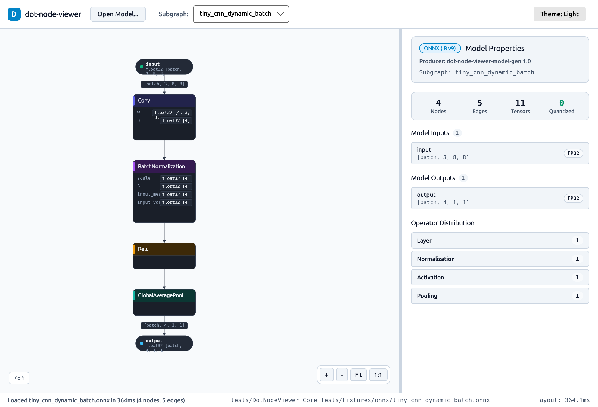

# How-To Guide: Using the `dot-node-viewer` Desktop Visualizer

This guide walks through using the cross-platform `dot-node-viewer` desktop visualizer (`DotNodeViewer.Desktop`) to open neural network models, navigate layered computational graph topologies on the interactive canvas, inspect node attributes and weights, review tensor dimensions and quantization schemes, and toggle between dark and light themes.

---

## 1. Launching the Application

You can launch the desktop application directly with the .NET CLI or by passing a model file path as a command-line argument.

### 1.1 Empty State Launch

To launch the visualizer in its clean empty state:

```bash
dotnet run --project src/DotNodeViewer.Desktop -c Release
```

The application opens with an inviting empty-state card offering drag-and-drop targeting, a file browser button, recent model shortcuts, and a summary of supported model formats.


### 1.2 Direct Model Launch

Pass the relative or absolute path of an ONNX (`.onnx`) or TensorFlow Lite (`.tflite`) file directly to the executable:

```bash
# Launch with an ONNX model
dotnet run --project src/DotNodeViewer.Desktop -c Release -- tests/DotNodeViewer.Core.Tests/Fixtures/onnx/tiny_cnn_dynamic_batch.onnx

# Launch with a quantized TensorFlow Lite model
dotnet run --project src/DotNodeViewer.Desktop -c Release -- tests/DotNodeViewer.Core.Tests/Fixtures/tflite/tiny_cnn_int8.tflite
```

The application immediately streams the model on a background thread, extracts the Unified Graph IR, runs the layered layout engine, and presents the interactive graph topology.

---

## 2. Navigating the Interactive Graph Canvas

When a model is opened, `dot-node-viewer` displays the graph topology on a high-performance custom `GraphCanvas` control.


### 2.1 Pan and Zoom Navigation
- **Pan:** Click and drag anywhere on empty canvas space, drag with middle-mouse button, or two-finger scroll on trackpads.
- **Zoom Around Cursor:** Hold `Ctrl` and scroll the mouse wheel, pinch on trackpads, or use the mouse wheel directly.
- **Floating HUD Controls:** Located in the bottom-right corner of the canvas:
  - `+`: Zoom in by 25%.
  - `-`: Zoom out by 20%.
  - `Fit`: Automatically scale and center the entire graph to fit the viewport.
  - `1:1`: Reset zoom to 100% scale.
- **Zoom Percentage Indicator:** Displayed in the bottom-left pill indicator (e.g. `100%`, `75%`).

### 2.2 Semantic Operator Nodes
Each operator node is rendered as a clean rounded card styled according to the design system:
- **Category Header Band:** Coded with distinct, colorblind-safe semantic hues (`Layer`, `Activation`, `Normalization`, `Pooling`, `Quantization`, etc.).
- **Operator Title:** Bold operator name (e.g., `Conv`, `Relu`, `Gemm`).
- **Node Name Subtitle:** Exact scoped node identifier in the model (e.g., `/model/layers.0/conv`).
- **Collapsed Parameter Rows:** Static single-consumer weights and biases (like convolutional kernel filters or dense weights) are rendered directly inside the node card with compact shape pills (e.g., `W · float32 [64, 3, 3, 3]`), reducing visual clutter while keeping key dimensions accessible.
- **Fused Activation Badges:** When an operator carries a fused non-linearity (such as `+ RELU`), it is highlighted with an amber badge.

### 2.3 Routed Tensor Edges & Quantization Indicators
- **Cubic Bézier Splines:** Smooth curve routing with directional arrowheads indicating dataflow direction.
- **Midpoint Shape Pills:** At medium and high zoom levels, activation tensor shapes (such as `[batch, 64, 112, 112]`) are rendered directly along the edge.
- **Quantization Indicators:** Edges carrying quantized integer data (`INT8` / `UINT8`) feature an emerald green accent stroke and an emerald indicator badge, highlighting hardware-accelerated datatypes.

---

## 3. Contextual Properties Sidebar (v1)

The right sidebar updates contextually based on the active selection:

### 3.1 Graph Overview (No Selection)
When no node is selected, the sidebar displays model-level telemetry:
- **Format & Producer:** Container format badge (e.g., `ONNX (IR v9)` or `TensorFlow Lite (v3)`) and producer string.
- **Model Metrics:** Total nodes, edges, tensors, and quantized tensors.
- **Model Inputs & Outputs:** Formal names, shapes, and quantization badges (`INT8`, `FP32`, `FP16`, `INT4`) with scale and zero-point parameters.
- **Operator Category Distribution:** Summary breakdown across categories.

### 3.2 Node Inspector (Node Selected)
Clicking any node on the canvas selects it with a glowing accent border and opens the Node Inspector:


- **Operator Title & Category:** Heading showing the operator name and category badge.
- **Metadata:** Domain and opset/schema version.
- **Typed Attributes:** Lists declared operator attributes (such as `strides`, `pads`, `kernel_shape`, `dilations`, `group`) with their native types (`Int64[]`, `Float64`, `String`, `TensorShape`).
- **Inputs & Weights:** Distinguishes runtime activation inputs from static initializers and weights, displaying shapes, data types, and affine quantization parameters.
- **Outputs:** Shows all output tensors produced by the operator.
- **Deselection:** Click the `✕` button or click on empty canvas to return to the Graph Overview.

---

## 4. Quantized Models Inspection

When opening quantized models such as TensorFlow Lite `INT8` networks, `dot-node-viewer` provides dedicated telemetry:


- Quantized weights display emerald `Q` / `INT8` badges.
- Scale factors and zero-point offsets are presented in tabular notation.
- Quantized edge dataflow is visibly differentiated from floating-point tensors.

---

## 5. Theme Switching (Dark & Light)

Toggle themes at any time using the `Theme` button in the top toolbar:

- **Dark Theme (Default):** Deep graphite background (`#12151B`) with high-contrast text (`#F1F5F9`).
- **Light Theme:** Clean porcelain background (`#F8FAFC`) with titanium boundaries and high-legibility navy text (`#0F172A`).


