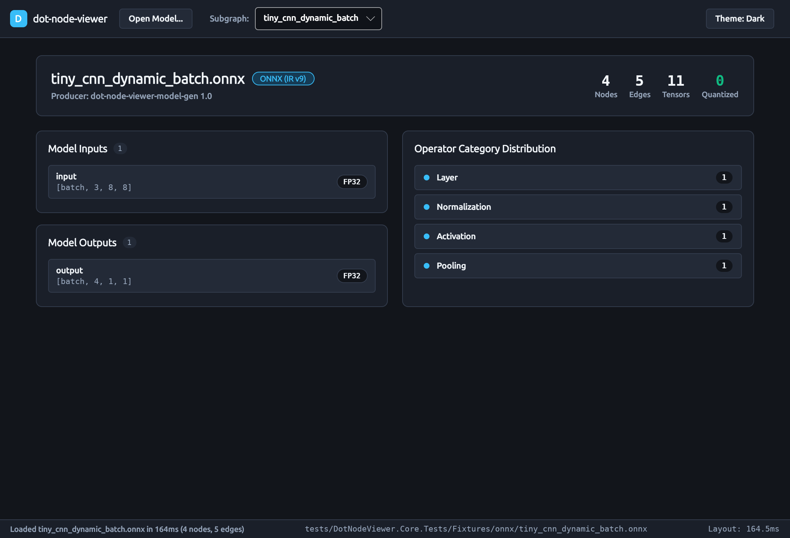
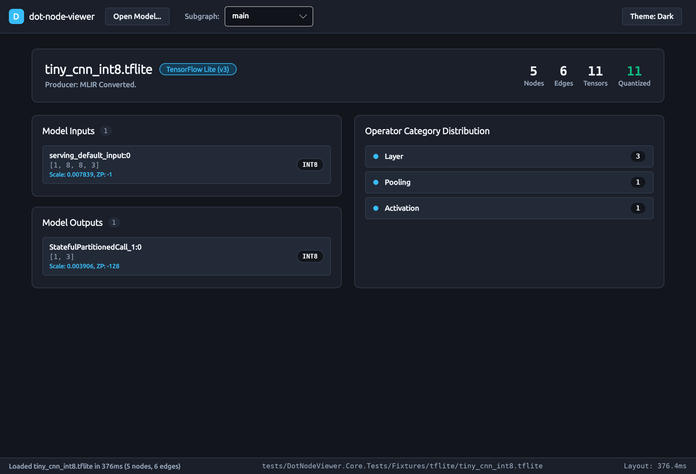
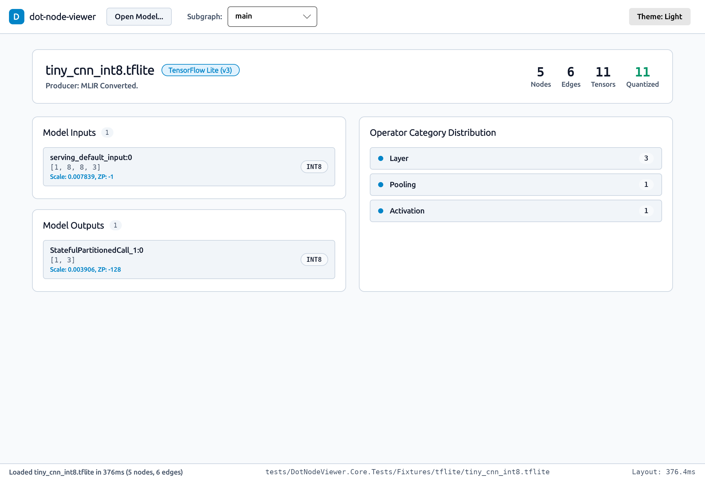

# How-To Guide: Using the `dot-node-viewer` Desktop Visualizer

This guide walks through using the cross-platform `dot-node-viewer` desktop visualizer (`DotNodeViewer.Desktop`) to open neural network models, inspect high-level graph telemetry, review tensor dimensions and quantization schemes, and toggle between dark and light themes.

---

## 1. Launching the Application

You can launch the desktop application directly with the .NET CLI or by passing a model file path as a command-line argument.

### 1.1 Empty State Launch

To launch the visualizer in its clean empty state:

```bash
dotnet run --project src/DotNodeViewer.Desktop -c Release
```

The application opens with an inviting empty-state card offering drag-and-drop targeting, a file browser button, recent model shortcuts, and a summary of supported model formats.


### 1.2 Direct Model Launch

Pass the relative or absolute path of an ONNX (`.onnx`) or TensorFlow Lite (`.tflite`) file directly to the executable:

```bash
# Launch with an ONNX model
dotnet run --project src/DotNodeViewer.Desktop -c Release -- tests/DotNodeViewer.Core.Tests/Fixtures/onnx/tiny_cnn_dynamic_batch.onnx

# Launch with a quantized TensorFlow Lite model
dotnet run --project src/DotNodeViewer.Desktop -c Release -- tests/DotNodeViewer.Core.Tests/Fixtures/tflite/tiny_cnn_int8.tflite
```

The application immediately streams the model on a background thread, extracts the Unified Graph IR, runs the layered layout engine, and presents the loaded model overview.

---

## 2. Opening Models from Within the App

`dot-node-viewer` supports three convenient methods to load neural network binaries:

1. **Top Toolbar "Open Model..." Button:** Click the `Open Model...` button in the upper-left corner of the window to open a native platform file picker filtered to `*.onnx` and `*.tflite` files.
2. **Drag-and-Drop:** Drag any supported model file directly from your system file manager (e.g., Nautilus, Finder, Windows Explorer) and drop it anywhere onto the window surface.
3. **Quick Samples & Recent Models List:** In the empty state, click any entry in the recent models list to immediately load that fixture.

---

## 3. Inspecting Loaded Model Telemetry

When a model is opened, `dot-node-viewer` displays an architectural telemetry card providing an immediate structural sanity check.



### 3.1 Model Header & Key Metrics

The top banner of the overview card summarizes:

- **Model Name & Format:** Canonical model filename, container format badge (e.g., `ONNX (IR v9)` or `TensorFlow Lite (v3)`), and producer string.
- **Node Count:** Total number of computation nodes across the primary subgraph.
- **Edge Count:** Total number of routed dataflow edges between operators.
- **Tensor Count:** Total number of intermediate activations, parameters, and boundary tensors.
- **Quantized Tensors:** Total number of tensors with quantized integer representations (highlighted in emerald green for fast hardware-acceleration verification).

### 3.2 Model Inputs & Outputs

The left column lists all external boundary tensors feeding into or produced by the model:

- **Name:** Formal input or output identifier name.
- **Shape:** Bracketed dimension specification formatted with tabular digits (e.g., `[batch, 3, 8, 8]` for dynamic batch dimensions or `[1, 224, 224, 3]` for fixed shapes).
- **Quantization Scheme Badges:**
  - `INT8` / `UINT8`: Quantized integer tensor. When per-tensor or per-channel affine quantization is present, scale factors and zero-point offsets are displayed directly below the shape.
  - `FP32`: Standard single-precision floating-point tensor.
  - `FP16` / `BF16`: Half-precision or Brain floating-point tensor.
  - `INT4`: Sub-byte integer quantized weights.



### 3.3 Operator Category Distribution

The right column groups all operator nodes in the subgraph by semantic category:

- **`Layer`:** Dense, Conv2D, Gemm, MatMul
- **`Activation`:** Relu, Gelu, Sigmoid, HardSwish
- **`Normalization`:** BatchNorm, LayerNorm, RMSNorm
- **`Pooling`:** MaxPool, AveragePool, GlobalAveragePool
- **`Quantization`:** QuantizeLinear, DequantizeLinear
- **`Shape`:** Reshape, Transpose, Squeeze, Flatten
- **`Tensor`:** Concat, Split, Slice, Gather

Each category features a colorblind-safe semantic badge and an exact node count.

---

## 4. Theme Switching (Dark & Light)

`dot-node-viewer` includes a dual theme engine designed around precision instrumentation palettes:

- **Dark Theme (Default):** Deep graphite background (`#12151B`) with high-contrast text (`#F1F5F9`) to minimize eye fatigue.
- **Light Theme:** Clean porcelain background (`#F8FAFC`) with crisp titanium boundaries and high-legibility navy text (`#0F172A`).

Click the **Theme: Dark** / **Theme: Light** button in the upper-right corner of the toolbar at any time to toggle themes dynamically without reloading the model.



---

## 5. Diagnostic & Error States

If an unsupported, truncated, or corrupt binary is opened, `dot-node-viewer` surfaces a diagnostic error banner:

- Explains the exact failure in plain language.
- Reports the byte offset in the file where deserialization failed (e.g., `0x00000042`).
- Details the container context (e.g., unexpected Protobuf tag or corrupt FlatBuffers vtable).
- Provides an action button to dismiss the banner and try another file.
