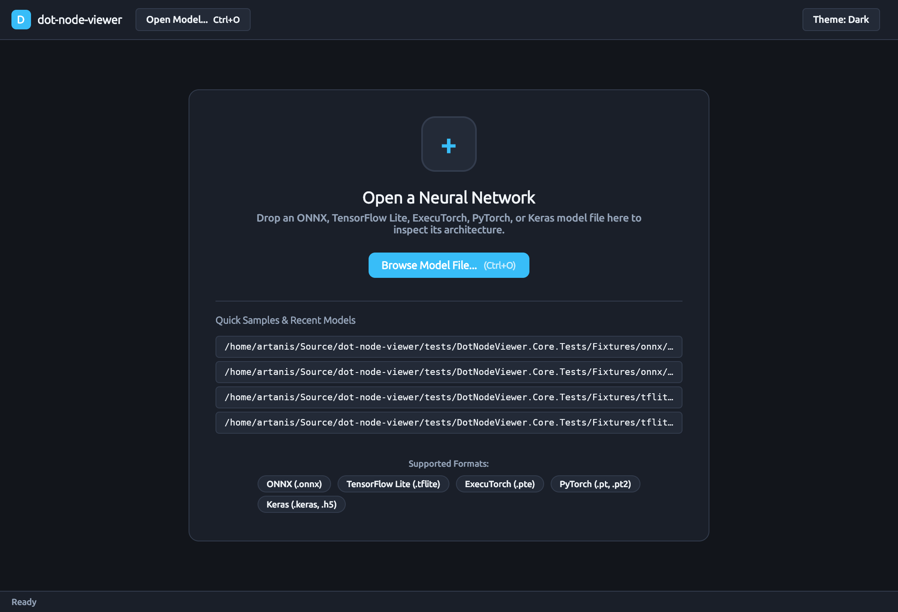

# How-To Guide: Using the `dot-node-viewer` Desktop Visualizer

This guide walks through using the cross-platform `dot-node-viewer` desktop visualizer (`DotNodeViewer.Desktop`) to open neural network models, navigate layered computational graph topologies, inspect on-demand weights and quantization schemes, drill down into nested subgraphs, search operators and tensors, and analyze model architecture telemetry.

---

## 1. Launching the Application

You can launch the desktop application directly with the .NET CLI or by passing a model file path as a command-line argument.

### 1.1 Empty State Launch

To launch the visualizer in its clean empty state:

```bash
dotnet run --project src/DotNodeViewer.Desktop -c Release
```

The application opens in an empty state with a drop target area, a file browser button, standard keyboard shortcuts (`Ctrl+O` / `Cmd+O`), recent model shortcuts, and supported format indicators.



### 1.2 Direct Model Launch

Pass the relative or absolute path of any supported neural network model (`.onnx`, `.tflite`, `.pte`, `.pt`, `.pt2`, `.keras`, `.h5`) directly to the executable:

```bash
# Launch with an ONNX model
dotnet run --project src/DotNodeViewer.Desktop -c Release -- tests/DotNodeViewer.Core.Tests/Fixtures/onnx/if_subgraph.onnx

# Launch with a quantized TensorFlow Lite model
dotnet run --project src/DotNodeViewer.Desktop -c Release -- tests/DotNodeViewer.Core.Tests/Fixtures/tflite/tiny_cnn_int8.tflite

# Launch with an ExecuTorch delegated model
dotnet run --project src/DotNodeViewer.Desktop -c Release -- tests/DotNodeViewer.Core.Tests/Fixtures/executorch/tiny_cnn_xnnpack.pte
```

The application streams the model on a background thread, extracts the Unified Graph IR, runs the layered layout engine, and presents the graph topology.

### 1.3 Drag-and-Drop Model Loading

Supported neural network models can be dragged directly onto the application window or browser canvas at any time—both in the initial empty state and when an existing model is already open:

- **Drop Target Overlay:** Dragging a file over the window displays a drop target overlay indicating that the window is ready to accept the file, along with format validation feedback.
- **Format Validation:** As candidate files are dragged over the window, their extensions are checked against supported formats (`.onnx`, `.tflite`, `.pte`, `.pt`, `.pt2`, `.keras`, `.h5`). Supported files enable the drop target; unsupported files display a format warning message.
- **Multi-File & Sidecar Handling:** When an ONNX model definition and its companion external weight file (e.g. `model.onnx` and `model.onnx.data`) are dropped together, the visualizer loads the `.onnx` graph definition while resolving external tensor data references relative to the model directory.
- **Directory Drops:** Dropping a directory scans for the first primary neural network model file within that folder.
- **Dismissal:** Pressing `Escape` or dragging the pointer outside the window cancels the drop operation and restores the prior view.


*Figure 1: Drop target overlay displayed when dragging a supported model file.*


*Figure 2: Validation warning displayed when dragging an unsupported file format.*

---

## 2. Navigating the Interactive Graph Canvas

When a model is opened, `dot-node-viewer` renders the graph topology using the custom `GraphCanvas` control.


### 2.1 Pan and Zoom Navigation
- **Pan:** Click and drag anywhere on empty canvas space, drag with middle/right mouse button, use keyboard arrow keys (`Left`, `Right`, `Up`, `Down`), or two-finger scroll on trackpads.
- **Zoom Around Cursor:** Hold `Ctrl` and scroll the mouse wheel, pinch on trackpads, or use `Ctrl` + `+` / `Ctrl` + `-`.
- **Keyboard Shortcuts:**
  - `Ctrl+O` / `Cmd+O`: Open a new model via the platform file picker.
  - `Ctrl+F` / `Cmd+F`: Open fast categorized search and jump to matching nodes.
  - `F` or `Ctrl+0` / `Cmd+0`: Zoom to fit the entire graph into the visible canvas.
  - `Ctrl` + `+` / `Ctrl` + `-` (or `Cmd` + `+` / `Cmd` + `-`): Zoom in and out.
  - `Tab` / `Shift+Tab`: Cycle focus through nodes in topological order.
  - `Up` / `Down`: Navigate to immediate predecessor or successor nodes along dataflow edges.
  - `Escape`: Clear current selection or close open search/inspect panels.
- **HUD Controls:** Located in the bottom-right corner of the canvas (`+`, `-`, `Fit`, `1:1`).

### 2.2 Semantic Operator Nodes
Each operator node displays its functional classification, operator type, and instance identifier:
- **Category Header Band:** Indicates the operator category (`Layer`, `Activation`, `Normalization`, `Pooling`, `Quantization`, etc.).
- **Operator Title:** Bold operator name (e.g., `Conv`, `Relu`, `Gemm`).
- **Node Name Subtitle:** Exact scoped node identifier in the model (e.g., `/model/layers.0/conv`).
- **Collapsed Parameter Rows:** Static single-consumer weights and biases (like convolutional kernel filters or dense weights) are rendered directly inside the node card with shape callouts (e.g., `W · float32 [64, 3, 3, 3]`), keeping key dimensions accessible without navigating away.
- **Fused Activation Badges:** Operators with fused non-linearities (such as `+ RELU`) display a fused operator badge.

### 2.3 1-Hop Neighborhood Highlighting & Dimming
Selecting any node on the canvas highlights its immediate upstream predecessors and downstream successors:
- **Predecessor Edges & Ports:** Highlighted with an amber indicator.
- **Successor Edges & Ports:** Highlighted with an emerald indicator.
- **Unrelated Branches:** Non-adjacent nodes and edges fade to 25% opacity to clarify dataflow in complex or branched graphs.


### 2.4 Graph Minimap
The collapsible minimap in the bottom-left corner displays an overview silhouette of the graph layout:
- **Viewport Rectangle:** Indicates visible canvas bounds within the larger graph.
- **Interactive Dragging:** Click or drag inside the minimap to pan the canvas to that region.
- **Toggle Button:** Click `Minimap` in the header bar to collapse or expand the overlay.


---

## 3. Fast Categorized Search & Filter

Press `Ctrl+F` or click the **Search** icon in the toolbar to activate the instant search panel.


- **Instant Matching:** Filters across:
  - **Node Identifiers:** Exact node names and scoped instance paths (e.g. `conv_0`, `/backbone/layer1`).
  - **Operator Types:** Canonical op names (e.g. `Conv`, `BatchNormalization`, `Relu`).
  - **Operator Categories:** Functional groupings (e.g. `Activation`, `Layer`, `Tensor`).
  - **Tensor Names:** Inputs, outputs, and intermediate activation tensors.
- **Direct Jump:** Use arrow keys or mouse click to select a search result; the canvas smoothly centers on the target node and selects it.

---

## 4. On-Demand Tensor Weight Inspector

To inspect numerical weights without paying eager allocation costs on model load, `dot-node-viewer` lazily reads slices on demand.


### 4.1 Inspecting Initializer & Weight Payloads
1. Click any node containing weights (such as a Convolution or Dense layer).
2. In the right-hand **Properties Panel**, locate the input tensor in the **Inputs & Weights** section.
3. Click the **Inspect Weights** button next to the tensor.
4. The embedded inspector panel decodes up to 64 KB of raw tensor values directly from the model stream.

### 4.2 Inspector Telemetry & Formats
- **Metadata:** Displays data type (e.g., `Float32`, `Float16`, `BFloat16`, `Int8`, `UInt8`), shape dimensions, element count, and stream byte range (`Offset`, `ByteLength`).
- **Summary Statistics:** Computes minimum, maximum, mean, percentage of zero values, and NaN / Infinity counts across the sampled window.
- **Raw vs. Dequantized Preview:** For quantized tensors (`INT8`, `UINT8`), displays both raw stored integer bytes and affine-dequantized real values based on the tensor's scale and zero-point parameters.
- **External Shards:** For models utilizing external weight binaries (such as ONNX external data or PyTorch `.pt` ZIP archives), displays external file path references safely.

---

## 5. Subgraph Breadcrumb Drill-Down

Modern models frequently embed control-flow blocks (`If` branches, `Loop` bodies, or submodules).


- **Drill-Down Trigger:** In the Properties Panel under **Attributes**, attributes containing nested subgraphs offer a **Drill Down** button.
- **Breadcrumb Navigation:** The header displays the active path hierarchy (e.g., `Root: main > If_0: then_branch`).
- **Parent Traversal:** Click any parent breadcrumb item or press the **< Back** button to ascend one level.

---

## 6. Architecture & Telemetry Bar

The top status bar provides at-a-glance architecture metrics for the active graph:
- **Total Parameters:** Parameter count (e.g., `2.4M params`).
- **Memory Footprint:** Uncompressed weight volume (e.g., `9.6 MB`).
- **Precision Distribution:** Breakdown across precision formats (`INT8`, `FP32`, `FP16`, `BF16`).
- **Hardware Delegates:** Highlights hardware acceleration delegates (e.g., `XNNPACK (2 blocks)`).
- **Diagnostics Warning Drawer:** If non-fatal anomalies occur during model parsing, an amber diagnostic pill indicates the warning count; clicking it opens a drawer detailing each diagnostic with file byte offsets and node context.

---

## 7. Theme Switching (Dark & Light)

Toggle themes at any time using the `Theme` button in the top toolbar:


- **Dark Theme (Default):** Dark interface palette optimized for reduced eye strain in low-light environments.
- **Light Theme:** High-contrast light interface palette suited for well-lit environments.
