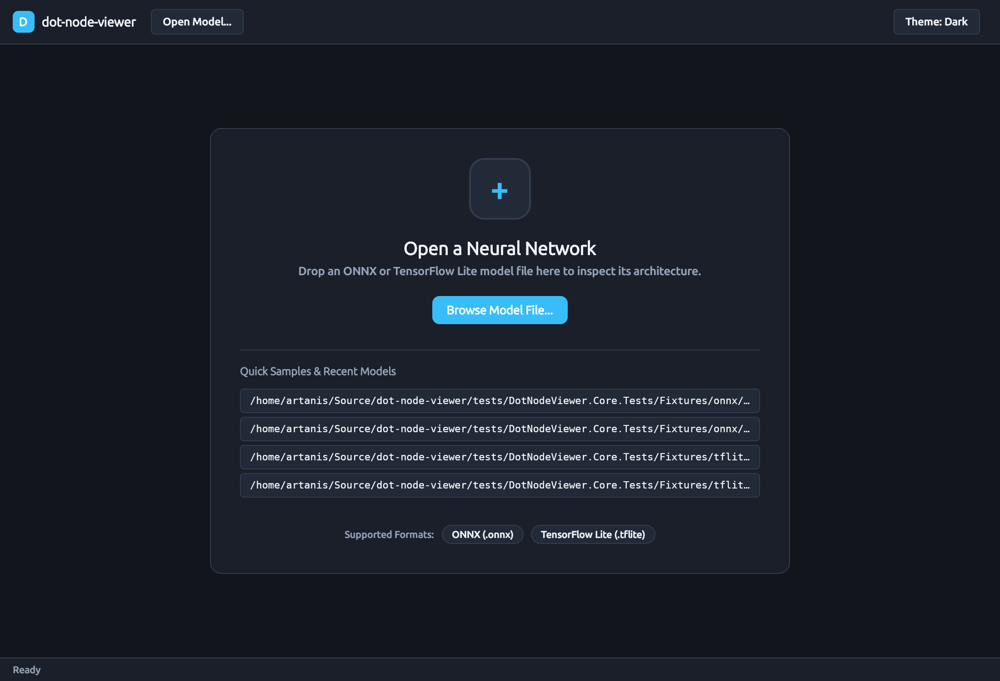
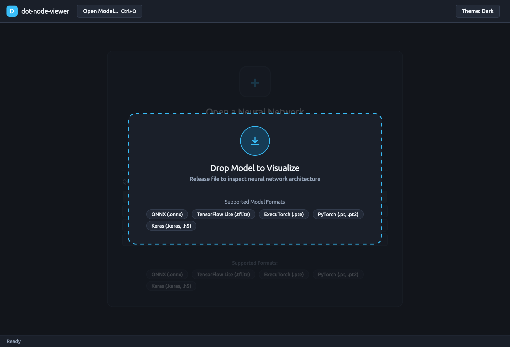
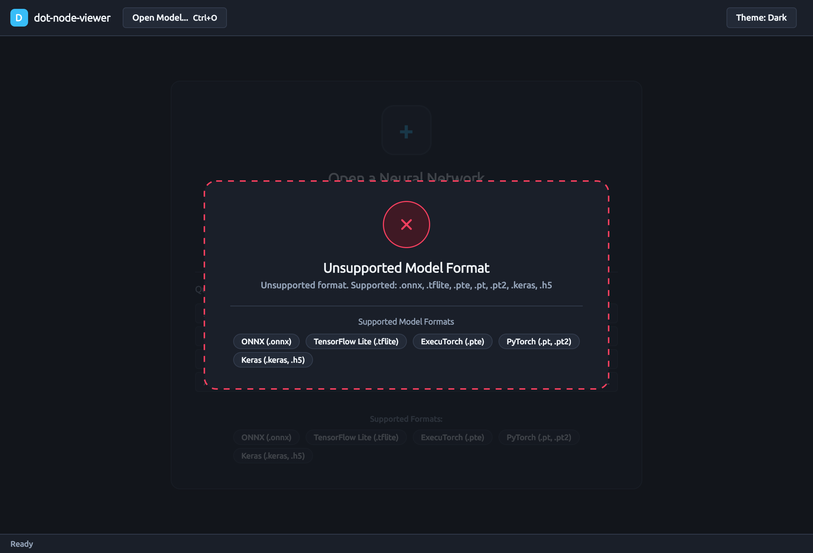
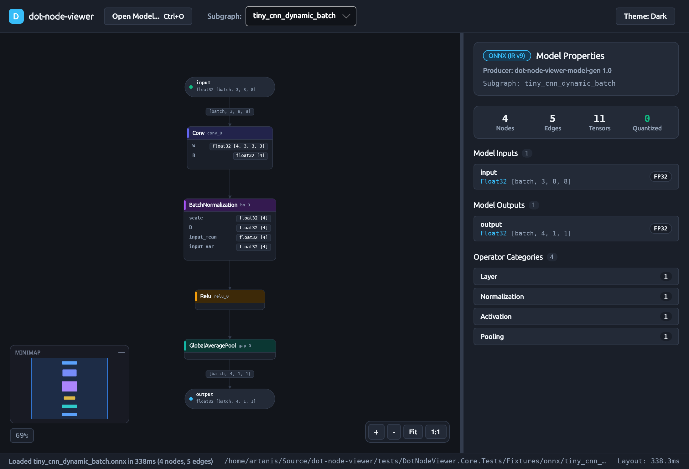
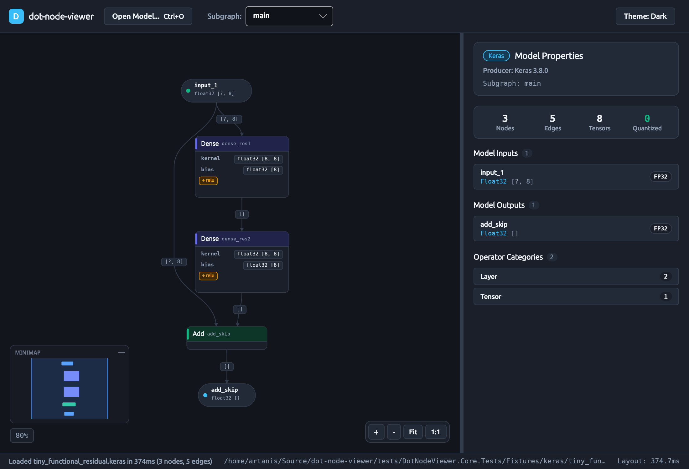
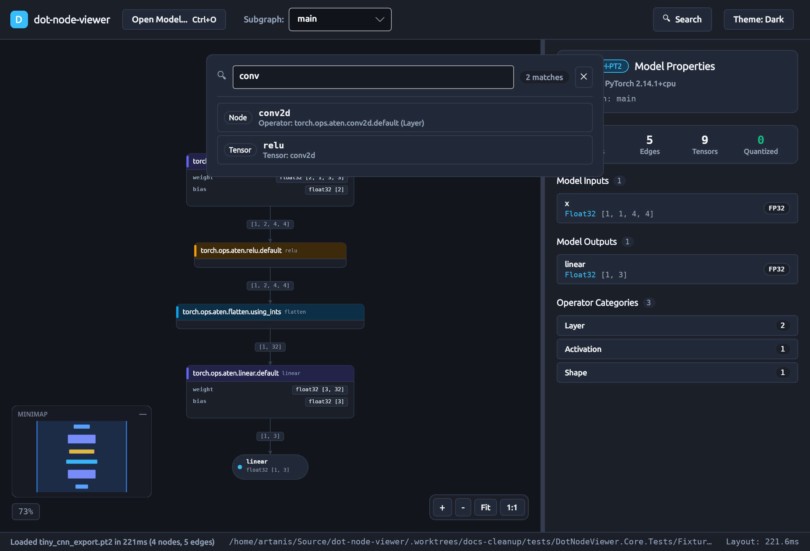
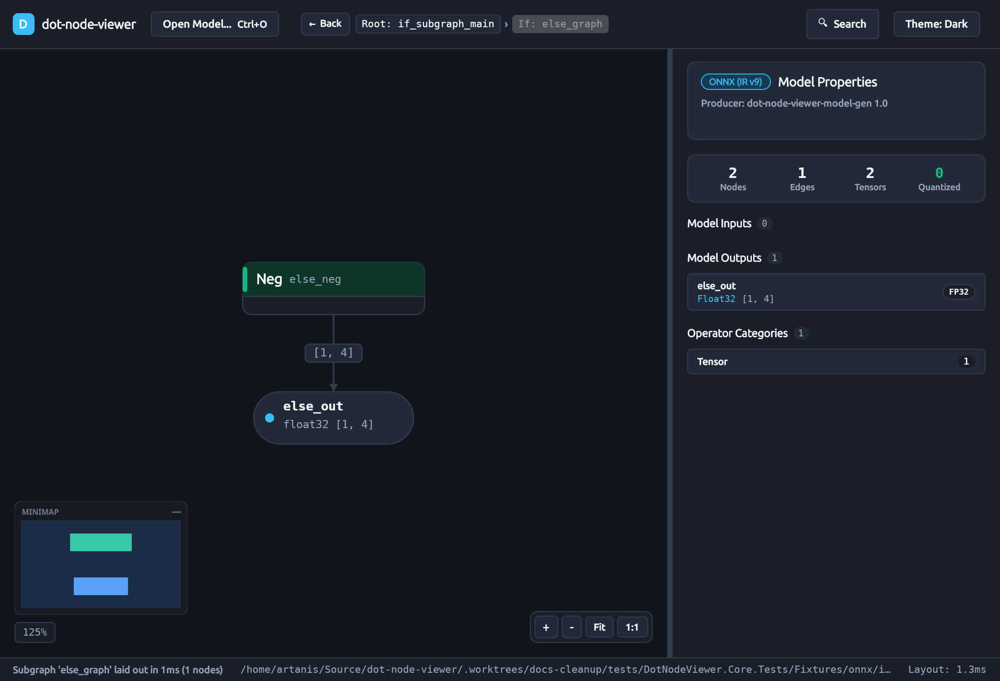
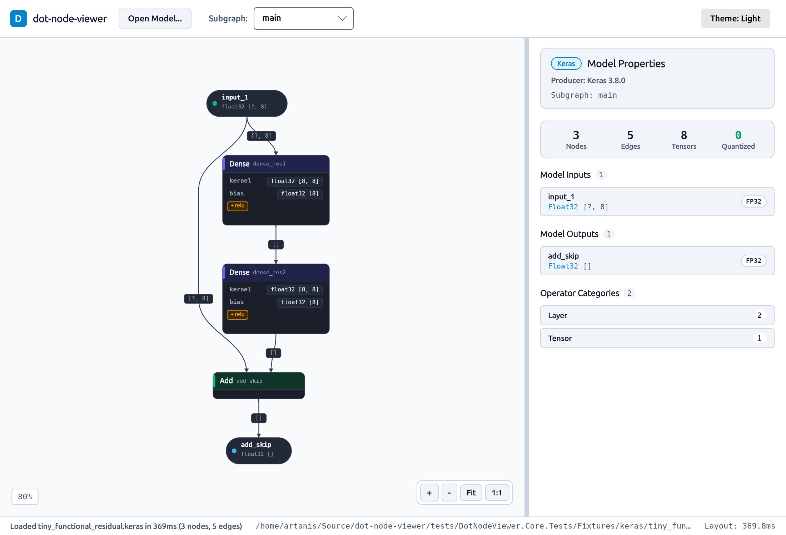

# How-To Guide: Using the `dot-node-viewer` Desktop Visualizer

This guide walks through using the cross-platform `dot-node-viewer` desktop visualizer (`DotNodeViewer.Desktop`) to open neural network models, navigate layered computational graph topologies, inspect on-demand weights and quantization schemes, drill down into nested subgraphs, search operators and tensors, and analyze model architecture telemetry.

---

## 1. Launching the Application

You can launch the desktop application directly with the .NET CLI or by passing a model file path as a command-line argument.

### 1.1 Empty State Launch

To launch the visualizer in its clean empty state:

```bash
dotnet run --project src/DotNodeViewer.Desktop -c Release
```

The application opens with an inviting empty-state card offering drag-and-drop targeting, a file browser button, keyboard shortcuts (`Ctrl+O` / `Cmd+O`), recent model shortcuts, and a summary of supported model formats.



### 1.2 Direct Model Launch

Pass the relative or absolute path of any supported neural network model (`.onnx`, `.tflite`, `.pte`, `.pt`, `.pt2`, `.keras`, `.h5`) directly to the executable:

```bash
# Launch with an ONNX model
dotnet run --project src/DotNodeViewer.Desktop -c Release -- tests/DotNodeViewer.Core.Tests/Fixtures/onnx/if_subgraph.onnx

# Launch with a quantized TensorFlow Lite model
dotnet run --project src/DotNodeViewer.Desktop -c Release -- tests/DotNodeViewer.Core.Tests/Fixtures/tflite/tiny_cnn_int8.tflite

# Launch with an ExecuTorch delegated model
dotnet run --project src/DotNodeViewer.Desktop -c Release -- tests/DotNodeViewer.Core.Tests/Fixtures/executorch/tiny_cnn_xnnpack.pte
```

The application immediately streams the model on a background thread, extracts the Unified Graph IR, runs the layered layout engine, and presents the interactive graph topology.

### 1.3 Drag-and-Drop Model Loading

You can drag and drop any supported model directly onto the application window or browser canvas at any time—both when in the initial empty welcome state and when an existing model is open on the canvas:

- **Visual Drop Overlay:** Dragging a file over the window triggers a high-contrast visual drop target overlay featuring a semi-transparent scrim, a dashed neon accent border, a glowing drop symbol, and active format badge pills.
- **Pre-Drop Format Validation:** As you hover over the window, candidate file extensions are validated. Supported formats (`.onnx`, `.tflite`, `.pte`, `.pt`, `.pt2`, `.keras`, `.h5`) activate the drop target with a `Copy` (+) cursor. Dropping unrecognized file types displays an amber/red warning banner (`Unsupported format`) and sets the cursor effect to `None` (🚫).
- **Multi-File & Sidecar Handling:** When dragging multiple files together (e.g. an ONNX model split into `model.onnx` and companion `model.onnx.data` external weight shards), the visualizer automatically identifies the `.onnx` entry point while ensuring companion weights are resolved relative to the graph definition.
- **Directory Drops:** Dropping a directory recursively scans for the first primary neural network model file.
- **Dismissal:** Press `Escape` or drag the pointer outside the window to immediately dismiss the drop overlay without altering the current session state.


*Figure 1: Responsive visual drop overlay with dashed accent border, format validation feedback, and format badges.*


*Figure 2: Real-time validation warning displayed when dragging an unsupported file format.*

---

## 2. Navigating the Interactive Graph Canvas

When a model is opened, `dot-node-viewer` displays the graph topology on a high-performance custom `GraphCanvas` control.



### 2.1 Pan and Zoom Navigation
- **Pan:** Click and drag anywhere on empty canvas space, drag with middle/right mouse button, use keyboard arrow keys (`Left`, `Right`, `Up`, `Down`), or two-finger scroll on trackpads.
- **Zoom Around Cursor:** Hold `Ctrl` and scroll the mouse wheel, pinch on trackpads, or use `Ctrl` + `+` / `Ctrl` + `-`.
- **Keyboard Shortcuts:**
  - `Ctrl+O` / `Cmd+O`: Open a new model via the platform file picker.
  - `Ctrl+F` / `Cmd+F`: Open fast categorized search and jump to matching nodes.
  - `F` or `Ctrl+0` / `Cmd+0`: Zoom to fit the entire graph into the visible canvas.
  - `Ctrl` + `+` / `Ctrl` + `-` (or `Cmd` + `+` / `Cmd` + `-`): Zoom in and out.
  - `Tab` / `Shift+Tab`: Cycle focus through nodes in topological order.
  - `Up` / `Down`: Navigate to immediate predecessor or successor nodes along dataflow edges.
  - `Escape`: Clear current selection or close open search/inspect panels.
- **Floating HUD Controls:** Located in the bottom-right corner of the canvas (`+`, `-`, `Fit`, `1:1`).

### 2.2 Semantic Operator Nodes
Each operator node is rendered as a clean rounded card styled according to the design system:
- **Category Header Band:** Coded with distinct, colorblind-safe semantic hues (`Layer`, `Activation`, `Normalization`, `Pooling`, `Quantization`, etc.).
- **Operator Title:** Bold operator name (e.g., `Conv`, `Relu`, `Gemm`).
- **Node Name Subtitle:** Exact scoped node identifier in the model (e.g., `/model/layers.0/conv`).
- **Collapsed Parameter Rows:** Static single-consumer weights and biases (like convolutional kernel filters or dense weights) are rendered directly inside the node card with compact shape pills (e.g., `W · float32 [64, 3, 3, 3]`), reducing visual clutter while keeping key dimensions accessible.
- **Fused Activation Badges:** When an operator carries a fused non-linearity (such as `+ RELU`), it is highlighted with an amber badge.

### 2.3 1-Hop Neighborhood Highlighting & Dimming
Selecting any node on the canvas dynamically highlights its immediate upstream predecessors and downstream successors:
- **Predecessor Edges & Ports:** Rendered with an amber warning accent.
- **Successor Edges & Ports:** Rendered with an emerald success accent.
- **Unrelated Branches:** All non-adjacent nodes and edges fade to 25% opacity, eliminating clutter in deep or branched networks.


### 2.4 Graph Minimap
The collapsible minimap in the bottom-left corner displays a high-level silhouette of the entire graph layout:
- **Viewport Rectangle:** Indicates current visible bounds.
- **Interactive Dragging:** Click or drag inside the minimap to pan canvas view to that region.
- **Toggle Button:** Click `Minimap` in the header bar to collapse or expand the overlay.



---

## 3. Fast Categorized Search & Filter

Press `Ctrl+F` or click the **Search** icon in the toolbar to activate the instant search panel.



- **Instant Matching:** Filters across:
  - **Node Identifiers:** Exact node names and scoped instance paths (e.g. `conv_0`, `/backbone/layer1`).
  - **Operator Types:** Canonical op names (e.g. `Conv`, `BatchNormalization`, `Relu`).
  - **Operator Categories:** Functional groupings (e.g. `Activation`, `Layer`, `Tensor`).
  - **Tensor Names:** Inputs, outputs, and intermediate activation tensors.
- **Direct Jump:** Use arrow keys or mouse click to select a search result; the canvas smoothly centers on the target node and selects it.

---

## 4. On-Demand Tensor Weight Inspector

To inspect numerical weights without paying eager allocation costs on model load, `dot-node-viewer` lazily reads slices on demand.


### 4.1 Inspecting Initializer & Weight Payloads
1. Click any node containing weights (such as a Convolution or Dense layer).
2. In the right-hand **Properties Panel**, locate the input tensor in the **Inputs & Weights** section.
3. Click the **Inspect Weights** button next to the tensor.
4. The embedded inspector panel decodes up to 64 KB of raw tensor values directly from the model stream.

### 4.2 Inspector Telemetry & Formats
- **Metadata:** Displays data type (e.g., `Float32`, `Float16`, `BFloat16`, `Int8`, `UInt8`), shape dimensions, element count, and stream byte range (`Offset`, `ByteLength`).
- **Summary Statistics:** Computes minimum, maximum, mean, percentage of zero values, and NaN / Infinity counts across the sampled window.
- **Raw vs. Dequantized Preview:** For quantized tensors (`INT8`, `UINT8`), displays both raw stored integer bytes and affine-dequantized real values based on the tensor's scale and zero-point parameters.
- **External Shards:** For models utilizing external weight binaries (such as ONNX external data or PyTorch `.pt` ZIP archives), displays external file path references safely.

---

## 5. Subgraph Breadcrumb Drill-Down

Modern models frequently embed control-flow blocks (`If` branches, `Loop` bodies, or submodules).



- **Drill-Down Trigger:** In the Properties Panel under **Attributes**, attributes containing nested subgraphs offer a **Drill Down** button.
- **Breadcrumb Navigation:** The header displays the active path hierarchy (e.g., `Root: main > If_0: then_branch`).
- **Parent Traversal:** Click any parent breadcrumb item or press the **< Back** button to ascend one level.

---

## 6. Architecture & Telemetry Bar

The top status bar provides at-a-glance architecture metrics for the active graph:
- **Total Parameters:** Parameter count (e.g., `2.4M params`).
- **Memory Footprint:** Uncompressed weight volume (e.g., `9.6 MB`).
- **Precision Distribution:** Breakdown across precision formats (`INT8`, `FP32`, `FP16`, `BF16`).
- **Hardware Delegates:** Highlights hardware acceleration delegates (e.g., `XNNPACK (2 blocks)`).
- **Diagnostics Warning Drawer:** If non-fatal anomalies occur during model parsing, an amber diagnostic pill indicates the warning count; clicking it opens a drawer detailing each diagnostic with file byte offsets and node context.

---

## 7. Theme Switching (Dark & Light)

Toggle themes at any time using the `Theme` button in the top toolbar:



- **Dark Theme (Default):** Deep graphite canvas (`#12151B`) with high-contrast text (`#F1F5F9`).
- **Light Theme:** Clean porcelain canvas (`#F8FAFC`) with titanium boundaries and high-legibility text (`#0F172A`).
