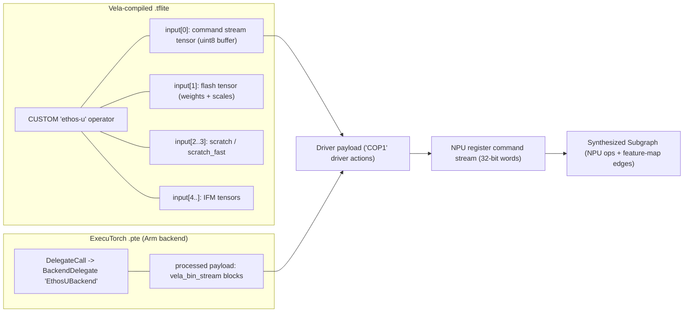

# Wish W01 — Ethos-U Command Stream Unwrapping (TFLite `ethos-u` & ExecuTorch `EthosUBackend`)

**Status:** Done (Implemented on branch `stage/W01-ethos-u-command-stream`)
**Depends on:** Stage **S03** (TFLite), Stage **S07** (ExecuTorch), Stage **S11** (subgraph breadcrumb drill-down & weight inspector)
**Suggested branch when promoted:** `stage/Sxx-ethos-u-command-stream`

## Goal
Let users **open an Arm Ethos-U NPU delegate block and look inside it like a subgraph**. Today a Vela-compiled TFLite model shows one opaque `CUSTOM(ethos-u)` node, and an ExecuTorch `.pte` lowered to the Arm backend shows one opaque `Delegate (EthosUBackend)` node. This feature decodes the Ethos-U driver payload and its NPU register command stream into a synthesized `Subgraph`:

- each NPU operation (`NPU_OP_CONV`, `NPU_OP_DEPTHWISE`, `NPU_OP_POOL`, `NPU_OP_ELEMENTWISE`, `NPU_OP_DMA_START`, …) becomes a `GraphNode`,
- the register state in effect for that operation becomes its attributes,
- feature-map edges are worked out from IFM/OFM memory regions and addresses.

Users can then check what Vela actually produced: how many operations it emitted, their shapes and precision, where DMA traffic happens, and how weights are laid out.

## Background



> [!IMPORTANT]
> The bit-level layouts below are summarized from public sources: `ethos-u-vela`, `ethos-u-core-driver`, and ExecuTorch `backends/arm/runtime/VelaBinStream.*`. **The implementing agent must check every layout against the pinned upstream source revisions** and record those revisions in the format doc and the ADR. The descriptions here say what to decode. They are not the authoritative byte offsets.

1. **TFLite (Vela output):** Vela replaces each NPU-supported partition with a `CUSTOM` operator whose `custom_code == "ethos-u"`. The payload is **not** in `custom_options`. It is in the operator's **input tensors**:
   - command stream tensor (`uint8`, constant buffer),
   - flash tensor (encoded weights and bias/scale streams, constant buffer),
   - scratch and scratch-fast arena tensors,
   - the real IFM tensors.

   S03 already exposes the constant buffers as `TensorDataSlice` initializers. Vela also writes an `OfflineMemoryAllocation` metadata buffer, which gives arena offsets for tensors.
2. **ExecuTorch (Arm backend):** `BackendDelegate.processed` (exposed by S07 as `AttributeValue.Bytes(TensorDataSlice)`) contains a `vela_bin_stream`. This is a sequence of 16-byte-aligned named blocks (`vela_bin_stream`, `cmd_data`, `weight_data`, scratch sizing, `inputs`, `outputs`, `vela_end_stream`), each with a 16-byte name and a 32-bit size. The `inputs`/`outputs` blocks give I/O shapes, element sizes, and scratch offsets.
3. **Driver payload:** `ethos-u-core-driver` reads a `COP1` header followed by 32-bit **driver actions**: optimizer/arch config (MACs per cycle, command stream version, SHRAM size), `COMMAND_STREAM` (length in words), `NOP`, and others. The arch config identifies the target: **Ethos-U55 / U65** (shared command set) or **Ethos-U85** (a different register map that needs its own decode table).
4. **NPU command stream:** a sequence of 32-bit words. Each command is either a **cmd0** (one word: opcode + 16-bit parameter) or a **cmd1** (opcode word + one 32-bit payload word, used for addresses and lengths). `NPU_SET_*` commands update register state. `NPU_OP_*` commands start an operation using the current state. `NPU_OP_STOP` ends the stream. Base addresses are relative to a **region** index, which the driver maps to base pointers (constant/flash, scratch arena, scratch-fast, …).

## Prerequisites
- Stages **S03**, **S07**, and **S11** complete. S11's breadcrumb navigation and `TensorInspectorViewModel` are reused.
- Read [`AGENTS.md`](../../AGENTS.md), [`PREREQUISITES.md`](../../PREREQUISITES.md), [`docs/roadmap/PROGRESS.md`](../roadmap/PROGRESS.md), and ADRs [`0002`](../adr/0002-immutable-record-ir.md), [`0003`](../adr/0003-lazy-weight-slices.md), and [`0006`](../adr/0006-ir-v1.md).

## Skills to Load
- `.agents/skills/port-model-format/SKILL.md` (and `references/ir-mapping-checklist.md`)
- `.agents/skills/add-test-model/SKILL.md` (and `references/manifest-and-snapshot-schema.md`)
- `.agents/skills/csharp-tunit/SKILL.md`
- `.agents/skills/csharp-async/SKILL.md`
- `.agents/skills/csharp-docs/SKILL.md`
- `.agents/skills/analyzing-dotnet-performance/SKILL.md`
- `.agents/skills/documentation-writer/SKILL.md`
- **`.agents/skills/computer-use/SKILL.md`** and **`.agents/skills/frontend-design/SKILL.md`** (mandatory: this wish changes the UI)
- `.agents/skills/development-plugin-for-avalonia/SKILL.md`

## Open Design Questions (resolve via ADR before coding)
1. **Eager vs. on-demand decoding.** Recommended: **on demand**. ADR 0003 forbids reading payload bytes during `ReadAsync`. Add a public `DelegatePayloadExpander` (or `IDelegatePayloadDecoder` + registry) in `DotNodeViewer.Core.Abstractions` that takes `(Stream, ModelGraph, GraphNode)` and returns `ValueTask<Subgraph?>`, reading only the delegate's slices. `ReadAsync` would only tag eligible nodes (for example, with a `delegate.backend = "ethos-u"` attribute).
2. **New IR surface.** Decide whether any of these frozen-contract additions are needed (each needs an ADR + `PROGRESS.md` note):
   - `TensorDataEncoding.EthosUCompressedWeights` (or a generic `Opaque` value) for encoded weight/scale streams that S11's inspector should show as hex, not decode as numbers.
   - An `OperatorCategory` value for DMA/data movement, or reuse `OperatorCategory.Data`.
   - A way to mark a `Subgraph` as *synthesized* (decoded from a delegate) as opposed to *declared by the format*. This could be a `Subgraph.Metadata`-style dictionary or a diagnostic. Avoid it if possible.
3. **Address-based dataflow fidelity.** Matching OFM→IFM by `(region, base address, byte extent)` can create false edges when the arena reuses memory. Recommended: use **last-writer-wins in stream order**, where a read connects to the most recent op whose OFM range overlaps it. Add a `ParseDiagnostic` (`Info`) explaining that edges are inferred.
4. **Ethos-U85 support in the first cut**, or U55/U65 only with a `Warning` diagnostic for U85 payloads.

## Scope & Deliverables
1. **Internal Ethos-U decoders (`src/DotNodeViewer.Core/Delegates/EthosU/`, all `internal`):**
   - `VelaBinStreamReader`: parses ExecuTorch `vela_bin_stream` blocks into `(name, offset, length)` slices with bounds checks. Returns `cmd_data` / `weight_data` slices and I/O descriptors (shape, element size, scratch offset).
   - `EthosUDriverPayloadReader`: validates the `COP1` header, walks driver actions, and extracts the architecture config (`macs_per_cc`, `cmd_stream_version`, `shram_size`) and the command stream word range.
   - `EthosUCommandStreamDecoder`: a `ref struct` over `ReadOnlySpan<byte>` that yields `NpuCommand(Offset, Opcode, Param, Payload?)` with no per-command allocation. It uses separate opcode/register tables for **U55/U65** and **U85**. Unknown opcodes produce a diagnostic. They never throw.
   - `EthosURegisterState`: a mutable struct that applies `NPU_SET_*` commands and takes an immutable snapshot at each `NPU_OP_*`:
     - IFM/IFM2/OFM width/height/depth, precision, region, base addresses, strides, padding,
     - kernel size/stride/dilation,
     - weight/scale region, base, and length,
     - activation function and clamp min/max,
     - block config,
     - DMA source/destination/length.
   - `EthosUSubgraphBuilder`: projects snapshots into the IR (see mapping below).
   - Hard safety limits: maximum command words (for example, 4 M), maximum NPU ops, and a check that every region address stays inside the known tensor extents. Malformed payloads produce `ParseDiagnostic`s and a partial subgraph. A corrupt delegate must never crash the viewer.
2. **IR mapping (synthesized `Subgraph`, named `"<delegate node name> (Ethos-U55-128)"`):**

   | Command stream element | Unified Graph IR |
   |---|---|
   | `NPU_OP_CONV` / `NPU_OP_DEPTHWISE` | `GraphNode`, `OperatorCategory.Layer`, operator name `NPU_CONV` / `NPU_DEPTHWISE` |
   | `NPU_OP_POOL` | `GraphNode`, `OperatorCategory.Pooling` (pool mode attribute) |
   | `NPU_OP_ELEMENTWISE` | `GraphNode`, `OperatorCategory.Tensor`, or `Activation` for unary activation modes |
   | `NPU_OP_DMA_START` (+ matching `NPU_OP_DMA_WAIT`) | `GraphNode`, `OperatorCategory.Data`, `src`/`dst` region + address + length attributes |
   | `NPU_OP_KERNEL_WAIT` / `DMA_WAIT` / `PMU_MASK` / `IRQ` / `STOP` | not drawn. Counted in subgraph-level stats and kept in the raw command listing |
   | Register snapshot at op time | `NodeAttribute`s (`ifm_shape`, `ofm_shape`, `ifm_precision`, `kernel`, `stride`, `dilation`, `padding`, `activation`, `clamp`, `block_config`, …) |
   | Feature map `(region, base, extent)` | `TensorEdge` named `r<region>@0x<addr>`, `TensorKind.Activation`, with shape/`DataType` from width/height/depth and precision |
   | Weight / scale streams | `TensorEdge`, `TensorKind.Initializer`, `TensorDataSlice` pointing into the flash tensor (TFLite) or `weight_data` block (PTE) at the absolute stream offset (encoding per ADR) |
   | Delegate IFMs / OFMs | `Subgraph.Inputs` / `Outputs` (`GraphPort`), matched by arena offset from `OfflineMemoryAllocation` (TFLite) or the `inputs`/`outputs` blocks (PTE), and linked back to the outer graph's tensor names |
   | Raw command list | `NodeAttribute` `commands` on each op node: the decoded `NPU_SET_*` commands that led to it, with word offsets |

3. **Public expansion entry point (per the ADR from Open Design Question 1):**
   - `ModelFormatRegistry`-style registration so that more delegate decoders can be added later (XNNPACK, Vela for other NPUs).
   - TFLite reader: tag `CUSTOM(ethos-u)` nodes as expandable. ExecuTorch reader: tag `Delegate (EthosUBackend)` nodes as expandable. Neither reader decodes during `ReadAsync`.
   - Fully async with `CancellationToken` and `.ConfigureAwait(false)`, AOT/trimming clean, using `ArrayPool<byte>.Shared` for the payload read buffer.
4. **CLI (`tools/DotNodeViewer.Cli`):**
   - `inspect <file> --expand-delegates`: prints each expandable delegate's synthesized subgraph summary (target arch, NPU op histogram, DMA count, command word count).
   - New `cmdstream <file> [--node <name>]` command: prints a Vela-style register listing (`offset  opcode  param  payload  # comment`) to diff against `vela --verbose-register-command-stream`.
   - `snapshot` gains an optional `delegates` array (op histogram, word count, arch) **only** with a new explicit flag, so existing `.expected.json` schemas stay unchanged (otherwise an ADR is required).
5. **UI (`DotNodeViewer.App`):**
   - Ethos-U delegate nodes get an **NPU badge** (`Ethos-U55-128 · 7 ops`) and an expand affordance.
   - Double-click, `Enter`, or the "Open delegate" button runs the expander on a background task and pushes the synthesized subgraph onto S11's breadcrumb (`main > ethos-u_0 (Ethos-U55)`). `Escape` or a breadcrumb click returns.
   - The canvas shows a non-intrusive **"Decoded from NPU command stream — edges inferred from memory addresses"** banner, following the diagnostics banner style.
   - The Properties sidebar for an NPU op shows grouped register state (IFM / OFM / Kernel / Weights / Activation / Block) and a collapsible **raw command listing** in a monospace font.
   - DMA nodes and region-coloured edge labels (flash / scratch / scratch-fast) follow `docs/design/design-system.md` tokens.
6. **Python model generator (`tools/model-gen/ethosu/`):**
   - `requirements.txt` pinning `ethos-u-vela` (and reusing the `tf/` and `torch/` venvs from S03/S07 for the source models).
   - `gen_ethosu.py`: compiles the S03 `tiny_cnn_int8.tflite` with Vela for `ethos-u55-128`, `ethos-u65-256` (and `ethos-u85-256` if Open Design Question 4 says so), and lowers a tiny CNN through ExecuTorch's Arm `EthosUPartitioner` to `.pte`.
   - For each output, emits `*.truth.json` using Vela's own `--verbose-register-command-stream` / `--verbose-high-level-command-stream` and summary CSV (NPU op count, op types, command word count, weight bytes) as **independent ground truth**.
7. **Test fixtures (`<= 256 KB` committed):**
   - `Fixtures/tflite/tiny_cnn_int8_vela_u55.tflite`, `tiny_cnn_int8_vela_u65.tflite` (optional `_u85`)
   - `Fixtures/executorch/tiny_cnn_ethosu55.pte`
   - Hand-crafted synthetic payload byte arrays inside the tests (not files) for corrupt and edge cases.
8. **Tests:**
   - `Synthetic/EthosUCommandStreamSyntheticTests.cs`:
     - cmd0/cmd1 word decoding,
     - register state carried across ops,
     - truncated cmd1 payload,
     - unknown opcode → diagnostic,
     - `COP1` magic mismatch,
     - missing `NPU_OP_STOP`,
     - word-limit guard,
     - out-of-range region address,
     - last-writer-wins edge inference with arena reuse.
   - `Synthetic/VelaBinStreamSyntheticTests.cs`: block alignment, missing `vela_end_stream`, oversize block length.
   - `Formats/EthosUDelegateModelTests.cs`: TFLite and PTE fixtures expand into subgraphs whose NPU op histogram, command word count, and weight byte totals match `*.truth.json`. Delegate I/O ports link to the outer graph tensors.
   - `App.Tests`: headless drill-down into a delegate, breadcrumb return, and Properties register grouping.
   - Allocation test: decoding the fixture command stream allocates nothing per command (measured with `GC.GetAllocatedBytesForCurrentThread`).
9. **Documentation (`README.md` & `docs/site/`):**
   - Add `docs/site/articles/formats/ethos-u.md` (Explanation + Reference): driver payload, `vela_bin_stream`, command stream decoding, the IR mapping table, the inferred-edge caveat, the pinned upstream revisions, and a Mermaid diagram of the decode pipeline.
   - Add a How-to guide, "Inspect what Vela generated for your model", that shows `inspect --expand-delegates`, `cmdstream`, and the UI drill-down with screenshots.
   - Update `tflite.md`, `executorch.md`, `cli/reference.md` (with real output examples), `toc.yml`, and the root `README.md` feature list.

## Explicitly Out of Scope
- Running or simulating the NPU, or estimating cycles and performance beyond what Vela's own metadata gives.
- Decoding Ethos-U **compressed weight streams** into numeric weight values (show them as opaque hex in the inspector).
- Other NPU delegates (Ethos-N, NXP Neutron, Hexagon, XNNPACK internal graphs). The expander registry should make these possible later.
- Editing or re-serializing command streams.

## Acceptance Criteria & Verification
```bash
dotnet build dot-node-viewer.slnx -c Release
dotnet test --solution dot-node-viewer.slnx -c Release
dotnet publish tools/DotNodeViewer.Cli -c Release -p:PublishAot=true
dotnet run --project tools/DotNodeViewer.Cli -c Release -- inspect tests/DotNodeViewer.Core.Tests/Fixtures/tflite/tiny_cnn_int8_vela_u55.tflite --expand-delegates
dotnet run --project tools/DotNodeViewer.Cli -c Release -- cmdstream tests/DotNodeViewer.Core.Tests/Fixtures/executorch/tiny_cnn_ethosu55.pte
dotnet tool run docfx build docs/site/docfx.json --warningsAsErrors
```
- The decoded NPU op count, op types, and command word count for every fixture match Vela's `*.truth.json` exactly.
- Live UI verification per `AGENTS.md` §4: screenshots of the collapsed delegate badge, the drilled-in NPU subgraph, the register Properties panel, and the raw command listing are saved to `docs/screenshots/<stage>/`.

## Hand-off & Git Requirements
- When promoted, work on branch `stage/Sxx-ethos-u-command-stream` and commit in logical sub-commits prefixed with `Sxx:`. For example:
  1. ADR for delegate expansion,
  2. internal decoders and synthetic tests,
  3. reader tagging and the expander API,
  4. model-gen, fixtures, and truth files,
  5. CLI,
  6. UI and screenshots,
  7. docs and `PROGRESS.md`.
- Set this wish's status to `Promoted (Sxx)` in [`docs/wishes/README.md`](README.md), and to `Done` when the stage completes.
