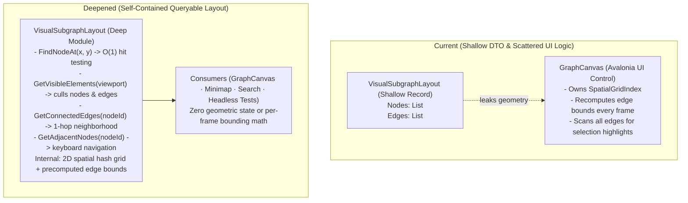

# Wish W02 — Visual Subgraph Layout Spatial Partitioning, Viewport Culling & Adjacency

**Status:** Accepted  
**Depends on:** Stage **S04** (Sugiyama layout engine), Stage **S06** (GraphCanvas)  
**Suggested branch when promoted:** `refactor/visual-subgraph-layout-spatial-indexing`  

## Goal
Deepen `VisualSubgraphLayout` in `DotNodeViewer.Layout` from a passive data record into a deep, queryable module. Embed a high-performance 2D spatial hash grid, precompute edge bounding boxes, and expose viewport culling, point hit-testing, and 1-hop adjacency queries directly on the layout. This eliminates duplicate spatial indexing and per-frame edge bounding box calculations in `GraphCanvas`, and provides headless testability for all geometric and navigation queries ahead of Stage S11 (Minimap, Search & Filter, Neighborhood Highlighting, and Keyboard Navigation).

## Background & Friction

In the current implementation:
1. `VisualSubgraphLayout` is a shallow record that simply holds `IReadOnlyList<VisualNode> Nodes` and `IReadOnlyList<VisualEdge> Edges`.
2. Spatial indexing (`SpatialGridIndex`) is implemented in `DotNodeViewer.App.Rendering`, coupling geometric indexing to the UI project even though it only references `DotNodeViewer.Layout` types.
3. `VisualEdge` does not store its axis-aligned bounding box. During every frame rendering, `GraphCanvas` iterates through all edges and runs `IsEdgeVisible`, scanning polyline points dynamically to compute an on-the-fly bounding box.
4. Adjacency queries (such as finding connected edges for a selected node) require `GraphCanvas` to perform a linear scan comparing source and target node identifiers across all edges on every frame.
5. Upcoming Stage S11 features (Minimap, Search & Filter jump, 1-hop neighborhood highlighting, keyboard navigation) would require `DotNodeViewer.App` to invent multiple ad-hoc dictionaries or run expensive linear scans.

## Proposed Architecture

1. **Move Spatial Grid into `DotNodeViewer.Layout`:**
   - Migrate and adapt `SpatialGridIndex` into `DotNodeViewer.Layout` as an internal or public high-performance spatial structure.
   - Index both `VisualNode`s and `VisualEdge`s into the spatial grid.
2. **Precomputed Edge Bounding Boxes:**
   - Store `BoundingBox Bounds` on `VisualEdge` (and `PositionedEdge`), computed once during edge routing in `SugiyamaPipeline.BuildPositionedGraph` or `ModelGraphLayoutAdapter`.
3. **Deep Query Interface on `VisualSubgraphLayout`:**
   - `VisualNode? FindNodeAt(double x, double y)`: Returns top-most node containing point.
   - `VisibleElements GetVisibleElements(BoundingBox viewport)`: Returns collections of visible nodes and edges in the specified viewport without allocating new arrays every query.
   - `IReadOnlyList<VisualEdge> GetConnectedEdges(string nodeId)`: Returns all incoming and outgoing edges for the given node.
   - `IReadOnlyList<VisualNode> GetAdjacentNodes(string nodeId)`: Returns upstream and downstream neighbor nodes for keyboard navigation.
4. **Thin `GraphCanvas` Integration:**
   - Remove `_spatialIndex` management from `GraphCanvas`.
   - In `Render`, query `Layout.GetVisibleElements(visibleWorldBounds)` directly.
   - Replace per-frame edge scanning with `Layout.GetConnectedEdges(selectedNodeId)`.
5. **Headless TUnit Tests:**
   - Comprehensive tests in `DotNodeViewer.Layout.Tests` verifying point hit-testing, edge bounding boxes, viewport culling, and 1-hop adjacency across synthetic and real layouts.
