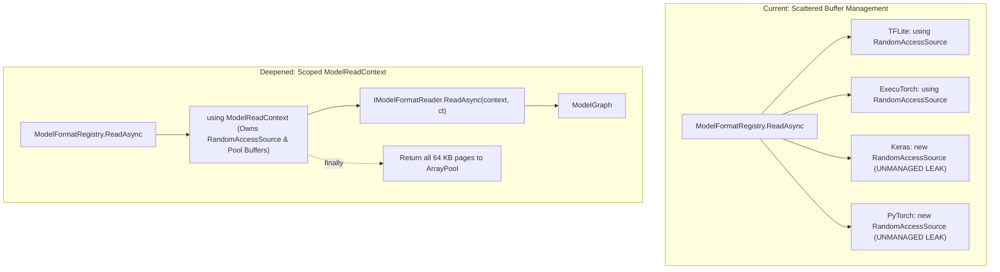

# Wish W04 — Scoped Model Read Context and Centralized Buffer Cache Lifecycle

**Status:** Proposed  
**Depends on:** Stage **S01** (abstractions), Stage **S08** (PyTorch), Stage **S10** (Keras & HDF5)  
**Suggested branch when promoted:** `refactor/scoped-model-read-context`  

## Goal
Centralize `RandomAccessSource` page-cache lifecycle and `ArrayPool<byte>.Shared` memory management inside `ModelFormatRegistry.ReadAsync` by introducing a scoped `ModelReadContext`. This eliminates silent buffer leaks in `KerasFormatReader`, `PyTorchFormatReader`, and `PyTorchPt2FormatReader`, simplifies format reader signatures, and ensures 100% deterministic reclamation of pooled memory buffers across all model formats.

## Background & Friction

In the current implementation:
1. `RandomAccessSource` manages an LRU page cache of up to sixteen 64 KB buffers rented from `ArrayPool<byte>.Shared`. It implements `IDisposable` to return these buffers to the pool.
2. In `TfliteFormatReader` and `ExecuTorchFormatReader`, `RandomAccessSource` is properly wrapped in a `using` block:
   ```csharp
   using RandomAccessSource source = new(stream);
   ```
3. In `KerasFormatReader`, `PyTorchFormatReader`, and `PyTorchPt2FormatReader`, `RandomAccessSource` is created without a `using` statement:
   ```csharp
   var source = new RandomAccessSource(stream);
   ```
4. Because `RandomAccessSource` has no finalizer, these rented 64 KB array buffers are never returned to `ArrayPool<byte>.Shared`. This silently leaks up to 1 MB of pooled memory per parsed model file.
5. Furthermore, requiring every format reader to instantiate, configure, and dispose its own `RandomAccessSource` is a leaky abstraction; the page caching strategy is an engine-level concern, not a format-specific one.



## Proposed Architecture

1. **Introduce `ModelReadContext`:**
   - Holds the input `Stream`, effective `ModelReadOptions`, `RandomAccessSource`, and optional memoized metadata (such as `ZipDirectory`).
   - Implements `IDisposable` / `IAsyncDisposable` to guarantee proper return of all pooled buffers in its `Dispose()` method.
2. **Centralize Lifecycle in `ModelFormatRegistry`:**
   - `ModelFormatRegistry.ReadAsync` constructs the `ModelReadContext` inside a `using` block.
   - All format readers consume the context and its managed `RandomAccessSource`.
3. **Prevent Reader Buffer Leaks:**
   - Format readers no longer construct or dispose `RandomAccessSource`.
4. **Testing:**
   - Add unit tests verifying that all rented pages are returned to `ArrayPool<byte>.Shared` even when a format reader throws a `ModelParseException`.
