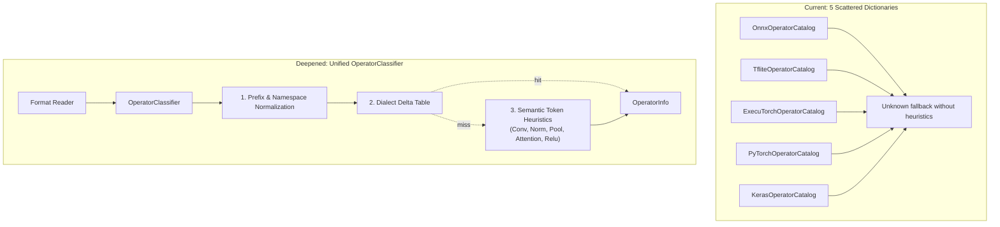

# Wish W05 — Unified Operator Classification, Normalization and Heuristic Inference

**Status:** Proposed  
**Depends on:** Stage **S01** (IR), Stage **S02** (ONNX), Stage **S03** (TFLite), Stage **S07** (ExecuTorch), Stage **S08** (PyTorch), Stage **S10** (Keras)  
**Suggested branch when promoted:** `refactor/unified-operator-classification`  

## Goal
Replace 5 disjoint, static operator catalog tables (`OnnxOperatorCatalog`, `TfliteOperatorCatalog`, `ExecuTorchOperatorCatalog`, `PyTorchOperatorCatalog`, `KerasOperatorCatalog`) with a unified `OperatorClassifier` module. Provide standardized namespace/prefix normalization, dialect-specific delta mappings, and robust token-based heuristic inference for custom operators and lowered hardware delegate kernels (such as XNNPACK, Arm Ethos-U, and Qualcomm QNN).

## Background & Friction

In the current codebase:
1. Each format folder contains an independent `*OperatorCatalog.cs` class (`OnnxOperatorCatalog` 13 KB, `TfliteOperatorCatalog` 12 KB, `ExecuTorchOperatorCatalog` 7 KB, `PyTorchOperatorCatalog` 6 KB, `KerasOperatorCatalog` 4 KB).
2. Each catalog duplicates basic string manipulation (such as splitting schema namespaces like `aten::`, `torch.ops.`, `xnnpack::`, or stripping trailing overload suffixes like `.out`, `.default`).
3. For custom, vendor-delegated, or newer opset operators not explicitly listed in the dictionary, catalogs immediately fall back to `OperatorCategory.Custom` or `OperatorCategory.Unknown`.
4. As a result, visualizer cards for common operations lowered into delegates (e.g., `xnnpack::conv2d`, `qnn::depthwise_conv`, custom layer names in Keras) lose their semantic category color coding and categorization.

## Proposed Architecture

1. **Introduce `OperatorClassifier` in `DotNodeViewer.Core.Ir` or `DotNodeViewer.Core.Abstractions`:**
   - Exposes `OperatorInfo Classify(string rawOpName, string? domain = null, int? version = null, ModelFormatId? format = null)`.
2. **Normalized Prefix Stripping:**
   - Standardizes removal of namespaces (`aten::`, `torch.ops.`, `c10::`, `xnnpack::`) and overloads (`.out`, `.default`, `.Tensor`).
3. **Dialect Delta Tables:**
   - Compact format-specific overrides for operators with unusual semantics (e.g. TFLite `DEQUANTIZE` vs ONNX `DequantizeLinear`).
4. **Token-Based Heuristic Fallback:**
   - When an operator is not found in delta tables, inspects token stems:
     - Contains `Conv`, `Convolution` → `OperatorCategory.Layer`
     - Contains `Norm`, `LayerNorm`, `BatchNorm` → `OperatorCategory.Normalization`
     - Contains `Pool` → `OperatorCategory.Pooling`
     - Contains `Relu`, `Gelu`, `Silu`, `Sigmoid`, `Tanh`, `Activation` → `OperatorCategory.Activation`
     - Contains `Attention`, `MHA`, `Transformer` → `OperatorCategory.Layer`
     - Contains `Quant`, `Dequant` → `OperatorCategory.Quantization`
     - Contains `Reshape`, `Transpose`, `Permute`, `Squeeze` → `OperatorCategory.Shape`
5. **Testing:**
   - Unit tests covering known and unknown operators across all 5 format dialects.
