# Wish W07 — Automated DocFX Documentation Deployment via GitHub Pages

**Status:** Done (Implemented on branch `infra/github-pages-docs-deployment`)  
**Depends on:** Stage **S00** (Bootstrap & CI Governance), Stage **S01** (Unified IR & DocFX Setup), Stage **S12** (WebAssembly Head)  
**Suggested branch when promoted:** `infra/github-pages-docs-deployment`  

## Goal

Provide fully automated, continuous publishing of the `dot-node-viewer` DocFX documentation website (`docs/site/`) to **GitHub Pages** on every push to `main` (and via manual `workflow_dispatch`). This ensures that Diátaxis architecture guides, format support matrices, CLI manuals, and C# XML API references for `DotNodeViewer.Core` and `DotNodeViewer.Layout` are publicly accessible online with zero drift from the codebase. In addition, establish a deployment seam for Stage S12 to co-host the interactive WebAssembly viewer (`DotNodeViewer.Browser`) directly alongside the documentation site.

## Background & Friction

In the current repository configuration:
1. **CI Builds but Discards Documentation:** `.github/workflows/ci.yml` validates DocFX compilation during the `build-and-unit-tests` job using:
   ```bash
   dotnet tool run docfx metadata docs/site/docfx.json --warningsAsErrors
   dotnet tool run docfx build docs/site/docfx.json --warningsAsErrors
   ```
   While this guarantees that XML comments, cross-references (`xref`), and Markdown guides compile with zero warnings, the resulting static site in `docs/site/_site` is discarded when the runner finishes.
2. **No Public Live Documentation URL:** Users, contributors, and evaluators cannot view the documentation online. Anyone wishing to read the comprehensive Diátaxis architecture guides, CLI commands, or API reference must clone the repository, install the .NET 10 SDK, restore dotnet tools, and execute `docfx --serve` locally.
3. **No Direct Links in `README.md` or PRs:** Project announcements, `README.md` badges, and PR reviews cannot link directly to hosted API docs or format guides (e.g., `https://<owner>.github.io/dot-node-viewer/articles/formats/onnx.html`).
4. **Decoupled WebAssembly Demo Opportunity:** Stage S12 introduces `DotNodeViewer.Browser`, an in-browser WebAssembly head (`net10.0-browser`). Hosting static documentation and the WebAssembly app on GitHub Pages under the same origin (e.g., `/` for docs and `/demo/` for the viewer) offers an instant zero-friction demonstration without requiring separate hosting infrastructure.

```mermaid
flowchart TD
    subgraph Current["Current: Build and Discard in CI"]
        Push1[git push main] --> CI[ci.yml: build-and-unit-tests]
        CI --> BuildDocFX[docfx metadata && docfx build]
        BuildDocFX --> Site1[docs/site/_site generated on runner]
        Site1 -.Runner shuts down.-> Discarded[Discarded / No Live URL]
    end

    subgraph Proposed["Proposed: Automated Continuous Deployment to GitHub Pages"]
        Push2[git push main / workflow_dispatch] --> DocsWorkflow[docs.yml / deployment pipeline]
        DocsWorkflow --> NetBuild[Build Core + Layout in Release]
        NetBuild --> DocFX[docfx metadata & build --warningsAsErrors]
        DocFX --> Artifact[actions/upload-pages-artifact]
        Artifact --> Deploy[actions/deploy-pages to github-pages environment]
        Deploy --> LiveSite["Live Site: https://<owner>.github.io/dot-node-viewer/"]
        LiveSite --> API[Managed API Reference: Core + Layout]
        LiveSite --> Guides[Diátaxis Guides & Format Matrix]
        LiveSite -.Stage S12 co-hosting.-> Demo["Interactive WebAssembly Demo (/demo/)"]
    end
```



## Proposed Architecture

### 1. Dedicated GitHub Actions Workflow (`.github/workflows/docs.yml`)

Implement a dedicated deployment workflow utilizing the modern GitHub Pages Actions ecosystem (`actions/configure-pages`, `actions/upload-pages-artifact`, and `actions/deploy-pages`):

- **Triggers:**
  - `push` to `main` filtering on documentation and source changes:
    - `docs/**`
    - `src/**`
    - `global.json`
    - `.config/dotnet-tools.json`
    - `.github/workflows/docs.yml`
  - `workflow_dispatch` (allowing manual re-deployments without dummy commits).
- **Permissions:**
  - `contents: read` (checkout repository).
  - `pages: write` (upload and publish to GitHub Pages).
  - `id-token: write` (authenticate deployment via OIDC).
- **Concurrency Control:**
  - `concurrency: group: "pages", cancel-in-progress: false` to ensure queue integrity and avoid half-deployed pages artifacts.

### 2. Build Pipeline & Quality Gates

The pipeline enforces the repository's strict quality rules before publishing:
1. **Repository Checkout:** `actions/checkout@v4` with `fetch-depth: 0` to preserve Git history for DocFX page update timestamps and git contribution links.
2. **SDK & Tool Setup:** `actions/setup-dotnet@v4` pinned via `global.json`, followed by `dotnet tool restore` to lock DocFX at the repository-pinned version (`2.78.3+`).
3. **Release Compilation:** `dotnet build dot-node-viewer.slnx -c Release` with `TreatWarningsAsErrors=true` to guarantee that C# XML documentation comments (`/// <summary>`) are generated and up-to-date.
4. **Metadata & Site Generation:**
   - `dotnet tool run docfx metadata docs/site/docfx.json --warningsAsErrors`
   - `dotnet tool run docfx build docs/site/docfx.json --warningsAsErrors`
5. **NoJekyll Marker:** Ensure a `.nojekyll` file is written to `docs/site/_site/` to prevent GitHub's default Jekyll engine from ignoring files prefixed with underscores or dot notation.
6. **Pages Artifact Packaging & Deployment:**
   - `actions/configure-pages@v5`
   - `actions/upload-pages-artifact@v3` with `path: docs/site/_site`
   - `actions/deploy-pages@v4` targeting the `github-pages` environment.

### 3. Stage S12 WebAssembly Head Co-Hosting Seam

Prepare the workflow structure so that once Stage S12 (`DotNodeViewer.Browser`) is completed:
- `dotnet publish src/DotNodeViewer.Browser -c Release -o ./wasm-dist` can be executed.
- The compiled Wasm distribution can be copied into `docs/site/_site/demo/`.
- The DocFX documentation site can link directly to `[Live WebAssembly Demo](demo/index.html)` in its top-level navigation bar (`docs/site/toc.yml`).

### 4. Configuration & Repository Metadata Updates

- **`docs/site/docfx.json`:**
  - Ensure client-side search (`ExtractSearchIndex`) remains active and verified.
  - Verify that relative paths work seamlessly both under `https://<owner>.github.io/<repo>/` and custom domains.
  - Verify git contribution links point to the correct upstream branch.
- **`README.md` & Site Entrypoint:**
  - Add a GitHub Pages deployment status badge:
    `[](https://<owner>.github.io/dot-node-viewer/)`
  - Include the live documentation URL in the header and Quick Reference sections of `README.md`.

## Workflow Blueprint

```yaml
name: Deploy Documentation

on:
  push:
    branches:
      - main
    paths:
      - 'docs/**'
      - 'src/**'
      - 'global.json'
      - '.config/dotnet-tools.json'
      - '.github/workflows/docs.yml'
  workflow_dispatch:

permissions:
  contents: read
  pages: write
  id-token: write

concurrency:
  group: "pages"
  cancel-in-progress: false

jobs:
  build-and-deploy:
    name: Build & Deploy DocFX to Pages
    runs-on: ubuntu-latest
    environment:
      name: github-pages
      url: ${{ steps.deployment.outputs.page_url }}
    steps:
      - name: Checkout repository
        uses: actions/checkout@v4
        with:
          fetch-depth: 0

      - name: Setup .NET 10 SDK
        uses: actions/setup-dotnet@v4
        with:
          global-json-file: global.json

      - name: Restore .NET local tools
        run: dotnet tool restore

      - name: Build solution (Release, zero warnings)
        run: dotnet build dot-node-viewer.slnx -c Release

      - name: Extract DocFX C# API metadata
        run: dotnet tool run docfx metadata docs/site/docfx.json --warningsAsErrors

      - name: Build DocFX documentation site
        run: dotnet tool run docfx build docs/site/docfx.json --warningsAsErrors

      - name: Ensure .nojekyll exists
        run: touch docs/site/_site/.nojekyll

      - name: Configure GitHub Pages
        uses: actions/configure-pages@v5

      - name: Upload Pages artifact
        uses: actions/upload-pages-artifact@v3
        with:
          path: docs/site/_site

      - name: Deploy to GitHub Pages
        id: deployment
        uses: actions/deploy-pages@v4
```

## Definition of Done (When Promoted)

1. **GitHub Actions Workflow Active:** `.github/workflows/docs.yml` is committed, tested, and green on `main`.
2. **Zero DocFX Warnings:** Both `docfx metadata` and `docfx build` pass with `--warningsAsErrors`.
3. **Live Site Verification:**
   - Homepage (`index.html`), Diátaxis articles (`articles/**`), and C# API reference (`api/**`) load properly without broken links or missing CSS/JS assets.
   - Client-side search functions correctly on the published site.
   - Navigation links resolve cleanly without 404 errors under the repository subpath.
4. **README & DocFX Updates:**
   - Root `README.md` updated with the live documentation link and GitHub Actions badge.
   - `docs/site/index.md` updated with relevant links.
5. **Stage S12 Compatibility:** Documentation notes the structure for placing the WebAssembly distribution in `/demo/` once Stage S12 lands.

## Open Design Questions

1. **Dedicated Workflow vs CI Step:** Should publishing run in a standalone `.github/workflows/docs.yml` triggered on changes to docs/code, or as a final gated job in `.github/workflows/ci.yml` after unit and model tests pass?
   - *Recommendation:* Standalone `docs.yml` with path filtering, so documentation changes can deploy quickly without having to re-run the full 15-minute multi-format model fixture test suite.
2. **WebAssembly Demo Embedding:** Should the Wasm demo in Stage S12 be embedded within an `<iframe>` on a DocFX article page, or opened in full-screen on `/demo/index.html`?
   - *Recommendation:* Provide full-screen access at `/demo/` with a top-nav link, plus an embedded iframe walkthrough in the getting-started guide.

