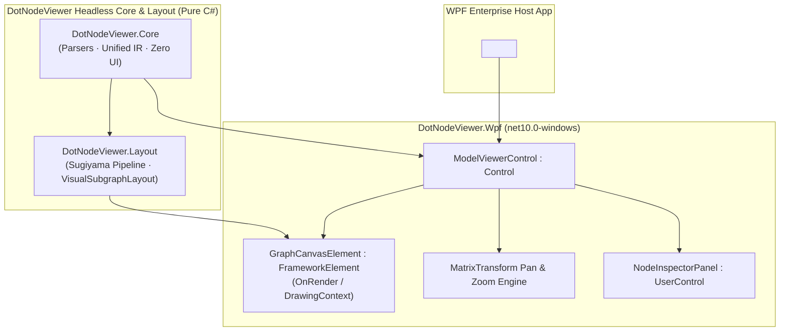

# Wish W08 — WPF Model Viewer Control (DotNodeViewer.Wpf)

**Status:** Proposed  
**Depends on:** Stage **S01** (Unified Graph IR), Stage **S04** (Sugiyama Layout Engine), Stage **S06** (Graph Rendering Patterns)  
**Suggested branch when promoted:** `feature/wpf-model-viewer-control`  

## Goal

Provide a native, high-performance **WPF (Windows Presentation Foundation) Control** packaged as `DotNodeViewer.Wpf` (`net10.0-windows`). The control allows enterprise Windows desktop applications—such as industrial automation suites, medical imaging workstations, EDA tools, and ML engineering workbenches—to embed interactive neural network graph visualization with zero Avalonia dependencies, full XAML data-binding support, hardware-accelerated Direct2D/DirectWrite rendering, and smooth pan-and-zoom navigation.

## Ecosystem Popularity & Motivation

WPF remains the undisputed heavyweight of enterprise Windows desktop development. Despite the arrival of newer frameworks, decade-long enterprise investments mean that the majority of commercial engineering, CAD, financial, defense, and healthcare software written in .NET runs on WPF. 

With the surge in local edge inference (ONNX Runtime, DirectML, Windows ML), enterprise engineering applications increasingly need to visualize, inspect, and debug model topologies directly within their existing WPF host windows without launching an external Electron or browser process.

Because `DotNodeViewer.Core` (IR & parsers) and `DotNodeViewer.Layout` (Sugiyama hierarchical layout) are pure C# libraries with zero UI dependencies, `DotNodeViewer.Wpf` can directly consume them, providing WPF developers with a first-class `<dnv:ModelViewerControl />`.

## Architectural Alignment



## Proposed Architecture & Component Model

### 1. Package Structure & Target Framework

- **Project:** `src/DotNodeViewer.Wpf/DotNodeViewer.Wpf.csproj`
- **Target Framework:** `net10.0-windows`
- **Dependencies:**
  - `DotNodeViewer.Core`
  - `DotNodeViewer.Layout`
  - Zero reference to `DotNodeViewer.App` or Avalonia.

### 2. Control Hierarchy

`DotNodeViewer.Wpf` exposes two primary controls:
1. `ModelViewerControl` (`Control`): The full-featured composite control including top toolbar (fit to screen, zoom level, orientation toggle), the interactive graph canvas, and a collapsible node properties inspector.
2. `GraphCanvasElement` (`FrameworkElement`): A low-level, lightweight canvas element dedicated purely to rendering the layout and handling pointer input.

### 3. Rendering Pipeline (`DrawingContext` & Direct2D)

- Graph geometry is drawn by overriding `FrameworkElement.OnRender(DrawingContext dc)`:
  - **Nodes:** Drawn as rounded rectangles using `DrawingContext.DrawRoundedRectangle` with cached `SolidColorBrush` and `Pen` instances frozen via `.Freeze()` to avoid WPF thread-affinity and allocation overhead.
  - **Edges:** Spline curves rendered using `StreamGeometry` and `StreamGeometryContext.PolyBezierTo` / `PolyLineTo`, enabling hardware acceleration in WPF's milcore composition engine.
  - **Labels:** Rendered via `FormattedText` or `GlyphRun` with cached `Typeface` references.
  - **Viewport Culling:** Uses `VisualSubgraphLayout.GetVisibleElements(viewportBounds)` (Wish W02) to skip off-screen nodes and edge polylines, maintaining 60+ FPS even on models with 10,000+ nodes.

### 4. Pan, Zoom & Coordinate Transformation

- Manages a WPF `MatrixTransform` on the drawing context:
  - `MouseWheel`: Smooth exponential zooming centered at the mouse cursor position.
  - `MouseLeftButtonDown` / `MouseMove` (with `Mouse.Capture`): Smooth panning across the canvas.
  - `DoubleTap` / `Reset`: Animates transform matrix to fit the entire graph within the available control bounds (`FitToScreen()`).

### 5. Dependency Properties & XAML API

```csharp
namespace DotNodeViewer.Wpf;

public class ModelViewerControl : Control
{
    public static readonly DependencyProperty ModelPathProperty =
        DependencyProperty.Register(nameof(ModelPath), typeof(string), typeof(ModelViewerControl),
            new PropertyMetadata(null, OnModelPathChanged));

    public static readonly DependencyProperty ModelStreamProperty =
        DependencyProperty.Register(nameof(ModelStream), typeof(Stream), typeof(ModelViewerControl),
            new PropertyMetadata(null, OnModelStreamChanged));

    public static readonly DependencyProperty SelectedNodeProperty =
        DependencyProperty.Register(nameof(SelectedNode), typeof(GraphNode), typeof(ModelViewerControl),
            new FrameworkPropertyMetadata(null, FrameworkPropertyMetadataOptions.BindsTwoWayByDefault));

    public static readonly DependencyProperty ZoomProperty =
        DependencyProperty.Register(nameof(Zoom), typeof(double), typeof(ModelViewerControl),
            new PropertyMetadata(1.0));

    public static readonly DependencyProperty IsInspectorVisibleProperty =
        DependencyProperty.Register(nameof(IsInspectorVisible), typeof(bool), typeof(ModelViewerControl),
            new PropertyMetadata(true));

    public static readonly RoutedEvent NodeSelectedEvent =
        EventManager.RegisterRoutedEvent(nameof(NodeSelected), RoutingStrategy.Bubble,
            typeof(RoutedEventHandler), typeof(ModelViewerControl));

    public static readonly RoutedEvent GraphLayoutCompletedEvent =
        EventManager.RegisterRoutedEvent(nameof(GraphLayoutCompleted), RoutingStrategy.Bubble,
            typeof(RoutedEventHandler), typeof(ModelViewerControl));
}
```

### 6. XAML Usage Example

```xml
<Window x:Class="EngineeringApp.MainWindow"
        xmlns="http://schemas.microsoft.com/winfx/2006/xaml/presentation"
        xmlns:x="http://schemas.microsoft.com/winfx/2006/xaml"
        xmlns:dnv="clr-namespace:DotNodeViewer.Wpf;assembly=DotNodeViewer.Wpf"
        Title="ONNX Model Diagnostics" Height="800" Width="1200">
    <Grid>
        <dnv:ModelViewerControl ModelPath="{Binding ActiveModelFilePath}"
                                SelectedNode="{Binding InspectedNode, Mode=TwoWay}"
                                IsInspectorVisible="True"
                                Background="#FF1E1E1E" />
    </Grid>
</Window>
```

## Performance & Resource Strategy

1. **Frozen Brushes & Pens:** All theme brushes, outline pens, and text formatting objects call `.Freeze()`, eliminating WPF dependency tracking and enabling multithreaded render thread sharing.
2. **StreamGeometry Reuse:** Reusable `StreamGeometry` paths for node outlines and edge splines, reconstructed only when the layout or viewport changes significantly.
3. **Lazy Weight Slicing:** Selecting a node queries tensor metadata immediately from IR, but lazy-loads weight bytes via `TensorDataLoader` only when the user expands the tensor previewer in the inspector.

## Testing Strategy

- **Unit Tests (`DotNodeViewer.Wpf.Tests`):**
  - Dependency property change propagation and validation.
  - Matrix coordinate transformations (screen point to world graph point and back).
  - Hit testing verification on WPF geometries.
- **Sample WPF Harness (`samples/DotNodeViewer.Wpf.Sample`):**
  - Interactive test harness demonstrating loading models from disk or memory streams with live selection and property inspection.

