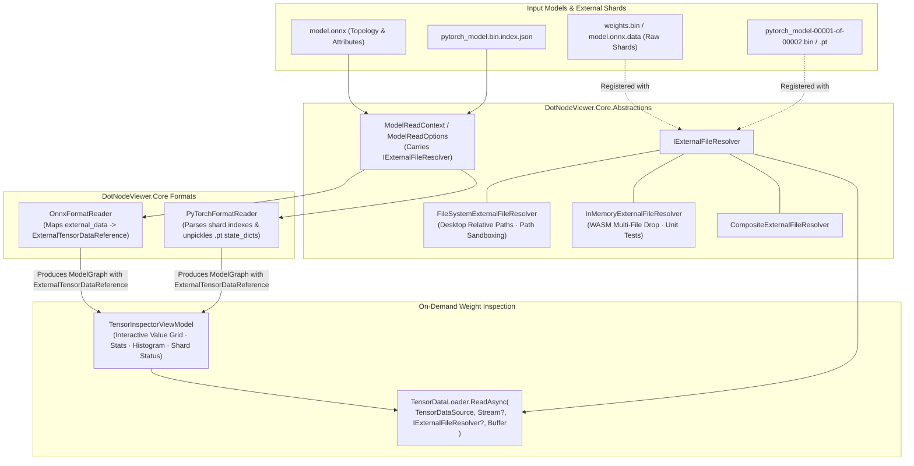

# Wish W09 — External Tensor Shard Loading (ONNX .bin Shards & PyTorch .pt Dictionaries)

**Status:** Proposed  
**Depends on:** Stage **S01** (Unified Graph IR & Abstractions), Stage **S02** (ONNX Parser), Stage **S08** (PyTorch Parser), Stage **S11** (Tensor Inspector & Polish), Stage **S12** (WebAssembly Head)  
**Suggested branch when promoted:** `feature/external-tensor-shards`  

## Goal

Provide end-to-end support for loading, resolving, and inspecting neural network models whose weight tensors are split into **external shard files**, including:
1. **ONNX models with external data:** Large models (especially those exceeding the 2 GB Protocol Buffers limit or saved with `save_as_external_data=True`) that store their graph topology in a `.onnx` file and raw tensor payloads across one or more external `.bin`, `.onnx.data`, or shard files.
2. **PyTorch sharded checkpoints & state dictionaries:** PyTorch models distributed as multi-file parameter shards (`pytorch_model-00001-of-00002.bin`, `pytorch_model.bin.index.json`, `model.safetensors.index.json`) or standalone/companion `.pt` / `.pth` / `.bin` parameter dictionaries (`state_dict`).
3. **Cross-platform resolution:** Seamless discovery and resolution of external companion files across both **Desktop** (automatic directory-relative file discovery and folder selection) and **WebAssembly / Browser** (multi-file drag-and-drop and folder drops) via a unified `IExternalFileResolver` abstraction.
4. **Interactive weight inspection:** Deepening `TensorDataLoader` and `TensorInspectorViewModel` so that external tensor weights can be read on demand, dequantized, summarized with statistical distribution metrics, and previewed with zero crashes and friendly visual diagnostics when shards are missing.

---

## Background & Ecosystem Motivation

Modern foundation models, large language models (LLMs), vision transformers (ViT), and multimodal diffusion networks routinely exceed single-file packaging limits:

- **The ONNX 2 GB Barrier:** Protocol Buffers enforces a hard 2 GB limit per message. The standard ONNX solution (`onnx.save_model(..., save_as_external_data=True)`) splits weights into separate binary files (`.bin`, `model.onnx.data`, or numbered chunk files). In many workflows (such as Hugging Face Optimum and ONNX Runtime Model Zoo), users work with models containing dozens of small `.bin` shards or a monolithic `.data` companion.
- **PyTorch Decoupled Topologies & Parameter Shards:** In PyTorch, model code/architecture is frequently decoupled from parameter weights. Checkpoints are saved as pickled `state_dict` dictionaries across multiple shards indexed by a manifest (`pytorch_model.bin.index.json`). Additionally, developers frequently possess a model architecture (such as an uninitialized TorchScript, TorchFX / PT2, or ONNX graph) and need to bind or overlay an external `.pt` / `.pth` dictionary to inspect weight values, verify layer matching, or diagnose training artifacts.

---

## Current Architecture & Friction Points

In the current codebase:

1. **`ExternalTensorDataReference` is a Dead End for Data Inspection:**
   - In `DotNodeViewer.Core.Ir`, `TensorDataSource` already defines `ExternalTensorDataReference(RelativePath, Offset, Length, DataType)`.
   - `OnnxFormatReader` correctly parses external data attributes (`location`, `offset`, `length`) and instantiates `ExternalTensorDataReference`.
   - However, `TensorDataLoader` only accepts `TensorDataSlice` against a single seekable `Stream`. It cannot resolve or read from external files.
   - In `TensorInspectorViewModel.cs`, when `tensor.Data is ExternalTensorDataReference`, the inspector displays the relative path, offset, and length as static metadata, but returns immediately:
     ```csharp
     if (tensor.Data is ExternalTensorDataReference ext)
     {
         IsExternal = true;
         ExternalPath = ext.RelativePath;
         // ... sets labels ...
         return; // ABORTS: No raw bytes read, no preview table, no min/max/mean stats
     }
     ```
2. **Zero Abstraction for Resolving Sibling or External Files:**
   - `IModelFormatReader.ReadAsync` only receives a single `Stream` and optional `ModelReadOptions`.
   - There is no mechanism in `DotNodeViewer.Core.Abstractions` to resolve external files relative to the model.
   - If a model is loaded from a raw stream (e.g. Browser WebAssembly, piped stream, or CLI stdin), the reader has no way of knowing where companion shard files reside.
3. **WebAssembly / Browser Head Cannot Access Sibling Files:**
   - In `DotNodeViewer.Browser`, there is no local filesystem access. Dropping a `.onnx` file without its `.bin` shard results in unresolved weights.
   - If a user drops multiple files simultaneously (e.g., `model.onnx` + `model.onnx.data`), the drop coordinator currently selects only the primary file and discards the rest.
4. **PyTorch Shard Index Not Supported:**
   - `PyTorchFormatReader` parses single-file archives (`.pt`/`.pth` TorchScript or single `state_dict` pickle).
   - It cannot parse sharded checkpoint indexes (`pytorch_model.bin.index.json`) or resolve tensor weights across multiple `.pt` or `.bin` shard files.
   - Users cannot overlay an external `.pt` dictionary onto a model graph to inspect parameters.

---

## Architectural Alignment



---

## Proposed Architecture & Component Model

### 1. `IExternalFileResolver` Abstraction (`DotNodeViewer.Core.Abstractions`)

Introduce a clean, zero-allocation, thread-safe abstraction for resolving and opening companion files:

```csharp
namespace DotNodeViewer.Core.Abstractions;

/// <summary>
/// Provides access to external companion files and data shards referenced by a model.
/// </summary>
public interface IExternalFileResolver : IDisposable
{
    /// <summary>
    /// Determines whether the specified relative path can be resolved by this provider.
    /// </summary>
    /// <param name="relativePath">The relative file path as recorded in the model metadata.</param>
    /// <returns><see langword="true"/> if the shard file exists and can be opened; otherwise, <see langword="false"/>.</returns>
    bool CanResolve(string relativePath);

    /// <summary>
    /// Opens a readable, seekable stream for the specified external shard file.
    /// </summary>
    /// <param name="relativePath">The relative file path as recorded in the model metadata.</param>
    /// <returns>A seekable <see cref="Stream"/> containing the external shard data.</returns>
    /// <exception cref="FileNotFoundException">The shard could not be located.</exception>
    /// <exception cref="ModelParseException">The path violates sandbox boundaries or cannot be opened.</exception>
    Stream OpenRead(string relativePath);

    /// <summary>
    /// Asynchronously opens a readable, seekable stream for the specified external shard file.
    /// </summary>
    ValueTask<Stream> OpenReadAsync(string relativePath, CancellationToken cancellationToken = default);

    /// <summary>
    /// Gets the length in bytes of the external shard file, or <see langword="null"/> if unknown.
    /// </summary>
    long? GetLength(string relativePath);
}
```

#### Standard Implementations:
- **`FileSystemExternalFileResolver`:**
  - Used by Desktop and CLI.
  - Takes a base directory (e.g. `Path.GetDirectoryName(modelFilePath)`).
  - Normalizes path separators (converts Windows `\` to `/` and vice versa).
  - Enforces strict path sandboxing: throws `ModelParseException` if a relative path escapes the base directory (e.g. `../../etc/passwd` or `..\..\secret.bin`).
- **`InMemoryExternalFileResolver`:**
  - Used by WebAssembly and unit tests.
  - Holds a case-insensitive dictionary mapping relative file names (e.g., `model.onnx.data`, `weights.bin`) to `Memory<byte>` or seekable `Stream` instances.
- **`NullExternalFileResolver`:**
  - Default fallback when no external resolver is provided. Safely reports `CanResolve(...) == false`.

### 2. Deepening `TensorDataLoader`

Extend `TensorDataLoader` to accept `IExternalFileResolver` and resolve `ExternalTensorDataReference`:

```csharp
namespace DotNodeViewer.Core.Abstractions;

public static class TensorDataLoader
{
    // Retain existing slice overloads for backward compatibility
    public static int ReadSlice(Stream stream, TensorDataSlice slice, Span<byte> destination);
    public static ValueTask<int> ReadSliceAsync(Stream stream, TensorDataSlice slice, Memory<byte> destination, CancellationToken ct = default);

    /// <summary>
    /// Reads up to destination.Length bytes for the specified tensor data source (inline slice or external reference).
    /// </summary>
    public static int Read(
        TensorDataSource source,
        Stream? modelStream,
        IExternalFileResolver? externalResolver,
        Span<byte> destination);

    /// <summary>
    /// Asynchronously reads up to destination.Length bytes for the specified tensor data source.
    /// </summary>
    public static ValueTask<int> ReadAsync(
        TensorDataSource source,
        Stream? modelStream,
        IExternalFileResolver? externalResolver,
        Memory<byte> destination,
        CancellationToken cancellationToken = default);
}
```

- **Stream Leasing / Caching:** To avoid repeatedly opening and closing external file handles during UI scrolling or inspector navigation, `IExternalFileResolver` or a scoped `ModelReadContext` caches open read-only file streams with LRU eviction or deterministic disposal.

### 3. ONNX External Shard Enhancements

1. **Robust Attribute Parsing:**
   - Parse all standard ONNX external data attributes:
     - `location`: relative file path or nested path (e.g. `weights/layer0.bin`).
     - `offset`: byte offset (hex string `0x...` or decimal integer).
     - `length`: byte length (optional; if missing, reads to end of shard file).
     - `checksum`: SHA-1 or SHA-256 hash (optional diagnostic check).
2. **Directory-Nested Shards:**
   - Support models referencing subdirectories (e.g., `shards/part_0.bin`).
3. **Format Reader Integration:**
   - Pass `IExternalFileResolver` via `ModelReadOptions.ExternalFileResolver`.
   - When models are read from file paths (`ModelFormatRegistry.ReadAsync(filePath)`), automatically instantiate `FileSystemExternalFileResolver(Path.GetDirectoryName(filePath))`.

### 4. PyTorch Sharded Checkpoint & Dictionary Support

1. **Hugging Face / PyTorch Sharded Index Detection:**
   - Add `PyTorchIndexFormatDetector` recognizing `pytorch_model.bin.index.json` and `model.safetensors.index.json`.
   - Reader parses the `"weight_map"` mapping parameter names to shard filenames (e.g. `"bert.encoder.layer.0.attention.self.query.weight": "pytorch_model-00001-of-00002.bin"`).
   - Generates a synthesized parameter graph where each weight tensor is linked to an `ExternalTensorDataReference(shardFileName, offset, length, dataType)`.
2. **Multi-Part PyTorch Pickled Checkpoints:**
   - Support unpickling PyTorch `.pt` / `.pth` state dictionaries stored across multiple files or inside split archives.
   - Resolve `Storage` payloads across companion files.
3. **External State Dict Overlay Action:**
   - Allow users to load a model topology (e.g., a TorchScript model without embedded weights, a PT2 FX graph, or an ONNX graph) and overlay an external `.pt` / `.bin` state dictionary.
   - Matches tensors by name and updates `TensorEdge.Data` from `null` or uninitialized references to concrete `TensorDataSlice` / `ExternalTensorDataReference`.

### 5. UI & Interaction Design (`DotNodeViewer.App`)

#### A. Multi-File Drag-and-Drop & Folder Drops
- **Drop Target Coordinator:**
  - When multiple files are dropped or a directory is selected:
    1. Scan files to identify the **primary model descriptor** (`.onnx`, `pytorch_model.bin.index.json`, `.pt`, `.pt2`).
    2. Collect all accompanying `.bin`, `.data`, `.pt`, and `.pth` files.
    3. Construct an `InMemoryExternalFileResolver` (on Browser WASM) or `FileSystemExternalFileResolver` (on Desktop) containing the companion files.
    4. Pass the resolver into `MainWindowViewModel.LoadModelAsync(...)`.
- **Folder Open / Drop:**
  - Allow users to drag-and-drop a complete folder containing a sharded model.
  - Add "Open Folder..." menu item in Desktop shell.

#### B. Tensor Inspector Enhancements
- When inspecting an external tensor:
  - If shard is **Resolved / Present**:
    - Load tensor values lazily using `TensorDataLoader.ReadAsync`.
    - Render formatted values table, statistical min/max/mean/variance cards, and value distribution histogram.
    - Display shard metadata badge: `[External: weights.bin @ 0x00040000 (16.0 MB)]`.
  - If shard is **Missing / Unresolved**:
    - Display an amber warning callout:
      > **External Shard Missing**  
      > The model references external data at `shards/weights_0.bin`, but the file could not be found.
    - Provide a **"Locate Shard..."** button allowing the user to select the missing file via file picker. Once selected, refresh the inspector immediately.

#### C. Model Properties Panel
- Add an **"External Shards"** card in the model properties tab:
  - Lists all referenced external files.
  - Indicates file status (e.g. `✓ Found (64.2 MB)` or `⚠ Missing`).
  - Shows total external weight footprint.

### 6. CLI Support (`DotNodeViewer.Cli`)

Add CLI flags to inspect models with external data:
```bash
# Automatically resolves sibling shards in the same directory:
dotnet run --project tools/DotNodeViewer.Cli -- inspect model.onnx

# Explicit external data directory:
dotnet run --project tools/DotNodeViewer.Cli -- inspect model.onnx --external-dir /path/to/shards/

# Snapshot verification including external weights:
dotnet run --project tools/DotNodeViewer.Cli -- snapshot pytorch_model.bin.index.json --id bert-base
```

---

## Security & Sandboxing (Path Traversal Protection)

> [!CAUTION]
> Models sourced from untrusted internet repositories could specify malicious `location` paths in external tensor records (e.g. `../../../../etc/shadow` or `..\..\..\Windows\System32\drivers\etc\hosts`).

To ensure complete safety:
1. **Strict Canonical Path Sandboxing:** `FileSystemExternalFileResolver` must resolve the full canonical path of the target file and verify that it starts with the canonical base directory path.
2. **Reject Absolute Paths:** Any `location` that begins with a filesystem root (`/`, `\`, `C:`) must be rejected with a `ModelParseException`.
3. **No Unbounded Memory Reads:** External shards must be read via streaming zero-allocation slices (`TensorDataLoader`). Never load an entire 4 GB external shard into a managed `byte[]`.

---

## Performance & Memory Guardrails

1. **Zero-Allocation Metadata Scanning:** Parsing shard index JSON or ONNX external data records uses `Utf8JsonReader` and `ReadOnlySpan<byte>` without intermediate strings or large heap allocations.
2. **Stream Pooling / Shared File Handles:** Cache open read-only `FileStream` instances during a session to avoid operating system file-descriptor starvation when a model references hundreds of individual `.bin` tensor files.
3. **NativeAOT & WASM Trimming:** All JSON and Protobuf structures used for index mapping and external references must be fully compatible with source-generated serialization.

---

## Testing Strategy

1. **Deterministic Python Model Generators (`tools/model-gen/`):**
   - `tools/model-gen/onnx/generate_external_data_model.py`: Generates a deterministic ONNX model with external `.bin` weights and external subdirectories.
   - `tools/model-gen/torch/generate_sharded_checkpoint.py`: Generates a deterministic PyTorch multi-shard checkpoint with `pytorch_model.bin.index.json` and split `.bin` files.
2. **Unit Tests (`tests/DotNodeViewer.Core.Tests`):**
   - `FileSystemExternalFileResolverTests`: Verifies path normalization, directory traversal prevention, and case insensitivity.
   - `InMemoryExternalFileResolverTests`: Verifies in-memory dictionary resolution for WASM drops.
   - `OnnxExternalDataTests`: Verifies reading external ONNX tensors with offset, length, and missing file diagnostics.
   - `PyTorchShardedIndexTests`: Verifies parsing of Hugging Face style `pytorch_model.bin.index.json` and state dictionary merging.
   - `TensorDataLoaderExternalTests`: Verifies reading slices across single and multiple shard files.
3. **UI & ViewModel Tests (`tests/DotNodeViewer.App.Tests`):**
   - Multi-file drop routing in `MainWindowViewModelTests`.
   - `TensorInspectorViewModelTests`: Verifies state transitions between resolved and missing external shards.

---

## Open Design Questions & ADR Requirements

- **ADR Required:** Author `docs/adr/0009-external-shard-resolution-and-multi-file-context.md` defining the public `IExternalFileResolver` interface and `TensorDataLoader` signatures.
- **Overlay State Dict Interaction:** Should applying an external `.pt` state dictionary be triggered via an explicit "Load Weights Dictionary..." menu action, or automatically suggested when an uninitialized architecture file is opened?
- **Checksum Verification:** Should SHA-1/SHA-256 checksums in ONNX external data be validated lazily on inspection, in the background, or only when explicitly requested via the CLI / UI?
