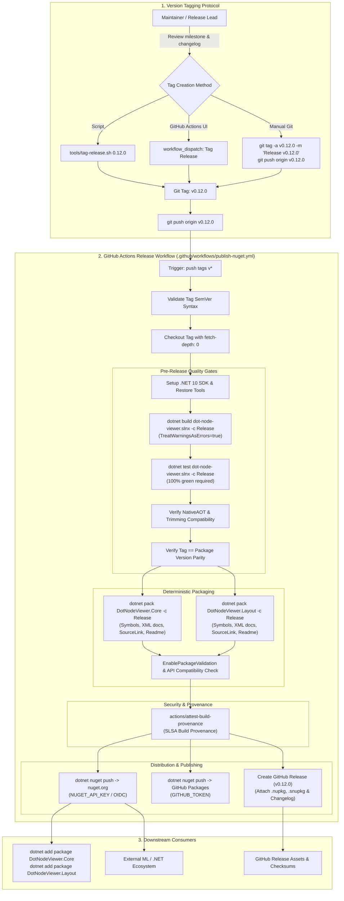

# Wish W10 — Automated NuGet Package Deployment & Git Tag Versioning

**Status:** Proposed  
**Depends on:** Stage **S00** (Bootstrap & CI Governance), Stage **S01** (Unified IR & Abstractions), Stage **S04** (Sugiyama Layout Engine)  
**Suggested branch when promoted:** `infra/nuget-package-deployment`  

---

## Goal

Provide an automated, secure, and reproducible release pipeline that publishes `dot-node-viewer` library packages (`DotNodeViewer.Core` and `DotNodeViewer.Layout`, with an extensible seam for `DotNodeViewer.Cli` as a .NET Tool) to **NuGet.org** and **GitHub Packages** whenever a version tag (e.g. `v0.12.0`, `v1.0.0`) is pushed to the repository.

Additionally, establish a standardized repository **versioning policy** and **Git tagging protocol** (SemVer 2.0.0) supported by automated helper scripts and GitHub Actions workflows, guaranteeing zero version drift between Git tags, assembly versions, and published `.nupkg` packages.

---

## Background & Friction

In the current repository state:

1. **Libraries Only Consumable via Source / Project Reference:**
   - `DotNodeViewer.Core` (Unified Graph IR, zero-allocation model detectors, streaming format readers) and `DotNodeViewer.Layout` (Sugiyama hierarchical layout engine) are designed as pure, headless, zero-UI C# libraries that pass `<IsAotCompatible>` and `<IsTrimmable>` checks with zero warnings.
   - However, external developers building ML inference pipelines, telemetry diagnostic tools, custom enterprise viewers, or server-side graph layout services cannot consume them via `dotnet add package DotNodeViewer.Core`. The libraries can currently only be built from a source clone of the repository.

2. **Zero Git Version Tags in Repository:**
   - Running `git tag -l` reveals that the repository currently has no Git tags.
   - There are no immutable release markers in Git history to correspond with milestones, architectural freezes, or stable points of documentation.

3. **Hardcoded, Fragmented Project Versions:**
   - Both `src/DotNodeViewer.Core/DotNodeViewer.Core.csproj` and `src/DotNodeViewer.Layout/DotNodeViewer.Layout.csproj` contain hardcoded `<Version>0.12.0</Version>` tags.
   - There is no centralized version orchestration in `Directory.Build.props`, creating a risk that project versions drift during development.

4. **No Automated CI Packaging & Deployment Pipeline:**
   - `.github/workflows/ci.yml` compiles the solution and runs unit/model tests.
   - `.github/workflows/docs.yml` (implemented in Wish W07) deploys the DocFX documentation site to GitHub Pages.
   - But there is no workflow that builds `.nupkg` / `.snupkg` artifacts, verifies package validation rules, signs or attests provenance, and publishes packages to NuGet.org upon release.

5. **Risk of Manual Deployment Drift:**
   - Manually executing `dotnet pack` and `dotnet nuget push` from a developer's workstation violates reproducibility:
     - Local machine environments (uncommitted files, dirty worktrees, unverified SDK versions) can taint packages.
     - Long-lived personal API keys stored on local machines pose credential leakage risks.
     - Manual deployments bypass CI quality gates (full test suite, zero-warning release build, AOT validation).

---

## Architectural Alignment & Release Flow



---

## Proposed Architecture

### 1. Centralized Versioning & Packaging Metadata

Consolidate versioning and common NuGet package metadata in `Directory.Build.props` so that version increments occur in a single location and all publishable libraries share identical author, license, repository, and packaging settings.

#### Updates to `Directory.Build.props`:

```xml
<Project>
  <!-- Global Build Properties -->
  <PropertyGroup>
    <TargetFramework Condition="'$(TargetFramework)' == ''">net10.0</TargetFramework>
    <LangVersion>latest</LangVersion>
    <Nullable>enable</Nullable>
    <ImplicitUsings>enable</ImplicitUsings>
    <TreatWarningsAsErrors>true</TreatWarningsAsErrors>
    <!-- Centralized Versioning -->
    <VersionPrefix>0.12.0</VersionPrefix>
    <VersionSuffix Condition="'$(VersionSuffix)' != ''">$(VersionSuffix)</VersionSuffix>
  </PropertyGroup>

  <!-- Common NuGet Package Metadata for Publishable Projects -->
  <PropertyGroup Condition="'$(MSBuildProjectName)' == 'DotNodeViewer.Core' or '$(MSBuildProjectName)' == 'DotNodeViewer.Layout' or '$(MSBuildProjectName)' == 'DotNodeViewer.Cli'">
    <Authors>dot-node-viewer contributors</Authors>
    <Company>dot-node-viewer</Company>
    <PackageLicenseExpression>MIT</PackageLicenseExpression>
    <PackageProjectUrl>https://github.com/dot-node-viewer/dot-node-viewer</PackageProjectUrl>
    <RepositoryUrl>https://github.com/dot-node-viewer/dot-node-viewer</RepositoryUrl>
    <RepositoryType>git</RepositoryType>
    <PackageRequireLicenseAcceptance>false</PackageRequireLicenseAcceptance>
    <PackageReadmeFile>README.md</PackageReadmeFile>
    
    <!-- Source Link & Deterministic Symbol Packaging -->
    <PublishRepositoryUrl>true</PublishRepositoryUrl>
    <EmbedUntrackedSources>true</EmbedUntrackedSources>
    <IncludeSymbols>true</IncludeSymbols>
    <SymbolPackageFormat>snupkg</SymbolPackageFormat>
    <ContinuousIntegrationBuild Condition="'$(GITHUB_ACTIONS)' == 'true'">true</ContinuousIntegrationBuild>

    <!-- Package Validation & API Guardrails -->
    <EnablePackageValidation>true</EnablePackageValidation>
  </PropertyGroup>
</Project>
```

#### Package Metadata in `src/DotNodeViewer.Core/DotNodeViewer.Core.csproj`:

```xml
<Project Sdk="Microsoft.NET.Sdk">
  <PropertyGroup>
    <RootNamespace>DotNodeViewer.Core</RootNamespace>
    <AssemblyName>DotNodeViewer.Core</AssemblyName>
    <PackageId>DotNodeViewer.Core</PackageId>
    <Description>Pure C# neural network model format detection, streaming graph extraction, and Unified Graph IR.</Description>
    <PackageTags>neural-networks;onnx;tflite;pytorch;executorch;keras;machine-learning;graph;aot</PackageTags>
  </PropertyGroup>

  <ItemGroup>
    <None Include="..\..\README.md" Pack="true" PackagePath="\" />
  </ItemGroup>

  <ItemGroup>
    <InternalsVisibleTo Include="DotNodeViewer.Core.Tests" />
  </ItemGroup>
</Project>
```

#### Package Metadata in `src/DotNodeViewer.Layout/DotNodeViewer.Layout.csproj`:

```xml
<Project Sdk="Microsoft.NET.Sdk">
  <PropertyGroup>
    <RootNamespace>DotNodeViewer.Layout</RootNamespace>
    <AssemblyName>DotNodeViewer.Layout</AssemblyName>
    <PackageId>DotNodeViewer.Layout</PackageId>
    <Description>Pure C# Sugiyama layered directed-graph layout engine for DotNodeViewer.Core graphs.</Description>
    <PackageTags>dag;graph-layout;sugiyama;dagre;visualization;layered-graph</PackageTags>
  </PropertyGroup>

  <ItemGroup>
    <ProjectReference Include="..\DotNodeViewer.Core\DotNodeViewer.Core.csproj" />
  </ItemGroup>

  <ItemGroup>
    <None Include="..\..\README.md" Pack="true" PackagePath="\" />
  </ItemGroup>

  <ItemGroup>
    <InternalsVisibleTo Include="DotNodeViewer.Layout.Tests" />
  </ItemGroup>
</Project>
```

---

### 2. Git Tagging Protocol & SemVer Standard

1. **Tag Format:**
   - Every release tag MUST strictly adhere to Semantic Versioning 2.0.0 prefixed with a lowercase `v`:
     - Stable release: `v<MAJOR>.<MINOR>.<PATCH>` (e.g. `v0.12.0`, `v1.0.0`)
     - Pre-release: `v<MAJOR>.<MINOR>.<PATCH>-<PRERELEASE>` (e.g. `v0.13.0-preview.1`, `v1.0.0-rc.2`)
2. **Tag Immutability:**
   - Tags are signed or annotated Git tags (`git tag -a ...`).
   - Tags pushed to `origin` MUST never be force-moved or deleted once published to NuGet.org (as NuGet feeds prohibit re-uploading an existing package version).
3. **Version Parity Check (Guardrail):**
   - The release CI workflow extracts the version number from the Git tag (`TAG_VERSION="${GITHUB_REF_NAME#v}"`).
   - It executes a verification step asserting that the tagged version matches the project version configured in `Directory.Build.props` (or overrides `-p:Version=$TAG_VERSION -p:PackageVersion=$TAG_VERSION`). If a developer tags `v0.13.0` while `Directory.Build.props` specifies `0.12.0`, the pipeline halts before any package is published.

---

### 3. Release Helper Tooling (`tools/tag-release.sh`)

To make tagging effortless and error-free for maintainers, provide a shell script `tools/tag-release.sh`:

- **Responsibilities:**
  1. Validates that current branch is `main` and working directory is completely clean (`git status --porcelain` is empty).
  2. Validates SemVer 2.0.0 syntax for the provided version argument.
  3. Verifies that `dotnet build dot-node-viewer.slnx -c Release` and `dotnet test dot-node-viewer.slnx -c Release` succeed locally.
  4. Updates `<VersionPrefix>` in `Directory.Build.props` if it differs.
  5. If changed, creates a release commit: `git commit -am "chore: release vX.Y.Z"`.
  6. Creates an annotated Git tag: `git tag -a "vX.Y.Z" -m "Release vX.Y.Z"`.
  7. Displays instructions or prompts to push the commit and tag: `git push origin main && git push origin vX.Y.Z`.

---

### 4. Dedicated GitHub Actions Workflow (`.github/workflows/publish-nuget.yml`)

Create a dedicated workflow triggered exclusively on Git tag pushes matching `v*`:

```yaml
name: Publish NuGet Packages

on:
  push:
    tags:
      - 'v[0-9]+.[0-9]+.[0-9]+*'
  workflow_dispatch:
    inputs:
      dry_run:
        description: 'Perform a dry run (build and pack without pushing to NuGet)'
        required: true
        type: boolean
        default: false

permissions:
  contents: write
  packages: write
  id-token: write
  attestations: write

concurrency:
  group: "nuget-release"
  cancel-in-progress: false

env:
  DOTNET_NOLOGO: "1"
  DOTNET_SKIP_FIRST_TIME_EXPERIENCE: "1"
  DOTNET_CLI_TELEMETRY_OPTOUT: "1"
  AVALONIA_TELEMETRY_OPTOUT: "1"

jobs:
  verify-and-publish:
    name: Build, Verify & Publish Packages
    runs-on: ubuntu-latest
    steps:
      - name: Checkout repository
        uses: actions/checkout@v4
        with:
          fetch-depth: 0

      - name: Extract Release Version from Tag
        id: parse_version
        run: |
          TAG="${GITHUB_REF_NAME}"
          if [[ "${TAG}" =~ ^v([0-9]+\.[0-9]+\.[0-9]+(-[0-9A-Za-z.-]+)?)$ ]]; then
            VERSION="${BASH_REMATCH[1]}"
            echo "version=${VERSION}" >> "$GITHUB_OUTPUT"
            echo "Extracted release version: ${VERSION}"
          else
            echo "Error: Tag '${TAG}' does not follow SemVer format vX.Y.Z[-preview]." >&2
            exit 1
          fi

      - name: Setup .NET 10 SDK
        uses: actions/setup-dotnet@v4
        with:
          global-json-file: global.json

      - name: Restore .NET local tools
        run: dotnet tool restore

      - name: Build solution (Release, zero warnings)
        run: dotnet build dot-node-viewer.slnx -c Release -p:Version=${{ steps.parse_version.outputs.version }}

      - name: Run Core & Layout Tests
        run: |
          dotnet test --project tests/DotNodeViewer.Core.Tests -c Release --no-build --output Detailed
          dotnet test --project tests/DotNodeViewer.Layout.Tests -c Release --no-build --output Detailed

      - name: Verify AOT & Trimming Compatibility
        run: |
          dotnet publish src/DotNodeViewer.Core/DotNodeViewer.Core.csproj -c Release -p:PublishAot=true -p:Version=${{ steps.parse_version.outputs.version }} -o ./artifacts/aot-test-core
          dotnet publish tools/DotNodeViewer.Cli/DotNodeViewer.Cli.csproj -c Release -p:PublishAot=true -p:Version=${{ steps.parse_version.outputs.version }} -o ./artifacts/aot-test-cli

      - name: Pack DotNodeViewer.Core
        run: |
          dotnet pack src/DotNodeViewer.Core/DotNodeViewer.Core.csproj \
            -c Release \
            --no-build \
            -p:Version=${{ steps.parse_version.outputs.version }} \
            -p:PackageVersion=${{ steps.parse_version.outputs.version }} \
            -o ./artifacts/packages

      - name: Pack DotNodeViewer.Layout
        run: |
          dotnet pack src/DotNodeViewer.Layout/DotNodeViewer.Layout.csproj \
            -c Release \
            --no-build \
            -p:Version=${{ steps.parse_version.outputs.version }} \
            -p:PackageVersion=${{ steps.parse_version.outputs.version }} \
            -o ./artifacts/packages

      - name: Generate Checksums
        working-directory: ./artifacts/packages
        run: |
          sha256sum *.nupkg *.snupkg > SHA256SUMS.txt
          cat SHA256SUMS.txt

      - name: Attest Build Provenance (SLSA)
        if: ${{ !inputs.dry_run }}
        uses: actions/attest-build-provenance@v2
        with:
          subject-path: './artifacts/packages/*.nupkg'

      - name: Publish to NuGet.org
        if: ${{ !inputs.dry_run }}
        run: |
          dotnet nuget push "./artifacts/packages/*.nupkg" \
            --api-key "${{ secrets.NUGET_API_KEY }}" \
            --source "https://api.nuget.org/v3/index.json" \
            --skip-duplicate

      - name: Publish to GitHub Packages
        if: ${{ !inputs.dry_run }}
        run: |
          dotnet nuget push "./artifacts/packages/*.nupkg" \
            --api-key "${{ secrets.GITHUB_TOKEN }}" \
            --source "https://nuget.pkg.github.com/${{ github.repository_owner }}/index.json" \
            --skip-duplicate

      - name: Create GitHub Release
        if: ${{ !inputs.dry_run }}
        uses: softprops/action-gh-release@v2
        with:
          tag_name: ${{ github.ref_name }}
          name: Release ${{ github.ref_name }}
          files: |
            ./artifacts/packages/*.nupkg
            ./artifacts/packages/*.snupkg
            ./artifacts/packages/SHA256SUMS.txt
          generate_release_notes: true
          draft: false
          prerelease: ${{ contains(steps.parse_version.outputs.version, '-') }}
```

---

### 5. Security & Provenance Controls

1. **Secret Management:**
   - `NUGET_API_KEY` stored in GitHub repository encrypted secrets, scoped strictly to the package prefixes `DotNodeViewer.*`.
   - Secret access is restricted to protected environments or tag refs (`v*`).
2. **NuGet OIDC Trusted Publishing (Future Seam):**
   - NuGet.org supports OIDC trusted publishing for GitHub Actions. Once enabled for the `dot-node-viewer` organization, the workflow can eliminate long-lived API keys entirely, obtaining short-lived publishing tokens authenticated through GitHub OIDC claims.
3. **SLSA Build Provenance Attestations:**
   - Using GitHub's native `actions/attest-build-provenance@v2`, cryptographic provenance records are generated for every `.nupkg`, verifiable via GitHub CLI (`gh attestation verify`).
4. **Symbol Packages & Source Link:**
   - Packages embed Source Link references to the exact commit SHA of the release tag.
   - Symbols (`.snupkg`) are published to the Microsoft Symbol Server / NuGet.org symbol catalog, enabling downstream consumers in Visual Studio, Rider, or VS Code to step into `DotNodeViewer.Core` source code with zero manual configuration.

---

### 6. Scope of Packaged Components

| Package ID | Project Path | Type | Target Framework | Purpose |
|---|---|---|---|---|
| `DotNodeViewer.Core` | `src/DotNodeViewer.Core/` | NuGet Library | `net10.0` | Pure C# Unified Graph IR, format detectors, streaming readers, tensor slicing, zero UI dependencies. |
| `DotNodeViewer.Layout` | `src/DotNodeViewer.Layout/` | NuGet Library | `net10.0` | Pure C# Sugiyama hierarchical graph layout engine. Depends on `DotNodeViewer.Core`. |
| `DotNodeViewer.Cli` *(Seam)* | `tools/DotNodeViewer.Cli/` | .NET Global Tool | `net10.0` | Command-line CLI for model topology snapshots, schema inspection, and format detection (`dotnet tool install -g DotNodeViewer.Cli`). |
| `DotNodeViewer.Wpf` *(Future Seam, W08)* | `src/DotNodeViewer.Wpf/` | NuGet Library | `net10.0-windows` | Optional WPF model viewer control packaging once Wish W08 is implemented. |

---

## Definition of Done (When Promoted)

1. **Packaging Configuration in Repository:**
   - `Directory.Build.props` centrally defines package metadata, Source Link, embedded symbols (`.snupkg`), and `<EnablePackageValidation>true</EnablePackageValidation>`.
   - `src/DotNodeViewer.Core/` and `src/DotNodeViewer.Layout/` produce compliant `.nupkg` and `.snupkg` artifacts on `dotnet pack -c Release`.
   - Package READMEs, license expressions, tags, and project URLs validate cleanly.
2. **Release Workflow Active:**
   - `.github/workflows/publish-nuget.yml` is committed, configured, and tested with `dry_run: true`.
3. **Helper Scripts:**
   - `tools/tag-release.sh` is provided, executable (`chmod +x`), and documented in developer guides.
4. **Tagging & Publishing Verification:**
   - An initial release tag (e.g. `v0.12.0` or initial milestone) is created and pushed.
   - The workflow executes all quality gates, builds packages, generates SHA-256 checksums, and publishes them to NuGet.org and GitHub Packages without warnings.
   - A corresponding GitHub Release is created with attached `.nupkg`, `.snupkg`, and checksum files.
5. **Downstream Package Consumption Verification:**
   - `dotnet add package DotNodeViewer.Core` installs and resolves successfully in a fresh sample console application.
6. **Documentation Updates:**
   - `README.md` updated with NuGet badges for `DotNodeViewer.Core` and `DotNodeViewer.Layout` linking to their respective NuGet gallery pages.
   - Diátaxis installation guide in `docs/site/` updated with instructions on adding the NuGet packages.

---

## Open Design Questions

1. **Centralized `Directory.Build.props` vs. MinVer (Git Tag Versioning):**
   - *Option A (Centralized Props + CI Check):* Maintain `<VersionPrefix>` in `Directory.Build.props` and verify that the Git tag matches it in CI.
   - *Option B (MinVer / Git-driven):* Use `MinVer` to automatically compute assembly and package versions directly from Git tags at build time.
   - *Recommendation:* Start with Option A for simplicity and explicit control, ensuring zero surprise version bumps in local development. When promoted, evaluate MinVer if manual version bumping in `Directory.Build.props` proves tedious.
2. **Include CLI Tool in Automated Publishing:**
   - Should `DotNodeViewer.Cli` be published as a .NET Tool on NuGet (`dotnet tool install -g DotNodeViewer.Cli`) in the same workflow?
   - *Recommendation:* Yes. Packaging the CLI as a global tool adds immense value for CI scripts, format inspection, and headless JSON snapshot comparisons across external repositories.
3. **Dual Publishing to GitHub Packages:**
   - Should packages be pushed to both NuGet.org and GitHub Packages (`nuget.pkg.github.com`)?
   - *Recommendation:* Yes. GitHub Packages serves as an internal backup registry and enables testing pre-release builds within GitHub Actions workflows without polluting public NuGet search indexes.

