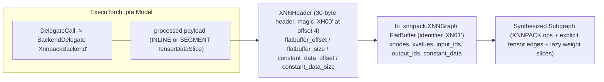

# Wish W11 — ExecuTorch `XnnpackBackend` Delegate Unwrapping

**Status:** Proposed
**Depends on:** Stage **S07** (ExecuTorch Parser), Wish **W01** (`IDelegateSubgraphExpander` & `DelegateSubgraphExpanderRegistry`, [ADR 0008](../adr/0008-delegate-subgraph-expansion-and-ethos-u.md)), Stage **S11** (Subgraph Breadcrumb Drill-Down & Weight Inspector)
**Suggested branch when promoted:** `feature/xnnpack-delegate-unwrapping`

---

## Goal

Let users **open an ExecuTorch `XnnpackBackend` delegate block and inspect the lowered XNNPACK operator graph as a synthesized `Subgraph`**.

Today, `ExecuTorchFormatReader` renders lowered XNNPACK partitions inside `.pte` models as a single opaque `Delegate (XnnpackBackend)` node whose processed payload is attached as an unparsed `TensorDataSlice`. By plugging an on-demand XNNPACK FlatBuffer decoder into the existing `IDelegateSubgraphExpander` / `DelegateSubgraphExpanderRegistry` pipeline established in **W01** ([ADR 0008](../adr/0008-delegate-subgraph-expansion-and-ethos-u.md)), practitioners can inspect fused convolutions, quantized linear layers, depth-to-space, static reductions, constant buffers, and internal tensor shapes without leaving the viewer or paying any upfront parse cost during `ReadAsync`.

---

## Background & Payload Structure



> [!IMPORTANT]
> The schema details below summarize ExecuTorch's `backends/xnnpack/serialization/schema.fbs` and Netron's XNNPACK FlatBuffer loader. **The implementing agent must verify every FlatBuffer vtable field index and `XNodeUnion` discriminant against the pinned upstream ExecuTorch revision** and record that revision in the format documentation.

1. **Delegate Storage in `.pte`:**
   - `ExecuTorchFormatReader` already extracts `BackendDelegate.processed` (both `INLINE` and `SEGMENT` data locations) as a lazy `AttributeValue.Bytes(TensorDataSlice)` attribute named `processed` on `Delegate (XnnpackBackend)` nodes (matching `EthosUDelegateExpander`).
2. **XNNPACK Header (`XNNHeader`):**
   - Lowered payloads begin with an `XNNHeader` (**30 bytes**: 4-byte zero padding, magic `"XH00"` at bytes `4..8`, `uint16` header length, `uint32` `flatbuffer_offset`, `uint32` `flatbuffer_size`, `uint32` `constant_data_offset`, `uint64` `constant_data_size`) specifying the relative offset and byte length of the `XNNGraph` FlatBuffer table and the trailing `constant_data` buffer region.
   - Older or inline payloads may start directly with the FlatBuffer (`"XN01"` identifier at offset 4, matching the `"XH00"` offset). The decoder must validate all header offsets and lengths against the processed slice bounds before reading (guarding against out-of-bounds header values).
3. **`fb_xnnpack.XNNGraph` Schema:**
   - `xvalues`: Vector of `XValue` union entries (`XNNTensorValue`, `XNNQuantizedTensorValue`) carrying data type, dimensions, constant buffer index, external I/O ID, and quantization parameters (`PerTensor` / `PerChannel` / `PerChannelGroup` scales and zero-points).
   - `xnodes`: Vector of `XNode` union entries (`XNodeUnion`) representing lowered XNNPACK operators, including standard layers (`XNNConv2d`, `XNNDepthwiseConv2d`, `XNNFullyConnected`, `XNNAdd`, `XNNMultiply`, `XNNSoftmax`, `XNNHardswish`, `XNNStaticResizeBilinear2d`, `XNNBatchMatrixMultiply`, `XNNScaledDotProductAttention`, `XNNConvert`, `XNNStaticReshape`, `XNNStaticTranspose`, etc.) as well as newer `fb_xnnpack.XNodeUnion` additions tracked in Netron:
     - **`49: XNNDepthToSpace2d`** (pixel-shuffle / space-depth rearrangement — `OperatorCategory.Shape`)
     - **`50: _XNNStaticReduce`** (static reduction op such as mean/sum — `OperatorCategory.Tensor`)
   - `input_ids` / `output_ids`: Ordered lists of `xvalues` indices corresponding to the outer delegate node's runtime inputs and outputs.
   - `constant_data`: Vector of `Buffer` / `ConstantDataOffset` entries locating packed weights and biases either inline inside the FlatBuffer or inside the trailing constant segment (or named data map).

---

## Prerequisites

- Stage **S07** (ExecuTorch reader) and Wish **W01** (`IDelegateSubgraphExpander`, `DelegateSubgraphExpanderRegistry`, breadcrumb drill-down UI, CLI `--expand-delegates`) complete.
- Read [`AGENTS.md`](../../AGENTS.md), [`docs/adr/0001-hybrid-parsing-and-encapsulation.md`](../adr/0001-hybrid-parsing-and-encapsulation.md), [`docs/adr/0003-lazy-weight-slices.md`](../adr/0003-lazy-weight-slices.md), [`docs/adr/0006-ir-v1.md`](../adr/0006-ir-v1.md), and [`docs/adr/0008-delegate-subgraph-expansion-and-ethos-u.md`](../adr/0008-delegate-subgraph-expansion-and-ethos-u.md).

---

## Skills to Load

- `.agents/skills/port-model-format/SKILL.md`
- `.agents/skills/add-test-model/SKILL.md`
- `.agents/skills/csharp-tunit/SKILL.md`
- `.agents/skills/csharp-async/SKILL.md`
- `.agents/skills/csharp-docs/SKILL.md`
- `.agents/skills/analyzing-dotnet-performance/SKILL.md`
- `.agents/skills/documentation-writer/SKILL.md`
- `.agents/skills/development-plugin-for-avalonia/SKILL.md` (if UI badges/labels are adjusted)

---

## Open Design Questions (Resolve Before Coding)

1. **No Frozen IR Changes Required:** Because `IDelegateSubgraphExpander` and `DelegateSubgraphExpanderRegistry` already exist from **W01** ([ADR 0008](../adr/0008-delegate-subgraph-expansion-and-ethos-u.md)), no public IR contract modifications are expected. Confirm whether any new `QuantizationInfo` subtype is needed for XNNPACK group-wise dynamic quantization (`PerChannelGroup`), or whether existing `BlockQuantization` / `AffineQuantization` covers all cases.
2. **External Named Constant Data (`named_data_map`):** Recent ExecuTorch `.pte` files can store XNNPACK weights in external `NamedData` segments referenced by `named_key` rather than inline `constant_data`. Decide whether the first cut resolves `Program.named_data` segments directly from the `.pte` stream (recommended) and emits a clear `ParseDiagnostic` for external `.ptd` files until **W09** (`IExternalFileResolver`) lands.
3. **`DisassembleAsync` Behavior:** `IDelegateSubgraphExpander.DisassembleAsync` produces register listings for Ethos-U command streams. For XNNPACK (which is an operator graph rather than a hardware register stream), decide whether `DisassembleAsync` returns `null` (unsupported) or a structured operator table summary.

---

## Scope & Deliverables

1. **ExecuTorch Reader Tagging (`src/DotNodeViewer.Core/Formats/ExecuTorch/ExecuTorchFormatReader.cs`):**
   - In `BuildDelegateNode`, tag `XnnpackBackend` delegates with:
     - `delegate.backend = "xnnpack"`
     - `delegate.expandable = true`
   - Preserve $O(1)$ lazy behavior during `ReadAsync` — do **not** read or decode the XNNPACK FlatBuffer payload eagerly.
2. **Internal XNNPACK Decoder (`src/DotNodeViewer.Core/Delegates/Xnnpack/`, all `internal`):**
   - `XnnpackHeaderReader`: parses and bounds-checks the optional 30-byte `XH00` header (magic at offset 4), extracting the FlatBuffer slice offset/length and constant-data offset/length.
   - `XnnpackOperatorCatalog`: maps `fb_xnnpack.XNodeUnion` enum discriminants (including `49: XNNDepthToSpace2d` and `50: _XNNStaticReduce`) to canonical operator names, formal port names, and semantic `OperatorCategory` values. Unknown union discriminants map safely to `OperatorCategory.Unknown` with a `ParseDiagnostic` warning instead of throwing.
   - `XnnpackGraphDecoder`: reuses the existing zero-allocation `FlatBufferTable` / span primitives in `DotNodeViewer.Core.IO` to decode `XNNGraph` (`xvalues`, `xnodes`, `input_ids`, `output_ids`, `constant_data`) into a `Subgraph`.
   - Lazy weight slicing: map constant tensor buffers to `TensorDataSlice` pointing directly to their exact absolute byte offset inside the `.pte` stream (using `ArrayPool<byte>.Shared` only for the FlatBuffer metadata table, never allocating constant weight buffers).
   - `XnnpackDelegateSubgraphExpander : IDelegateSubgraphExpander`:
     - `BackendId => "xnnpack"`
     - `CanExpand` checks for `delegate.backend == "xnnpack"` and a valid processed payload slice.
     - `ExpandAsync` reads only the FlatBuffer metadata slice (not the constant weight segment), builds the synthesized `Subgraph` named `"{node.Name} (XNNPACK)"`, and links delegate I/O ports back to outer tensor names.
   - Hard safety limits: maximum node/value count, FlatBuffer offset bounds checks, and `ModelParseException` / `ParseDiagnostic` handling for truncated or corrupt payloads.
3. **Registry Registration (`DelegateSubgraphExpanderRegistry.cs`):**
   - Pre-register `XnnpackDelegateSubgraphExpander.Instance` in `DelegateSubgraphExpanderRegistry.Default`.
4. **CLI & UI Reuse:**
   - Verify `DotNodeViewer.Cli inspect <model.pte> --expand-delegates` expands XNNPACK delegates cleanly.
   - Verify the Avalonia UI displays the expand affordance on `Delegate (XnnpackBackend)` nodes and supports breadcrumb drill-down (`main > Delegate (XnnpackBackend) (XNNPACK)`) and lazy weight inspection on internal XNNPACK weights.
5. **Python Model Generator & Fixtures (`tools/model-gen/torch/`):**
   - Extend or add a deterministic script lowering a tiny CNN (including `Conv2d`, `ReLU`, `PixelShuffle` → `XNNDepthToSpace2d`, and a static reduction → `_XNNStaticReduce`) through ExecuTorch's `XnnpackPartitioner` to a committed `.pte` fixture (`<= 256 KB`) with an independent `*.truth.json` ground truth.
6. **Tests (`tests/DotNodeViewer.Core.Tests/` & `tests/DotNodeViewer.App.Tests/`):**
   - `Synthetic/XnnpackDelegateSyntheticTests.cs`: synthetic `XH00` + `XN01` FlatBuffer payloads covering normal ops, `49: XNNDepthToSpace2d`, `50: _XNNStaticReduce`, quantized tensors, unknown union discriminants, truncated headers, out-of-bounds buffer indices, and zero-allocation lazy weight slicing (via `AllocationProbe`).
   - `Formats/XnnpackDelegateModelTests.cs`: verifies end-to-end `.pte` expansion against `*.truth.json`.
   - `App.Tests`: headless drill-down into an XNNPACK delegate node and return via breadcrumb.
7. **Documentation (`README.md` & `docs/site/`):**
   - Update `docs/site/articles/formats/executorch.md` with XNNPACK delegate unwrapping details, supported `XNodeUnion` coverage, pinned upstream schema revision, and Mermaid decode diagram.
   - Update root `README.md` feature summary.

---

## Explicitly Out of Scope

- Executing or benchmarking XNNPACK subgraphs.
- Unwrapping other ExecuTorch delegates (CoreML, Vulkan, QNN/HTP) — those should be tracked as separate expanders using the same `IDelegateSubgraphExpander` seam.
- Re-serializing or editing XNNPACK FlatBuffers.

---

## Acceptance Criteria & Verification

```bash
dotnet build dot-node-viewer.slnx -c Release
dotnet test dot-node-viewer.slnx -c Release
dotnet publish tools/DotNodeViewer.Cli -c Release -p:PublishAot=true
dotnet run --project tools/DotNodeViewer.Cli -c Release -- inspect <xnnpack-fixture.pte> --expand-delegates
dotnet tool run docfx build docs/site/docfx.json --warningsAsErrors
```

- Expanded XNNPACK operator count, operator types (including `XNNDepthToSpace2d` and `_XNNStaticReduce`), and tensor shapes match `*.truth.json` exactly.
- Constant weight buffers inside the delegate are sliced lazily without heap allocation during `ExpandAsync`.
- `ExecuTorchFormatReader.ReadAsync` remains $O(1)$ with respect to delegate payload size and does not break any existing `.expected.json` snapshots.
