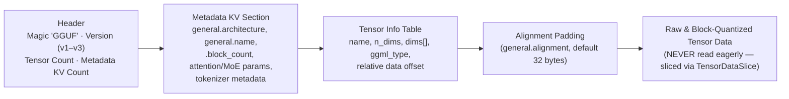

# Wish W12 — GGUF Format Support (LLM & Audio Model Graphs)

**Status:** Proposed
**Depends on:** Stage **S01** (Unified Graph IR & Abstractions), Stage **S04** (Layout Engine), Stage **S11** (Tensor Inspector & Polish)
**Suggested branch when promoted:** `feature/gguf-format-support`

---

## Goal

Add first-class support in `DotNodeViewer.Core` for detecting, zero-allocation header/metadata scanning, and visualizing **GGUF** (`.gguf`, GGML Universal File Format) large language model (LLM), vision-language, and audio model files.

Because GGUF files store a flat tensor table and rich architecture metadata rather than an explicit execution graph, the reader should synthesize a clean, hierarchical **block-level graph** (embedding → repeated transformer / MoE / state-space / audio blocks → output norm & head) while recording every tensor's raw weight payload lazily via `TensorDataSlice` so multi-gigabyte quantized checkpoints open instantaneously without allocating weight memory.

---

## Background & Ecosystem Motivation

GGUF is the dominant local inference format across `llama.cpp`, Ollama, LM Studio, `whisper.cpp`, and quantized edge deployments. Unlike ONNX or TFLite, a `.gguf` container is structured as:



- **Rapid Architecture Evolution:** Recent Netron updates expanded GGUF graph synthesis across **19 new architectures**, including:
  - LLM & MoE variants: `deepseek41` (including Engram memory/lookup modules), `mistral-large4`, `lfm3` (Liquid Foundation Models), `kimi-k31`, `limite`, and hybrid attention/SSM architectures.
  - Speech & audio models: `kokoro` (TTS), `moshi` (full-duplex speech), alongside classic encoder-decoder / vocoder pipelines.
- **Block-Level Graph Synthesis:** Showing thousands of raw weights as disconnected nodes makes large LLMs unreadable. Grouping tensors by structural prefixes (`token_embd`, `blk.{i}.attn_*`, `blk.{i}.ffn_*`, `blk.{i}.ssm_*`, `blk.{i}.engram_*`, `output_norm`, `output`) and synthesizing structured per-block or per-module nodes lets engineers inspect architecture topology, parameter counts, quantization mixes (`Q4_K_M`, `Q6_K`, `Q8_0`, `BF16`, `F16`), and per-layer metadata at a glance.
- **Zero-Allocation Streaming Advantage:** GGUF files routinely span 4 GB–100+ GB. Because `DotNodeViewer.Core` strictly prohibits eager weight reads ([ADR 0003](../adr/0003-lazy-weight-slices.md)), a streaming GGUF reader only parses the small header, metadata KVs, and tensor info table (typically a few hundred kilobytes), skipping the entire multi-gigabyte tensor payload section in $O(1)$ via `TensorDataSlice(dataBaseOffset + tensor.Offset, byteLength, ...)`.

---

## Prerequisites

- Stages **S01**, **S04**, and **S11** complete.
- Optional synergy with **W09** (`IExternalFileResolver`) for multi-split GGUF shards (`model-00001-of-00004.gguf` with `split.no` / `split.count`).
- Read [`AGENTS.md`](../../AGENTS.md), [`docs/adr/0001-hybrid-parsing-and-encapsulation.md`](../adr/0001-hybrid-parsing-and-encapsulation.md), [`docs/adr/0002-immutable-record-ir.md`](../adr/0002-immutable-record-ir.md), [`docs/adr/0003-lazy-weight-slices.md`](../adr/0003-lazy-weight-slices.md), and [`docs/adr/0006-ir-v1.md`](../adr/0006-ir-v1.md).

---

## Skills to Load

- `.agents/skills/port-model-format/SKILL.md` (and `references/ir-mapping-checklist.md`)
- `.agents/skills/add-test-model/SKILL.md` (and `references/manifest-and-snapshot-schema.md`)
- `.agents/skills/csharp-tunit/SKILL.md`
- `.agents/skills/csharp-async/SKILL.md`
- `.agents/skills/csharp-docs/SKILL.md`
- `.agents/skills/analyzing-dotnet-performance/SKILL.md`
- `.agents/skills/documentation-writer/SKILL.md`

---

## Open Design Questions (Resolve via ADR Before Coding)

1. **Frozen IR Additions (ADR Required):**
   - Add `ModelFormatId.Gguf => new("gguf")` to `DotNodeViewer.Core.Ir.ModelFormatId` (defined in `ModelFormatInfo.cs`).
   - Decide how GGML block-quantized tensor types (`Q4_0`, `Q4_1`, `Q5_0`, `Q5_1`, `Q8_0`, `Q8_1`, `Q2_K`–`Q6_K`, `Q8_K`, `IQ1_S`–`IQ4_XS`, `TQ1_0`, `TQ2_0`, `MXFP4`) map onto `DataType`, `BlockQuantization`, and `TensorDataEncoding`:
     - Recommended: map exact unquantized types (`F32`, `F16`, `BF16`, `F64`, `I8`, `I16`, `I32`, `I64`) to existing `DataType` values; map block-quantized types using `BlockQuantization(Scheme, BlockSize, Bits)` on `TensorDescriptor.Quantization` plus an explicit `TensorDataEncoding` (e.g. `Opaque` or `GgmlQuantizedBlock`) so `TensorInspectorViewModel` displays raw hex/block metadata safely without misinterpreting super-block headers as dense floats.
2. **Block-Level Graph Synthesis & Subgraph Strategy:**
   - Should each repeated block (`blk.0`, `blk.1`, …) appear as a grouped node/module in the primary subgraph, or should each block expand into a child `Subgraph` (with an option for flat vs. hierarchical view)?
   - How should unseen `general.architecture` values fall back? Recommended: **data-driven prefix grouping** (grouping by `blk.{n}.<component>` / longest common dot-prefix) supplemented by architecture-specific metadata templates for well-known families (`llama`, `qwen*`, `deepseek*` including `deepseek41` Engram, `mistral-large4`, `lfm3`, `kimi-k31`, `kokoro`, `moshi`, `limite`, `whisper`, `gemma*`, `phi*`, `mamba*`).
3. **Tokenizer & Large Metadata Array Handling:**
   - GGUF files embed huge metadata arrays (`tokenizer.ggml.tokens`, `tokenizer.ggml.merges`, `tokenizer.ggml.scores` with 128k–256k string entries). Skipping or summarizing large metadata arrays (recording element count + sample rather than materializing 256k strings into `ModelGraph.Metadata`) is critical to keep startup fast and WASM memory bounded.

---

## Scope & Deliverables

1. **Format Detection (`src/DotNodeViewer.Core/Formats/Gguf/GgufFormatDetector.cs`):**
   - Zero-allocation probe checking `"GGUF"` magic (`0x46554747`), supported version range (`1..=3`), endianness validation, and bounded header sanity checks (rejecting corrupt/truncated files).
2. **Streaming Reader (`src/DotNodeViewer.Core/Formats/Gguf/`, all parser types `internal`):**
   - `GgufBinaryReader`: zero-allocation streaming reader using `BinaryPrimitives` and `ArrayPool<byte>.Shared` supporting GGUF v1, v2, and v3 (little-endian and big-endian v3 support where applicable).
   - Metadata KV parser supporting all GGUF scalar and array value types (`UINT8`..`UINT64`, `INT8`..`INT64`, `FLOAT32`, `FLOAT64`, `BOOL`, `STRING`, `ARRAY`), with configurable/hard caps on huge tokenizer arrays so parsing stays fast and memory-bounded.
   - `GgmlTypeCatalog`: authoritative block-size and byte-size table for all `ggml_type` enum values, using checked 128-bit (`UInt128`) arithmetic to prevent overflow when computing tensor byte sizes from dimensions.
   - `GgufGraphSynthesizer`: builds a structured `ModelGraph` with:
     - Model-level `Metadata` (`general.architecture`, `general.name`, `general.file_type`, `general.quantization_version`, context length, head count, layer count, split info).
     - Synthesized block-level graph topology supporting modern LLM/MoE/SSM/audio architectures (including Netron's recent additions such as `deepseek41` with Engram, `mistral-large4`, `lfm3`, `kimi-k31`, `kokoro`, `moshi`, `limite`) plus a resilient generic prefix-grouping fallback for any future architecture.
     - Accurate `TensorDataSlice` offsets computed from the aligned tensor data base offset (`AlignUp(headerEndOffset, general.alignment ?? 32) + tensor.RelativeOffset`).
   - Hard safety limits: max KV count, max tensor count, max string length, max nesting depth for arrays, bounds checking every tensor slice against `stream.Length`, wrapping all errors in `ModelParseException`.
3. **Registry Integration (`ModelFormatRegistry.cs`):**
   - Register `GgufFormatDetector` and `GgufFormatReader` in `ModelFormatRegistry.Default`.
   - Ensure `DotNodeViewer.Cli detect/inspect/snapshot` and the Avalonia Desktop/Browser apps automatically support `.gguf` files (add `.gguf` to file picker filters and drag-and-drop extensions).
4. **Python Model Generator & Fixtures (`tools/model-gen/gguf/`):**
   - Deterministic Python script generating minimal synthetic `.gguf` v3 fixtures (`<= 256 KB`) covering:
     - Tiny transformer LLM (standard `llama`-style blocks with mixed `F16` / `Q4_0` / `Q8_0` tensors)
     - Tiny MoE / Engram-style block fixture (verifying specialized block synthesis)
     - Tiny audio model fixture (e.g. `kokoro`-style tensor layout)
   - Emit independent `*.truth.json` ground truth files and register fixtures in `models.manifest.json`.
5. **Tests (`tests/DotNodeViewer.Core.Tests/`):**
   - `Synthetic/GgufSyntheticTests.cs`: magic/version detection, v2/v3 parsing, alignment padding, large tokenizer array skipping, 64-bit/128-bit size overflow rejection, truncated header/KV/tensor table → `ModelParseException`, zero-allocation probe (`AllocationProbe`) on a multi-MB synthetic tensor payload confirming weights are never allocated.
   - `Formats/GgufModelTests.cs`: manifest-driven golden snapshot verification against `*.truth.json`.
6. **Documentation (`README.md` & `docs/site/`):**
   - Add `docs/site/articles/formats/gguf.md` (Explanation + Reference: container layout, lazy slicing, GGML quantization mapping, block-level graph synthesis, supported architecture families).
   - Update `docs/site/toc.yml`, format support matrix, and root `README.md`.

---

## Explicitly Out of Scope

- Full CPU/GPU dequantization of exotic K-quant / IQ-quant / TQ-quant super-blocks in the first cut (display block metadata and raw hex safely; optional `Q4_0` / `Q8_0` inspector dequantization can follow separately).
- Running LLM inference or executing tokenizers.
- Legacy GGML (`ggml`/`ggmf`/`ggjt`) pre-GGUF formats.

---

## Acceptance Criteria & Verification

```bash
dotnet build dot-node-viewer.slnx -c Release
dotnet test dot-node-viewer.slnx -c Release
dotnet publish tools/DotNodeViewer.Cli -c Release -p:PublishAot=true
dotnet run --project tools/DotNodeViewer.Cli -c Release -- inspect tests/DotNodeViewer.Core.Tests/Fixtures/gguf/tiny_llm.gguf
dotnet tool run docfx build docs/site/docfx.json --warningsAsErrors
```

- Opening a synthetic multi-megabyte `.gguf` allocates `< 10%` of the payload size during `ReadAsync` (verified by `AllocationProbe`).
- All committed `.gguf` fixtures match their independent `*.truth.json` ground truth and golden `.expected.json` snapshots.
- NativeAOT and WebAssembly trimming pass with zero warnings.
