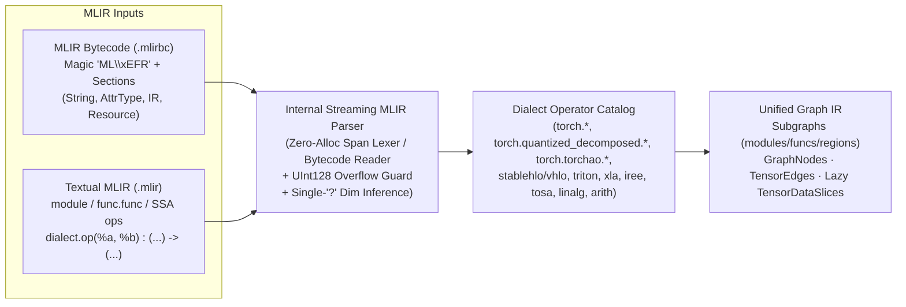

# Wish W13 — MLIR Format Support (Textual & Bytecode IR)

**Status:** Proposed
**Depends on:** Stage **S01** (Unified Graph IR & Abstractions), Stage **S04** (Layout Engine), Stage **S11** (Subgraph Navigation & Tensor Inspector)
**Suggested branch when promoted:** `feature/mlir-format-support`

---

## Goal

Add first-class support in `DotNodeViewer.Core` for detecting and parsing **MLIR** compiler intermediate representations — both **MLIR Bytecode (`.mlirbc`)** and **textual MLIR (`.mlir`)** — across major machine learning compiler dialects, mapping functions, regions, SSA values, dialect operations, and dense resource weights into the Unified Graph IR.

In addition, adopt key defensive tensor-parsing patterns proven in recent Netron MLIR updates: **128-bit / arbitrary-precision element-count overflow protection**, **single-`?` dynamic dimension inference from buffer byte lengths**, and an ADR-governed path for emerging compiler **low-bit / complex `DataType` extensions** (`float8e5m3fnu`, `mxi8`, `complex<float16>`).

---

## Background & Ecosystem Motivation

MLIR has become the common intermediate representation across modern ML compilers and accelerator toolchains:

- **PyTorch & Quantization:** `torch-mlir`, `torch.quantized_decomposed.*` (`quantize_per_tensor`, `dequantize_per_tensor`, `quantize_per_channel`, etc.), and `torch.torchao.*` low-bit quantization operators.
- **JAX / XLA / OpenXLA:** `stablehlo.*`, `vhlo.*`, `mhlo.*`, `chlo.*`, and XLA host/device dialects.
- **IREE & Edge Compilers:** `iree_input.*`, `flow.*`, `hal.*`, `linalg.*`, `tosa.*`, `arith.*`, `tensor.*`, `scf.*`, `func.*`.
- **GPU Kernel Compilers:** OpenAI **Triton** (`tt.*`, `ttg.*`, `ttng.*`) for inspecting fused FlashAttention, MoE, and FP8 GEMM kernels.



### Defensive Parser Patterns to Adopt from Netron's Recent MLIR Commits

1. **128-Bit / BigInteger Element-Count Overflow Protection:**
   - Compiler IRs frequently contain symbolic/sentinel dimensions or malformed fuzz shapes whose product overflows 64-bit signed integers (`long`). Computing total element counts and expected buffer byte lengths using `UInt128` (or `BigInteger` for extreme ranks) prevents silent wrap-around, negative buffer lengths, and out-of-bounds slice exceptions.
2. **Single-`?` Dynamic Dimension Inference from Buffer Byte Length:**
   - When a constant/dense resource tensor declares a shape containing **exactly one dynamic dimension** (`?`, e.g. `tensor<?x64xf16>`) alongside a concrete binary payload of known `byteLength` and element bit-width, infer the missing dimension cleanly if `totalElements` is an exact integer multiple of the product of the static dimensions (and leave it `TensorDimension.Dynamic` otherwise).
3. **Emerging Compiler `DataType` Extensions (Deferred Behind ADR):**
   - Recent MLIR / Triton / TorchAO pipelines introduce tensor element types not present in the frozen v1 `DataType` enum ([ADR 0006](../adr/0006-ir-v1.md)):
     - **`float8e5m3fnu`** (8-bit finite unsigned-zero float, E5M3)
     - **`mxi8`** (OCP microscaling 8-bit integer)
     - **`complex<float16>`** (32-bit complex number composed of two IEEE `float16` components)
   - Until an ADR extends `DotNodeViewer.Core.Ir.DataType`, map unsupported element types gracefully to `DataType.Unknown` with a `ParseDiagnostic` recording the exact MLIR type string.

---

## Prerequisites

- Stages **S01**, **S04**, and **S11** complete.
- Read [`AGENTS.md`](../../AGENTS.md), [`docs/adr/0001-hybrid-parsing-and-encapsulation.md`](../adr/0001-hybrid-parsing-and-encapsulation.md), [`docs/adr/0002-immutable-record-ir.md`](../adr/0002-immutable-record-ir.md), [`docs/adr/0003-lazy-weight-slices.md`](../adr/0003-lazy-weight-slices.md), and [`docs/adr/0006-ir-v1.md`](../adr/0006-ir-v1.md).

---

## Skills to Load

- `.agents/skills/port-model-format/SKILL.md` (and `references/ir-mapping-checklist.md`)
- `.agents/skills/add-test-model/SKILL.md` (and `references/manifest-and-snapshot-schema.md`)
- `.agents/skills/csharp-tunit/SKILL.md`
- `.agents/skills/csharp-async/SKILL.md`
- `.agents/skills/csharp-docs/SKILL.md`
- `.agents/skills/analyzing-dotnet-performance/SKILL.md`
- `.agents/skills/documentation-writer/SKILL.md`

---

## Open Design Questions (Resolve via ADR Before Coding)

1. **Frozen IR Additions (ADR Required):**
   - Add `ModelFormatId.Mlir => new("mlir")` to `DotNodeViewer.Core.Ir.ModelFormatInfo`.
   - Decide whether to extend `DotNodeViewer.Core.Ir.DataType` with `Float8E5M3Fnu`, `MxInt8`, and `Complex32` (`complex<float16>`) in the same ADR (along with decoding support in `TensorInspectorViewModel`), or defer those enum members to a dedicated IR v1.x DataType ADR.
2. **Phased Delivery: Bytecode + Textual Scope:**
   - **MLIR Bytecode (`.mlirbc`):** Binary container with `"ML\xEFR"` magic, varint-encoded sections, and binary resource blobs (naturally compatible with zero-allocation lazy `TensorDataSlice` slicing).
   - **Textual MLIR (`.mlir`):** Generic assembly syntax (`%res = "dialect.op"(%a, %b) {attr = ...} : (type) -> type`) plus common custom assembly forms (`module`, `func.func`, `stablehlo.*`, `tosa.*`, `tt.func`, `arith.*`, `torch.*`, `dense<...>` / `dense_resource<...>`).
   - Decide whether both bytecode and textual parsers land together or whether bytecode + generic/core textual syntax lands first, followed by custom dialect pretty-printers.
3. **Nested Regions & Multi-Block Control Flow:**
   - MLIR operations (`scf.if`, `scf.for`, `stablehlo.while`, `linalg.generic`, `tt.reduce`) carry nested **regions** with basic blocks and block arguments (`^bb0(%arg0: ...)`). Map each function and nested region to a child `Subgraph` (attached via `AttributeValue.Graph` on the owning op, matching ONNX `If`/`Loop` conventions), and decide how multi-block CFG branches (`cf.br`, `cf.cond_br`) should be surfaced.

---

## Scope & Deliverables

1. **Format Detection (`src/DotNodeViewer.Core/Formats/Mlir/MlirFormatDetector.cs`):**
   - Binary detection: exact 4-byte MLIR bytecode magic `"ML\xEFR"` (`0x4D 0x4C 0xEF 0x52`) + valid bytecode version varint.
   - Textual detection: bounded prefix scan recognizing MLIR module/function/dialect declarations (`module`, `func.func`, `tt.func`, `builtin.module`, `#loc`, `"stablehlo.`, `"torch.`, `"tosa.`) while rejecting JSON, XML, Python, and arbitrary plain-text files without false positives.
2. **Internal MLIR Parsers (`src/DotNodeViewer.Core/Formats/Mlir/`, all `internal`):**
   - `MlirBytecodeReader`: streaming section walker for `.mlirbc` files (String, Dialect, AttrType, IR, Resource, ResourceOffset sections). Records binary `dense_resource` / `DenseElementsAttr` payloads lazily as `TensorDataSlice` without allocating weight buffers.
   - `MlirTextLexer` & `MlirTextParser`: streaming UTF-8 span lexer and recursive-descent parser with explicit recursion depth guard, parsing modules, functions, SSA values, generic and common custom op forms, type/shape annotations (`tensor<...>`), attributes, and `dense_resource` hex/blob references.
   - `MlirShapeHelper`:
     - Uses `UInt128` checked multiplication for element-count and byte-length computation (overflow → `ParseDiagnostic` / `ModelParseException` instead of wrap-around).
     - Implements single-`?` dynamic dimension inference from known buffer byte length and element bit-width.
   - `MlirOperatorCatalog`: maps dialect-qualified operations across:
     - `torch.*`, `torch.quantized_decomposed.*`, `torch.torchao.*`
     - `stablehlo.*`, `vhlo.*`, `mhlo.*`, `chlo.*`, `xla.*`
     - `triton` / `tt.*`, `ttg.*`, `ttng.*`
     - `tosa.*`, `linalg.*`, `iree_input.*`, `flow.*`, `hal.*`
     - `arith.*`, `math.*`, `tensor.*`, `scf.*`, `func.*`, `builtin.*`
     into semantic `OperatorCategory` values with `OperatorInfo.Domain = <dialect>`.
   - Safety guards: hard limits on nesting depth, token/section count, attribute size, and stream bounds; wrap format errors in `ModelParseException`.
3. **Registry, CLI & UI Integration:**
   - Register `MlirFormatDetector` and `MlirFormatReader` in `ModelFormatRegistry.Default`.
   - Add `.mlir` and `.mlirbc` to UI file pickers and drag-and-drop filters.
4. **Fixtures & Model Generators (`tools/model-gen/mlir/`):**
   - Deterministic scripts or curated minimal `.mlir` / `.mlirbc` fixtures (`<= 256 KB`) covering StableHLO/VHLO, TOSA, `torch.quantized_decomposed` / `torch.torchao`, and Triton (`tt.func`), each paired with `*.truth.json`.
5. **Tests (`tests/DotNodeViewer.Core.Tests/`):**
   - `Synthetic/MlirSyntheticTests.cs`:
     - Bytecode (`ML\xEFR`) and textual `.mlir` detection (including negative tests against JSON/Python/random text).
     - Dialect categorization across `torch.quantized_decomposed.*`, `torch.torchao.*`, `stablehlo.*`, `vhlo.*`, `tosa.*`, `tt.*`, `iree.*`, `linalg.*`.
     - **Overflow protection test:** shape dimensions whose product exceeds `long.MaxValue` do not overflow or produce negative byte sizes.
     - **Single-`?` dynamic dimension inference test:** `tensor<?x4xf32>` with 48-byte buffer resolves to `[3, 4]`; non-divisible buffer length or multiple `?` dimensions remain dynamic.
     - Unsupported element types (`float8e5m3fnu`, `mxi8`, `complex<float16>` before ADR extension) produce clean diagnostics rather than crashing.
     - Truncated bytecode, deeply nested malformed regions, and zero-allocation lazy slicing probe on multi-MB bytecode resource blobs.
   - `Formats/MlirModelTests.cs`: manifest-driven golden snapshot verification against `*.truth.json`.
6. **Documentation (`README.md` & `docs/site/`):**
   - Add `docs/site/articles/formats/mlir.md` (Explanation + Reference: textual vs. bytecode support, dialect coverage table, region-to-subgraph mapping, overflow/shape-inference rules).
   - Update `docs/site/toc.yml`, format support matrix, and root `README.md`.

---

## Explicitly Out of Scope

- Full MLIR dialect verifier, type inference pass, or compiler optimization/lowering passes.
- Supporting arbitrary user-defined custom assembly syntax for every third-party dialect (fall back gracefully to generic op representation or emit a clear diagnostic on unsupported custom printer syntax).
- Executing MLIR modules or JIT-compiling Triton/IREE kernels.

---

## Acceptance Criteria & Verification

```bash
dotnet build dot-node-viewer.slnx -c Release
dotnet test dot-node-viewer.slnx -c Release
dotnet publish tools/DotNodeViewer.Cli -c Release -p:PublishAot=true
dotnet run --project tools/DotNodeViewer.Cli -c Release -- inspect tests/DotNodeViewer.Core.Tests/Fixtures/mlir/tiny_stablehlo.mlir
dotnet tool run docfx build docs/site/docfx.json --warningsAsErrors
```

- All `.mlir` and `.mlirbc` fixtures parse cleanly and match `*.truth.json` and `.expected.json`.
- Bytecode dense resource blobs are sliced lazily via `TensorDataSlice` without eager heap allocation (`AllocationProbe`).
- Element-count overflow and single-`?` dynamic dimension inference edge cases are covered by automated TUnit tests.
